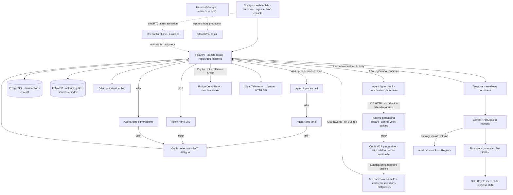

# MaaS agentique — Alizé Lab

Démonstrateur de billettique interopérable, code original sous licence MIT, porté par Benjamin Maillard.

**Première version exécutable, au 24 octobre 2026.** Les réponses OpenAI et Ollama ont été testées avec la délégation A2A et les outils MCP. Le paiement Bridge sandbox de 12 € a été confirmé par Demo Bank, puis le titre délivré via Temporal et Keyple sur carte stub. La voix OpenAI reste à éprouver. Le parcours local fonctionne sans API payante. Le POC ne couvre pas encore tout le [plan cible](plan-implementation-poc.md).

Résultats et limites : [validation du socle](docs/validation-2026-10-24.md), [tests OpenAI et Ollama](docs/tests-ia-locale-et-acces-2026-10-24.md), puis [paiement Bridge complet](docs/test-paiement-bridge-2026-10-24.md).

La coopération avec les partenaires vélo et parking est implémentée : **agent MaaS → A2A → agent partenaire sur un runtime séparé → MCP → service simulé avec état**. Les actions sont confirmées dans l'IHM, liées à une autorisation temporaire et exécutées avec reprise Temporal. Les équipements et opérateurs externes restent simulés. Voir [le fonctionnement et les essais partenaires](docs/partenaires-a2a-2026-10-24.md).

## Démarrer

Prérequis : Docker avec Compose, `make`, Python 3 pour créer le fichier de configuration. Les essais ont été effectués sur Docker Desktop Apple Silicon ; Linux reste à vérifier. OPA 1.0.1 utilise ici une image amd64 émulée.

```sh
make bootstrap   # crée .env seulement s'il est absent, construit les images
make up          # démarre les services et attend Temporal
make seed        # charge le catalogue fictif dans FalkorDB ; réexécutable
make demo        # achat, émission, événements, SAV, commissions et contrôles
```

Ouvrir **[Alizé Lab](http://127.0.0.1:5190)**. Le port 5190 évite le conflit avec une autre application locale sur 5173. [API Swagger](http://127.0.0.1:8000/docs), [Temporal](http://127.0.0.1:8088), [Jaeger](http://127.0.0.1:16686).

Les ports publiés sont limités à `127.0.0.1`. Les identités sont des sélecteurs de démonstration, avec secrets locaux connus : conserver cet environnement en local.

```sh
make test        # tests Python et politiques OPA
make protocols   # échanges Agno/A2A/MCP, modèle de test explicite
make proofs      # tests Solidity, Anvil, déploiement et preuve de validations
make resilience  # arrêt brutal du Worker, signal durable, réponse carte perdue
make chain-restart # persistance du registre de preuves après redémarrage Anvil
make security    # refus d'accès et signatures ; contrôles adaptés aux services actifs
make lab         # Harness² réel, éditeurs déterministes sans LLM
make evidence    # services, états, références de preuves et présence OTel
make verify      # vérifications automatiques, sans appel LLM cloud ni paiement Bridge
make stop        # arrête les services ; conserve les volumes
make ai-local    # sélectionne Ollama sur le Mac, sans changer les secrets
make test-live-local # test réel Qwen → A2A → MCP, sans appel OpenAI
make ai-openai   # sélectionne le fournisseur OpenAI configuré
make test-live-openai # test réel cloud, consomme des tokens et une réservation
make test-access # lectures authentifiées OpenAI/Bridge, sans paiement
make test-bridge-prepare # crée un achat fictif et un lien Demo Bank, sans le payer
make test-bridge-status  # relit le statut bancaire côté serveur
make test-bridge-verify  # après validation Demo Bank : paiement, titre et idempotence
make test-partners      # cycle vélo/parking A2A/MCP/Temporal, modèle déterministe explicite
make test-partners-local # même cycle avec le vrai modèle Ollama sélectionné
make test-partners-openai # même cycle cloud, consomme des tokens
make test-partners-concurrency # trois demandes pour deux vélos, aucun surbooking
make test-partners-resilience # demande en attente pendant un arrêt du Worker
```

`make bootstrap` exécute aussi les deux tests Java pendant la construction de Keyple. Les fichiers Python `requirements.lock`, le verrou npm et les versions Maven figent les dépendances testées. Les essais d'intégration ajoutent des données fictives ; ils n'effacent aucun volume.

## Parcours de démonstration

1. **Voyageur / automate** : choisir Léa, calculer transport + parking + vélo. Le transport passe de 10 € à 7 € avec le profil étudiant fictif, le parking coûte 5 €. Les réductions ne se cumulent pas. Confirmer le devis de 12 €.
2. Simuler le paiement. Avec la pause activée, la commande attend dans Temporal. Reprendre le chargement : le SDK Keyple sélectionne, écrit et relit une carte stub ; le simulateur conserve séparément l'identité de l'opération.
3. **Services partenaires**, sur une commande délivrée : cocher la confirmation de l'action, réserver un vélo via A2A, démarrer la location puis le restituer avec une durée fictive de dix minutes. Faire de même pour la réservation, l'entrée et la sortie du parking. Le panneau affiche les agents A2A, les outils MCP exécutés et le résultat métier vérifié. **Console** : envoyer également une validation X deux fois pour tester le doublon. Les restitutions et sorties produisent des CloudEvents, dédupliqués et contrôlés contre les produits achetés.
4. **Agence & SAV** : le conseiller peut enregistrer une régularisation fictive jusqu'à 5 €. OPA refuse un dépassement. Deux demandes simultanées avec la même clé produisent un seul effet.
5. Après une régularisation de 2 €, le prépayé net est 10 €, dont 0,50 € de commission agence et 9,50 € pour les opérateurs. Le vélo crée une créance distincte de 3 €, dont 0,15 € de commission **à encaisser**. Aucun reversement bancaire n'est effectué. Avant confirmation du paiement, aucun encaissement ni commission n'est constaté.
6. **Console / ancrage** : après `make proofs`, demander l'ancrage d'un lot. Le manifeste hors chaîne est signé Ed25519 ; Temporal ancre son SHA-256 dans Anvil. La validation n'attend pas la blockchain.

Le frontal est responsive. La vue **Automate** possède un écran de borne dédié : présentation de carte fictive, choix des produits, confirmation du devis, **QR Bridge sandbox** ou **terminal CB simulé**, chargement Keyple et fin de session. Les cartes Léa et Alex ouvrent des sessions séparées, sans historique des autres achats sur la borne. Le retour à l’accueil après deux minutes d’inactivité conserve les commandes déjà engagées. Pendant le paiement QR, l’écran reste ouvert jusqu’à l’expiration du lien (10 minutes). Temporal surveille la banque pendant 15 minutes même si l’écran est fermé ; après cette fenêtre, un contrôle manuel est nécessaire. Voir [le parcours QR Bridge](docs/automate-qr-2026-10-25.md). Il ne s'agit pas d'un matériel certifié. Voir [le parcours et les vérifications de la borne](docs/automate-ihm-2026-10-24.md).

Les remontées X/Y sont simulées. Les partenaires vélo/parking ont des agents A2A et outils MCP réels, avec stocks et réservations fictifs dans PostgreSQL. Un événement contradictoire est rejeté avec un conflit ; l'écran de rapprochement/quarantaine reste à compléter.

Le panneau **Périmètre du démonstrateur**, accessible dans chaque vue et ouvert par défaut dans la console, distingue les fonctions présentes, les simulations et les compléments à réaliser. Le fournisseur IA et l'activation Bridge suivent la configuration courante ; ces indications ne remplacent pas un contrôle de disponibilité. La voix reste signalée comme expérimentale et le panier depuis le dialogue comme non implémenté.

## Architecture effectivement implémentée



Les agents n'ont aucun outil d'achat, débit ou remboursement. Leurs outils lisent les API métier avec le JWT du demandeur. Temporal conserve les opérations longues ; AgentOS expose Agno et A2A, sans planificateur concurrent. Les tests de protocole courants utilisent un **double déterministe de modèle** ; les commandes `test-live-local` et `test-live-openai` vérifient séparément les modèles réels. Les réponses indiquent le fournisseur, le modèle et les outils MCP réellement exécutés, y compris ceux appelés par l'agent délégué.

Les agents partenaires disposent en plus d'outils de réservation et d'usage simulés, limités à une action préalablement confirmée. Un jeton signé de dix minutes lie l'opération, le voyageur, l'organisation, le partenaire, l'action et le fournisseur IA. Le modèle ne reçoit ni le jeton ni la possibilité de modifier la durée ou la commande. Avant toute écriture, le runtime impose une lecture MCP de disponibilité. Le stock, la transition d'état, le reçu et l'événement de fin d'usage sont enregistrés dans une transaction. Les notifications manuelles de la console et les partenaires partagent le même registre CloudEvents.

Le catalogue de référence est [fixtures/catalog.json](fixtures/catalog.json). Les devis enregistrent sa version et ses montants. FalkorDB contient sa projection par acteur (`Actor → TariffGrid → Product`) et les passages documentaires reliés aux produits. Le moteur tarifaire calcule sur les données structurées, pas sur une réponse de GraphRAG. MCP `read_catalog` accède à ce catalogue ; `search_tariffs` recherche les sources. Les deux autres outils lisent commandes et relevés dans le périmètre autorisé.

La recherche combine un index textuel, un index de vecteurs **lexicaux locaux** de 96 dimensions, une fusion des rangs et une traversée des sources. Ce n'est pas encore une recherche par embeddings sémantiques OpenAI. La génération sourcée dépend de l'activation d'un fournisseur IA, Ollama ou OpenAI.

Anvil conserve son état dans un volume inscriptible. Ce nœud local persiste le registre et l'environnement de bloc, sans constituer une archive complète d'un réseau Ethereum. Si le réseau est volontairement réinitialisé, relancer `make proofs` : les signatures hors chaîne sont vérifiées, les anciennes références sont conservées et les lots sont réancrés avec un identifiant de nouvelle instance. L'interface signale cette reprise. Le nœud de développement utilise ici l'utilisateur root du conteneur pour écrire son volume, sans port RPC publié sur le Mac.

## Brancher OpenAI et Bridge

Les secrets communiqués dans une conversation doivent être renouvelés. **Ne pas les copier dans les sources, les commandes ou les tickets.** Le fichier `.env` local est exclu de Git et du contexte de construction Docker. Il n'est pas fourni avec une clé active.

Configurer directement `.env`, puis recréer les services :

```sh
docker compose up -d --force-recreate api agents partners
```

Pour OpenAI : `OPENAI_API_KEY`, `AI_ENABLED=true`, `AGENT_MODE=openai`, `OPENAI_MODEL=gpt-6-luna`. Le texte utilise OpenAI Responses via Agno ; le parcours A2A/MCP a été testé réellement. La voix prévue utilise `gpt-realtime-2.1-mini` et délègue les questions métier aux agents. La clé principale reste côté serveur ; le navigateur reçoit un secret éphémère Realtime. La session vocale s'arrête côté client après trois minutes. **L'audio et ses latences restent à tester réellement.**

### Ollama pour les essais locaux

Sur le Mac testé, Ollama **0.32.1** est déjà installé avec **`qwen3:14b`** (poids de 9,3 Go). Aucun modèle supplémentaire n'a été téléchargé. Les agents Docker joignent le serveur natif sur `http://host.docker.internal:11434`, afin de conserver l'accélération du Mac. Le serveur Ollama et les poids ne sont pas fournis dans les images du projet.

```sh
make ai-local
make test-live-local
```

Configuration : `AI_ENABLED=true`, `AGENT_MODE=ollama`, `OLLAMA_HOST=http://host.docker.internal:11434`, `OLLAMA_MODEL=qwen3:14b`. Sur cette machine, ce mode est laissé actif. Pour une nouvelle installation, lancer Ollama et installer préalablement un modèle compatible avec les outils ; le fichier d'exemple reste désactivé par défaut. Sur Linux, adapter l'accès au serveur local ; ce chemin réseau n'a été testé que sur Docker Desktop Mac.

Le fournisseur Agno est `Ollama`, avec réflexion désactivée pour ces essais, contexte de 8 192 tokens et sortie plafonnée à 700 tokens par réponse. Les URL cloud et identifiants de modèles cloud sont refusés ; aucun basculement automatique vers OpenAI. Les demandes locales ne réservent aucun budget OpenAI. La voix reste disponible uniquement en mode OpenAI dans cette version.

`AI_MONTHLY_BUDGET_EUR=50` limite des réservations conservatrices : 1 € par demande textuelle, 3 € par démarrage vocal, plus les demandes métier vocales. Elles sont sérialisées dans PostgreSQL. Ce compteur n'est ni la facture OpenAI ni une garantie absolue sur son montant ; la durée du navigateur et l'expiration d'un jeton ne constituent pas une limite fournisseur de dépense.

Pour Bridge : `BRIDGE_CLIENT_ID` et `BRIDGE_CLIENT_SECRET` **sandbox**, `BRIDGE_ENABLED=true`, `BRIDGE_CALLBACK_URL` accepté par Bridge. Le parcours testé utilise `BRIDGE_FLOW=payment_link` et `BRIDGE_BENEFICIARY_MODE=default` : le bénéficiaire configuré dans le compte Bridge est repris, sans IBAN transmis dans la demande. Ce compte refuse la création directe de payment requests et les bénéficiaires dynamiques. Le connecteur sélectionne Demo Bank (`574`) et refuse des identifiants de production. Le frontal propose alors le choix Bridge lors de la confirmation. Les liens du POC expirent après une heure.

Le retour du navigateur ne confirme jamais le paiement. Le serveur retrouve la payment request liée au lien, puis vérifie montant, EUR et référence de commande ; seul `ACSC` sur la demande et sa transaction déverrouille l'émission. Une création dont la réponse est perdue passe en rapprochement, sans second POST automatique. Un refus HTTP explicite de création est conservé avec son code, sans être assimilé à un paiement incertain. Plusieurs tentatives bancaires sur un même lien exigent un rapprochement manuel dans cette version.

Le test complet a confirmé 12 € fictifs, un seul paiement comptabilisé et un seul chargement Keyple, y compris après répétition des contrôles. Le relevé répartit 0,60 € de commission et 11,40 € pour les opérateurs ; il n'exécute aucun reversement. Ce test utilise la **relecture serveur à la demande**, pas des notifications publiques. Pour les notifications, configurer `BRIDGE_WEBHOOK_SECRET` et une URL joignable vers `/api/webhooks/bridge` ; la signature sur corps brut et le routage lien/demande sont testés localement, mais la réception depuis Bridge reste à éprouver. Le remboursement bancaire et l'encaissement postpayé ne sont pas implémentés. TrueLayer reste une alternative prévue.

Sources : [premier paiement Bridge](https://docs.bridgeapi.io/docs/initiate-your-first-payment-1), [Demo Bank](https://docs.bridgeapi.io/docs/testing-your-payment-flow), [signature des notifications](https://docs.bridgeapi.io/docs/secure-your-webhooks), [Realtime OpenAI](https://developers.openai.com/api/reference/resources/realtime/subresources/client_secrets/methods/create).

## Frontières de cette version

| Élément | État |
|---|---|
| PostgreSQL, Temporal, OPA, FalkorDB | Logiciels réels, essais locaux passés |
| Agno / AgentOS, A2A, MCP | 5 agents MaaS, 2 agents partenaires sur un runtime séparé ; 4 outils de lecture et 4 outils partenaires |
| Keyple / Keypop | SDK réels ; lecteur et carte stub, sans SAM réel ni titre exploitable |
| Anvil, contrat Solidity, signature Ed25519 | Ancrage réel local, idempotence et altération testées |
| Paiement et SAV locaux, identité | Simulés, données fictives |
| Partenaires vélo / parking | Agents A2A et MCP réels ; stock, réservation et usages simulés avec état ; aucun opérateur externe connecté |
| Bridge | Paiement Demo Bank sandbox de 12 € testé jusqu'à la délivrance ; relecture serveur ACSC, sans argent réel ; notifications externes à valider |
| Voix OpenAI | Adaptateur présent ; audio et latences à valider |
| Ollama | Qwen3:14b réel, actif pour les essais locaux ; aucun recours automatique au cloud |
| Harness² Google | Code réel figé ; éditeurs et sélection déterministes, deux tâches comptables ; aucune amélioration d'agent IA mesurée |
| OpenTelemetry | Traces HTTP API et workflows/Activities Temporal ; propagation aux agents à compléter |
| Éligibilité documentaire / identité nationale | Profils préétablis ; vérification de justificatifs réels non implémentée |
| Car sharing, covoiturage, open payment EMV | Hors parcours courant ; futurs connecteurs |
| Lecture labiale, routage, information voyageurs | Lecture labiale future ; routage et IV hors périmètre |

La persistance métier utilise une table générique et une création de schéma initiale : migrations et modèles métier dédiés restent à prévoir. Pas de revendication de certification Calypso, de conformité bancaire ou de préparation à la production. Le déploiement Linux n'a pas encore été éprouvé. Les architectures et plans plus larges restent dans [le plan d'article](plan-maas-agentique.md), [la proposition de POC](proposition-poc-maas-agentique.md) et [le plan d'implémentation](plan-implementation-poc.md).

## Licence et composants tiers

[MIT](LICENSE) pour le code original et la documentation de ce projet. Les bibliothèques, services et jeux de données tiers conservent leurs licences. En particulier, le serveur FalkorDB est sous SSPLv1 ; Keyple/Keypop sous EPL-2.0 ; Harness² sous Apache-2.0. Voir [THIRD_PARTY_NOTICES.md](THIRD_PARTY_NOTICES.md). Aucun dépôt public ni déploiement externe n'a été créé.
