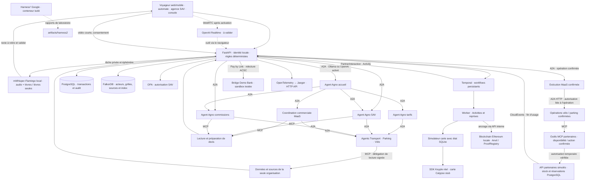

# MaaS agentique — Alizé Lab

POC de billettique interopérable, code original sous licence MIT, porté par Benjamin Maillard.

> **Cadre du projet :** Alizé Lab est un POC destiné à explorer et démontrer une architecture, pas un système opérationnel. Les scénarios utilisent des identités et données de démonstration, Bridge en sandbox et des équipements ou partenaires simulés. Les fonctions disponibles et les évolutions envisagées sont décrites dans leurs rubriques respectives.

**Première version exécutable, au 24 octobre 2026.** Les réponses OpenAI et Ollama ont été testées avec la délégation A2A et les outils MCP. Le paiement Bridge sandbox de 12 € a été confirmé par Demo Bank, puis le titre délivré via Temporal et Keyple sur carte stub. Le parcours local fonctionne sans API payante. Le [plan cible](plan-implementation-poc.md) guide les évolutions suivantes.

Comptes rendus des essais : [validation du socle](docs/validation-2026-10-24.md), [tests OpenAI et Ollama](docs/tests-ia-locale-et-acces-2026-10-24.md), puis [paiement Bridge complet](docs/test-paiement-bridge-2026-10-24.md).

La coopération avec les partenaires vélo et parking est implémentée : **agent MaaS → A2A → agent partenaire sur un runtime séparé → MCP → service simulé avec état**. Les actions sont confirmées dans l'IHM, liées à une autorisation temporaire et exécutées avec reprise Temporal. Voir [le fonctionnement et les essais partenaires](docs/partenaires-a2a-2026-10-24.md).

La transcription **audio + lèvres et lèvres seules** est intégrée à l’assistant avec **mWhisper-Flamingo multilingue**, depuis la **webcam uniquement**, sur de courtes séquences traitées localement. Les deux modes ont été testés sur un extrait public français ; la lecture labiale seule reste imprécise. Activation facultative : `make perception` (environ 4 Go de ressources, construction initiale de plusieurs minutes). Voir [installation, résultats réels et limites](docs/perception-whisper-flamingo-2026-10-28.md), puis [le parcours webcam et l’audio OpenAI facultatif](docs/webcam-audio-local-2026-10-28.md).

Les demandes d’information passent par les organisations responsables : **Accueil → coordinateur Tarifs → agent Parking → MCP de consultation Parking**, sans commande préalable. Disponibilité, préparation d’offre combinée, SAV et commissions suivent la même séparation des périmètres. Un devis préparé depuis le dialogue peut être examiné dans l’écran Voyageur ou Agence avant confirmation. Voir [la correction des parcours et ses validations](docs/cooperation-organisations-2026-10-28.md).

Le panneau **Échanges en direct** montre les délégations A2A et appels MCP pendant leur exécution : agents sollicités, états et durées. Il s’ouvre lors d’une demande à l’assistant ou aux partenaires et reste accessible depuis le bouton du même nom. Actualisation toutes les 0,8 seconde, accès limité à la session et distinction explicite entre modèle réel et double de test. Voir [le fonctionnement et les essais du suivi](docs/echanges-agents-direct-2026-10-28.md).

**Agence & SAV** possède un poste conseiller dédié, utilisable en **gare** ou en **centre de relation client** : recherche voyageur/référence, commandes et titres, vente accompagnée, dossiers de contact persistants, notes et régularisations selon l’habilitation. Voir [le parcours Agence et CRC](docs/poste-agence-crc-2026-10-28.md).

## Comprendre l’architecture

Le [dossier d’architecture de haut niveau](docs/architecture/README.md) présente les principes, les composants et leurs responsabilités, les bénéfices attendus et les compromis. Il explique notamment [Temporal et ses mécanismes de reprise](docs/architecture/temporal.md), ainsi que [la blockchain, Anvil et les bénéfices de l’ancrage](docs/architecture/blockchain-et-anvil.md). Il contient des diagrammes Mermaid et un glossaire accessible aux lecteurs qui découvrent A2A, MCP, GraphRAG, Temporal ou Anvil. Il relie les choix techniques aux scénarios de la série d’articles.

## Démarrer

Prérequis : Docker avec Compose, `make`, Python 3 pour créer le fichier de configuration. Environnement de référence testé : Docker Desktop Apple Silicon. OPA 1.0.1 utilise ici une image amd64 émulée.

```sh
make bootstrap   # crée .env seulement s'il est absent, construit les images
make up          # démarre les services et attend Temporal
make seed        # charge le catalogue fictif dans FalkorDB ; réexécutable
make demo        # achat, émission, événements, SAV, commissions et contrôles
```

Ouvrir **[Alizé Lab](http://127.0.0.1:5190)**. La vue **Voyageur** commence par une connexion de démonstration (Léa ou Alex), puis propose **Acheter**, **Panier**, **Mes titres**, **Mes services** et **Aide**. Voir [le nouveau parcours Voyageur et ses vérifications](docs/voyageur-ergonomie-2026-10-27.md). Le port 5190 évite le conflit avec une autre application locale sur 5173. [API Swagger](http://127.0.0.1:8000/docs), [Temporal](http://127.0.0.1:8088), [Jaeger](http://127.0.0.1:16686).

Les ports publiés sont limités à `127.0.0.1`. Les identités sont des sélecteurs de démonstration, avec secrets locaux connus : conserver cet environnement en local.

```sh
make test        # tests Python et politiques OPA
make protocols   # échanges Agno/A2A/MCP, modèle de test explicite
make proofs      # tests Solidity, Anvil, déploiement et preuve de validations
make resilience  # arrêt brutal du Worker, signal durable, réponse carte perdue
make chain-restart # persistance du registre de preuves après redémarrage Anvil
make security    # refus d'accès et signatures ; contrôles adaptés aux services actifs
make lab         # Harness² réel, éditeurs déterministes sans LLM
make evidence    # services, états, références de preuves et présence OTel
make verify      # vérifications automatiques, sans appel LLM cloud ni paiement Bridge
make stop        # arrête les services ; conserve les volumes
make ai-local    # sélectionne Ollama sur le Mac, sans changer les secrets
make test-live-local # test réel Qwen → A2A → MCP, sans appel OpenAI
make ai-openai   # sélectionne le fournisseur OpenAI configuré
make test-live-openai # test réel cloud, consomme des tokens et une réservation
make test-access # lectures authentifiées OpenAI/Bridge, sans paiement
make test-bridge-prepare # crée un achat fictif et un lien Demo Bank, sans le payer
make test-bridge-status  # relit le statut bancaire côté serveur
make test-bridge-verify  # après validation Demo Bank : paiement, titre et idempotence
make test-partners      # cycle vélo/parking A2A/MCP/Temporal, modèle déterministe explicite
make test-partners-local # même cycle avec le vrai modèle Ollama sélectionné
make test-partners-openai # même cycle cloud, consomme des tokens
make test-partners-concurrency # trois demandes pour deux vélos, aucun surbooking
make test-partners-resilience # demande en attente pendant un arrêt du Worker
```

`make bootstrap` exécute aussi les deux tests Java pendant la construction de Keyple. Les fichiers Python `requirements.lock`, le verrou npm et les versions Maven figent les dépendances testées. Les essais d'intégration ajoutent des données fictives ; ils n'effacent aucun volume.

## Parcours de démonstration

1. **Voyageur** : se connecter en démonstration avec Léa, ajouter transport, parking et vélo au panier, puis vérifier la date et le tarif. Le transport passe de 10 € à 7 € lorsque le droit étudiant fictif est valide ; le parking coûte 5 €. Choisir le paiement local ou Bridge sandbox, accepter le récapitulatif et confirmer la commande de 12 €. Le vendeur du site est automatiquement Application MaaS. **Automate** conserve son parcours de présentation de carte et son vendeur agence.
2. Effectuer le paiement depuis l’écran suivant. Le SDK Keyple sélectionne, écrit et relit une carte stub ; le simulateur conserve séparément l’identité de l’opération. Voyageur suit le chargement automatiquement, puis donne accès aux titres et services. Les pauses et reprises techniques restent testables avec `make demo` et `make resilience`.
3. **Mes services**, sur une commande délivrée : cocher la confirmation de l’action, réserver un vélo, démarrer la location puis le restituer avec une durée fictive de dix minutes. Faire de même pour le parking. Les échanges utilisent les agents A2A et les outils MCP ; leurs détails restent consultables dans les vues techniques. **Console** : envoyer une validation X deux fois pour tester le doublon. Les restitutions et sorties produisent des CloudEvents, dédupliqués et contrôlés contre les produits achetés.
4. **Agence & SAV** : le conseiller peut enregistrer une régularisation fictive jusqu'à 5 €. OPA refuse un dépassement. Deux demandes simultanées avec la même clé produisent un seul effet.
5. Pour une commande de 12 €, après une régularisation de 2 €, le prépayé net est 10 €. Vendeur agence : commission de 0,50 € et part opérateurs de 9,50 €. Vendeur Application MaaS du site : commission de 0,20 € et part opérateurs de 9,80 €. Le vélo crée une créance distincte de 3 €, avec commission **à encaisser** de 0,15 € pour l’agence ou 0,06 € pour l’application. Aucun reversement bancaire n’est effectué. Avant confirmation du paiement, aucun encaissement ni commission n’est constaté.
6. **Console / ancrage** : après `make proofs`, demander l'ancrage d'un lot. Le manifeste hors chaîne est signé Ed25519 ; Temporal ancre son SHA-256 dans Anvil. La validation n'attend pas la blockchain.

Le frontal est responsive. La vue **Automate** possède un écran de borne dédié : présentation de carte fictive, choix des produits, confirmation du devis, **QR Bridge sandbox** ou **terminal CB simulé**, chargement Keyple et fin de session. Les cartes Léa et Alex ouvrent des sessions séparées, sans historique des autres achats sur la borne. Le retour à l’accueil après deux minutes d’inactivité conserve les commandes déjà engagées. Pendant le paiement QR, l’écran reste ouvert jusqu’à l’expiration du lien (10 minutes). Temporal surveille la banque pendant 15 minutes même si l’écran est fermé ; après cette fenêtre, un contrôle manuel est nécessaire. Voir [le parcours QR Bridge](docs/automate-qr-2026-10-25.md). Voir [le parcours et les vérifications de la borne](docs/automate-ihm-2026-10-24.md).

Les remontées X/Y et les partenaires vélo/parking partagent le registre d’événements. Les stocks et réservations sont persistés dans PostgreSQL ; un événement contradictoire est rejeté pour rapprochement.

Le panneau **Périmètre du démonstrateur**, accessible dans chaque vue et ouvert par défaut dans la console, distingue les fonctions présentes, les simulations et les compléments à réaliser. Le fournisseur IA et l'activation Bridge suivent la configuration courante ; ces indications ne remplacent pas un contrôle de disponibilité. Les évolutions du dialogue et de la voix figurent dans la feuille de route.

## Architecture effectivement implémentée



Les agents d’accueil, tarifs, SAV et commissions n’ont aucun outil d’achat, débit ou remboursement. Leurs outils lisent les API métier avec le JWT du demandeur. Temporal conserve les opérations longues ; AgentOS expose Agno et A2A, sans planificateur concurrent. Les tests de protocole courants utilisent un **double déterministe de modèle** ; les commandes `test-live-local` et `test-live-openai` vérifient séparément les modèles réels. Les réponses indiquent le fournisseur, le modèle et les outils MCP réellement exécutés, y compris ceux appelés par l'agent délégué.

Les points d’entrée partenaires de consultation et d’exécution sont distincts. Seuls `bike_operations` et `parking_operations` disposent d’outils de réservation et d’usage, limités à une action préalablement confirmée. Un jeton signé de dix minutes lie l'opération, le voyageur, l'organisation, le partenaire, l'action et le fournisseur IA. Le modèle ne reçoit ni le jeton ni la possibilité de modifier la durée ou la commande. Avant toute écriture, le runtime impose une lecture MCP de disponibilité. Le stock, la transition d'état, le reçu et l'événement de fin d'usage sont enregistrés dans une transaction. Les notifications manuelles de la console et les partenaires partagent le même registre CloudEvents.

Le catalogue de référence est [fixtures/catalog.json](fixtures/catalog.json). Il publie les organisations, offres et accords de distribution. Les devis enregistrent les conditions acceptées par ligne ; les relevés ventilent les montants et commissions par fournisseur. FalkorDB contient des corpus séparés pour MaaS, Transport, Parking et Vélo. L’agent fournisseur utilise `read_provider_context` pour consulter son seul périmètre. Le moteur tarifaire calcule sur les données structurées. Le MCP central propose aussi `prepare_quote`, sans achat, ainsi que les lectures de commande, relevé et règles MaaS.

La recherche combine un index textuel, un index de vecteurs **lexicaux locaux** de 96 dimensions, une fusion des rangs et une traversée des sources. La génération sourcée dépend de l'activation d'un fournisseur IA, Ollama ou OpenAI.

Anvil conserve son état dans un volume inscriptible. Ce nœud local persiste le registre et l'environnement de bloc, sans constituer une archive complète d'un réseau Ethereum. Si le réseau est volontairement réinitialisé, relancer `make proofs` : les signatures hors chaîne sont vérifiées, les anciennes références sont conservées et les lots sont réancrés avec un identifiant de nouvelle instance. L'interface signale cette reprise. Le nœud de développement utilise ici l'utilisateur root du conteneur pour écrire son volume, sans port RPC publié sur le Mac.

## Brancher OpenAI et Bridge

Les secrets communiqués dans une conversation doivent être renouvelés. **Ne pas les copier dans les sources, les commandes ou les tickets.** Le fichier `.env` local est exclu de Git et du contexte de construction Docker. Il n'est pas fourni avec une clé active.

Configurer directement `.env`, puis recréer les services :

```sh
docker compose up -d --force-recreate api agents partners
```

Pour OpenAI : `OPENAI_API_KEY`, `AI_ENABLED=true`, `AGENT_MODE=openai`, `OPENAI_MODEL=gpt-6-luna`. Le texte utilise OpenAI Responses via Agno ; le parcours A2A/MCP a été testé réellement. L’option audio en direct utilise `gpt-realtime-2.1-mini` et délègue les questions métier aux agents. Elle s’active séparément avec `OPENAI_LIVE_AUDIO_ENABLED=true`, sans imposer OpenAI aux agents texte ; les images restent sur le Mac. La clé principale reste côté serveur ; le navigateur reçoit un secret éphémère Realtime. La session vocale s'arrête côté client après trois minutes. Une connexion audio réelle a été vérifiée avec un extrait public ; le parcours matériel webcam/micro reste à valider dans le navigateur.

### Ollama pour les essais locaux

Sur le Mac testé, Ollama **0.32.1** est déjà installé avec **`qwen3:14b`** (poids de 9,3 Go). Aucun modèle supplémentaire n'a été téléchargé. Les agents Docker joignent le serveur natif sur `http://host.docker.internal:11434`, afin de conserver l'accélération du Mac. Le serveur Ollama et les poids sont installés séparément des images Docker.

```sh
make ai-local
make test-live-local
```

Configuration : `AI_ENABLED=true`, `AGENT_MODE=ollama`, `OLLAMA_HOST=http://host.docker.internal:11434`, `OLLAMA_MODEL=qwen3:14b`. Sur cette machine, ce mode est laissé actif. Pour une nouvelle installation, lancer Ollama et installer préalablement un modèle compatible avec les outils ; le fichier d'exemple reste désactivé par défaut. Sur Linux, adapter l'accès au serveur local ; ce chemin réseau n'a été testé que sur Docker Desktop Mac.

Le fournisseur Agno est `Ollama`, avec réflexion désactivée pour ces essais, contexte de 8 192 tokens et sortie plafonnée à 700 tokens par réponse. Les URL cloud et identifiants de modèles cloud sont refusés ; aucun basculement automatique vers OpenAI. Les demandes locales ne réservent aucun budget OpenAI. La voix reste disponible uniquement en mode OpenAI dans cette version.

`AI_MONTHLY_BUDGET_EUR=50` limite des réservations conservatrices : 1 € par demande textuelle, 3 € par démarrage vocal, plus les demandes métier vocales. Elles sont sérialisées dans PostgreSQL. Ce compteur n'est ni la facture OpenAI ni une garantie absolue sur son montant ; la durée du navigateur et l'expiration d'un jeton ne constituent pas une limite fournisseur de dépense.

Pour Bridge : `BRIDGE_CLIENT_ID` et `BRIDGE_CLIENT_SECRET` **sandbox**, `BRIDGE_ENABLED=true`, `BRIDGE_CALLBACK_URL` accepté par Bridge. Le parcours testé utilise `BRIDGE_FLOW=payment_link` et `BRIDGE_BENEFICIARY_MODE=default` : le bénéficiaire configuré dans le compte Bridge est repris, sans IBAN transmis dans la demande. Ce compte refuse la création directe de payment requests et les bénéficiaires dynamiques. Le connecteur sélectionne Demo Bank (`574`) et refuse des identifiants de production. Le frontal propose alors le choix Bridge lors de la confirmation. Les liens expirent après une heure dans le parcours web et dix minutes sur la borne.

Le retour du navigateur ne confirme jamais le paiement. Le serveur retrouve la payment request liée au lien, puis vérifie montant, EUR et référence de commande ; seul `ACSC` sur la demande et sa transaction déverrouille l'émission. Une création dont la réponse est perdue passe en rapprochement, sans second POST automatique. Un refus HTTP explicite de création est conservé avec son code, sans être assimilé à un paiement incertain. Plusieurs tentatives bancaires sur un même lien exigent un rapprochement manuel dans cette version.

Le test complet a confirmé 12 € fictifs, un seul paiement comptabilisé et un seul chargement Keyple, y compris après répétition des contrôles. Le relevé répartit 0,60 € de commission et 11,40 € pour les opérateurs ; il n'exécute aucun reversement. Le test web utilise la **relecture serveur à la demande** ; la borne ajoute une surveillance Temporal bornée à quinze minutes. Aucun de ces parcours ne repose sur des notifications publiques. Pour les notifications, configurer `BRIDGE_WEBHOOK_SECRET` et une URL joignable vers `/api/webhooks/bridge` ; la signature sur corps brut et le routage lien/demande sont testés localement, mais la réception depuis Bridge reste à éprouver. Le remboursement bancaire, l’encaissement postpayé et l’alternative TrueLayer figurent dans les évolutions prévues.

Sources : [premier paiement Bridge](https://docs.bridgeapi.io/docs/initiate-your-first-payment-1), [Demo Bank](https://docs.bridgeapi.io/docs/testing-your-payment-flow), [signature des notifications](https://docs.bridgeapi.io/docs/secure-your-webhooks), [Realtime OpenAI](https://developers.openai.com/api/reference/resources/realtime/subresources/client_secrets/methods/create).

## Capacités et prochaines étapes

Le parcours réunit la vente multicanal, les agents A2A/MCP, les tarifs déterministes, le paiement ponctuel Bridge, la délivrance Keyple, les usages partenaires, le SAV et les preuves blockchain. Les [rapports d’essais](docs/validation-2026-10-24.md) et leurs compléments documentent les résultats observés.

Les [prochains épisodes](docs/serie-articles-souplesse-maas-agentique.md) explorent l’ajout de services locaux, l’abonnement étudiant et le portefeuille territorial. Le [plan cible](plan-implementation-poc.md) détaille les autres évolutions : voix, justificatifs, identité numérique, connecteurs et déploiement Linux. Le calcul d’itinéraire et l’information voyageurs sont hors du périmètre billettique retenu.

## Licence et composants tiers

[MIT](LICENSE) pour le code original et la documentation de ce projet. Les bibliothèques, services et jeux de données tiers conservent leurs licences. En particulier, le serveur FalkorDB est sous SSPLv1 ; Keyple/Keypop sous EPL-2.0 ; Harness² sous Apache-2.0. Voir [THIRD_PARTY_NOTICES.md](THIRD_PARTY_NOTICES.md).
