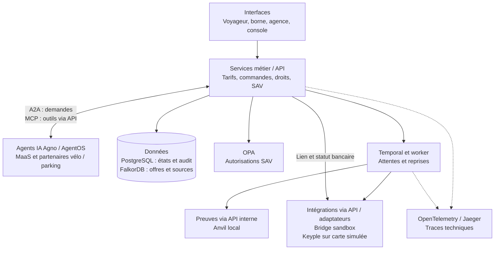

# Comprendre l’architecture d’Alizé Lab

**Dossier d’architecture de haut niveau — 25 octobre 2026**

Ce dossier s’adresse aux lecteurs qui découvrent le projet et ses technologies. Il décrit le code du démonstrateur à cette date, ses choix et leurs limites. Les résultats d’essais sont référencés ; aucune nouvelle campagne de validation n’est revendiquée par ce document.

## Le problème traité

Un voyageur achète une offre auprès d’un vendeur, paie, reçoit un droit de transport et utilise des services partenaires. Le vendeur, les opérateurs et l’agence de service après-vente doivent retrouver des montants et des états cohérents, même si une opération est interrompue.

**MaaS** signifie *Mobility as a Service* : réunir plusieurs services de mobilité dans un même parcours. Ici, le POC se concentre sur la **billettique** — offres, vente, paiement, délivrance de droits, usages et SAV. Le calcul d’itinéraire et l’information voyageurs sont hors périmètre.

Le qualificatif **agentique** désigne l’intervention d’agents IA spécialisés, capables de consulter des outils et de déléguer une demande à un autre agent. Leur présence ne leur donne pas le pouvoir de fixer librement un prix ou d’autoriser un débit.

## Lecture du dossier

| Document | Ce qu’il explique |
|---|---|
| [Principes et bénéfices](principes-et-benefices.md) | Pourquoi séparer compréhension, calcul, exécution et reprise ; bénéfices attendus et contreparties. |
| [Composants et responsabilités](composants.md) | Le rôle de chaque logiciel, les données qu’il porte et ses limites. |
| [Parcours et échanges](parcours.md) | Comment une demande circule entre interface, agents, outils, paiement et délivrance. |
| [Glossaire](glossaire.md) | A2A, MCP, API, GraphRAG, workflow, idempotence, blockchain et autres notions. |

Pour une première lecture : commencer par la vue ci-dessous, puis les principes. Les détails de déploiement restent dans le [README du projet](../../README.md).

## La vue d’ensemble

Ce schéma regroupe les fonctions pour rester lisible. Un bloc n’est pas nécessairement un conteneur distinct. Les flèches représentent les échanges principaux, pas tous les appels techniques.

**A2A relie des agents ; MCP relie un agent à des outils ; les API métier gardent la responsabilité des effets exécutés.** Temporal ne choisit pas la réponse d’un modèle : il mémorise et fait progresser des opérations qui doivent survivre à une interruption.

Les appels partenaires du schéma ne sont possibles que pour une action confirmée dans l’interface. Les outils d’action sont liés à cette opération. Les autres outils IA du POC sont en lecture seule.

## Ce qui est réel, simulé ou futur

| Périmètre | Situation dans le POC |
|---|---|
| Services techniques | PostgreSQL, FalkorDB, Temporal, OPA, Agno/AgentOS, A2A et MCP exécutent du code réel. |
| Intelligence artificielle | Ollama local et OpenAI ont des parcours d’essai dédiés ; des doubles déterministes permettent aussi les tests sans modèle. Le fournisseur actif dépend de la configuration. |
| Paiement | Virement ponctuel Bridge **sandbox** testé jusqu’à la délivrance ; paiement CB local **simulé**, sans PSP carte connecté. Aucun argent réel. |
| Carte | SDK Keyple réel, lecteur et carte **stub**, c’est-à-dire des substituts logiciels de test ; pas de SAM ni de carte physique exploitable sur un réseau réel. |
| Partenaires | Coopération A2A/MCP réelle, stocks et usages vélo/parking fictifs avec état ; aucun opérateur externe connecté. |
| Validations | Événements de fabricants X/Y simulés ; contrôles et déduplication côté service. |
| Blockchain | Ancrage réel sur une chaîne Anvil locale de développement ; aucune chaîne partagée entre autorités indépendantes. |
| Extensions | Piscine, théâtre, portefeuille territorial, contrat étudiant et douze échéances : **projets futurs**, non implémentés. |

La voix dispose d’un adaptateur expérimental ; l’audio et ses latences restent à éprouver. Le panier préparé directement par le dialogue, l’identité numérique nationale et la vérification de justificatifs réels ne sont pas réalisés. La lecture labiale est un axe futur. Harness² reste un laboratoire isolé, hors parcours de vente.

## Où vérifier les affirmations

- [Parcours partenaires et essais A2A/MCP](../partenaires-a2a-2026-10-24.md).
- [Paiement QR Bridge, reprise et limites](../automate-qr-2026-10-25.md).
- [Essais des fournisseurs IA](../tests-ia-locale-et-acces-2026-10-24.md).
- [Première validation du socle](../validation-2026-10-24.md), à lire avec les rapports complémentaires plus récents.
- [Série d’articles et futurs POC](../serie-articles-souplesse-maas-agentique.md).

Le [plan d’implémentation cible](../../plan-implementation-poc.md) et le [plan d’article initial](../../plan-maas-agentique.md) couvrent un périmètre plus large que le code actuel. Une intention dans ces plans ne vaut pas fonctionnalité réalisée.
