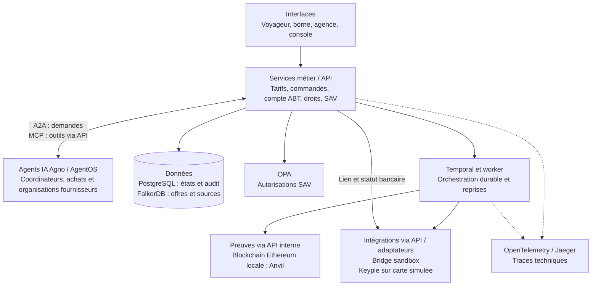

# Comprendre l’architecture d’Alizé Lab

**Dossier d’architecture de haut niveau — actualisé le 29 octobre 2026**

Ce dossier s’adresse aux lecteurs qui découvrent le projet et ses technologies. Il présente les choix de conception et les relie aux parcours et résultats documentés.

## Le problème traité

Un voyageur achète une offre auprès d’un vendeur, paie, reçoit un droit de transport et utilise des services partenaires. Le vendeur, les opérateurs et l’agence de service après-vente doivent retrouver des montants et des états cohérents, même si une opération est interrompue.

**MaaS** signifie *Mobility as a Service* : réunir plusieurs services de mobilité dans un même parcours. Ici, le POC se concentre sur la **billettique** — offres, vente, paiement, délivrance de droits, usages et SAV. Le calcul d’itinéraire et l’information voyageurs sont hors périmètre.

Le qualificatif **agentique** désigne l’intervention d’agents IA spécialisés, capables de consulter des outils et de déléguer une demande à un autre agent. Les services métier calculent les prix et autorisent les opérations ; les agents accompagnent et coordonnent le parcours.

## Lecture du dossier

| Document | Ce qu’il explique |
|---|---|
| [Principes et bénéfices](principes-et-benefices.md) | Pourquoi séparer compréhension, calcul, exécution et reprise ; bénéfices attendus et contreparties. |
| [Composants et responsabilités](composants.md) | Le rôle de chaque logiciel et les données qu’il porte. |
| [Parcours et échanges](parcours.md) | Comment une demande circule entre interface, agents, outils, paiement et délivrance. |
| [Temporal : coordonner et reprendre](temporal.md) | Les workflows, activités, workers, signaux, délais et reprises, à partir du paiement du POC. |
| [Blockchain et Anvil : conserver des preuves](blockchain-et-anvil.md) | Le mécanisme d’ancrage et ses bénéfices pour la coopération entre partenaires. |
| [Glossaire](glossaire.md) | A2A, MCP, API, GraphRAG, workflow, idempotence, blockchain et autres notions. |

Pour une première lecture : commencer par la vue ci-dessous, puis les principes. Les détails de déploiement restent dans le [README du projet](../../README.md).

Pour manipuler l’application, suivre le [guide de démonstration](../guide-demonstration.md). L’[index documentaire](../README.md) relie chaque fonction aux rapports d’essai et l’[exploitation locale](../exploitation-et-verification.md) décrit la configuration et les vérifications.

## La vue d’ensemble

Ce schéma regroupe les fonctions pour rester lisible. Les blocs regroupent les responsabilités ; leur déploiement est détaillé dans les composants. Les flèches représentent les échanges principaux, pas tous les appels techniques.

**A2A relie des agents ; MCP relie un agent à des outils ; les API métier gardent la responsabilité des effets exécutés.** Temporal mémorise et fait progresser les opérations qui doivent survivre à une interruption.

Les agents fournisseurs peuvent consulter leurs offres et leur périmètre de dossier. Des points d’entrée distincts exécutent les actions partenaires confirmées dans l’interface, avec des outils liés à cette seule opération. Les coordinateurs peuvent aussi préparer un devis sans achat ; les agents Achats consultent l’historique, le compte ABT et les preuves, sans souscription ni prélèvement.

## Les capacités à explorer

| Parcours | Composants mobilisés |
|---|---|
| Comprendre une offre | Agents Agno, délégation A2A, outils MCP et recherche FalkorDB. |
| Acheter et délivrer | Services métier, paiement Bridge sandbox, Temporal et SDK Keyple sur carte stub. |
| Souscrire un titre transport ABT | Compte voyageur, droit côté serveur, échéancier annuel ou post-paiement plafonné, prélèvements simulés. |
| Retrouver ses achats et vérifier leur intégrité | Agent Achats, outils MCP à périmètre signé, sources métier et preuves relues sur la chaîne active. |
| Utiliser un service partenaire | Agents vélo/parking, outils MCP, stock et réservations persistés. |
| Traiter une validation et un dossier SAV | CloudEvents, PostgreSQL, habilitations OPA et journal des opérations. |
| Conserver et consulter des preuves | Manifestes signés, ancrage blockchain Anvil et traces OpenTelemetry/Jaeger. |
| Éprouver des variantes | Modèles Ollama ou OpenAI, doubles déterministes de test et laboratoire Harness². |

Les extensions vers les services locaux, l’abonnement étudiant et les crédits territoriaux sont présentées dans la [série d’articles](../serie-articles-souplesse-maas-agentique.md).

## Où vérifier les affirmations

- [Parcours partenaires et essais A2A/MCP](../partenaires-a2a-2026-10-24.md).
- [Compte ABT et limites des prélèvements simulés](../abt-transport-2026-10-29.md).
- [Routage, historique et preuves de cycle de vie](../routage-achats-preuves-2026-10-29.md).
- [Audits ABT](../audit-tests-abt-2026-10-29.md) et [autres domaines](../audit-tests-hors-abt-2026-10-29.md).
- [Paiement QR Bridge, reprise et limites](../automate-qr-2026-10-25.md).
- [Essais des fournisseurs IA](../tests-ia-locale-et-acces-2026-10-24.md).
- [Première validation du socle](../validation-2026-10-24.md), à lire avec les rapports complémentaires plus récents.
- [Série d’articles et futurs POC](../serie-articles-souplesse-maas-agentique.md).

Le [plan d’implémentation cible](../../plan-implementation-poc.md) et le [plan d’article initial](../../plan-maas-agentique.md) couvrent un périmètre plus large que le code actuel. La série d’articles suit le passage de ces objectifs aux réalisations successives.
