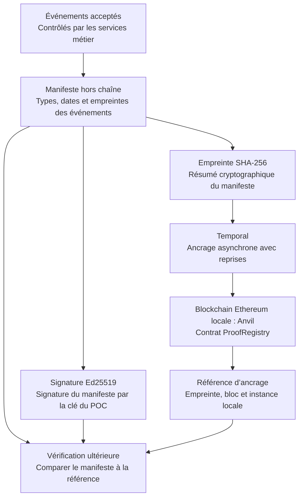

# Blockchain et Anvil : pourquoi conserver une preuve commune ?

[Retour au dossier d’architecture](README.md)

## D’abord, qu’est-ce qu’une blockchain ?

Une **blockchain** est un registre de transactions organisées en blocs, liés par des empreintes cryptographiques. Dans un réseau partagé, des participants appliquent des règles communes pour vérifier et enregistrer ces transactions. La possibilité pour plusieurs parties de vérifier la même référence est au cœur de son intérêt pour cette architecture.

**Anvil est le logiciel qui fait fonctionner notre blockchain Ethereum locale de développement.** Il permet d’exécuter les programmes blockchain et leurs transactions dans un environnement maîtrisé. Le programme du POC, appelé *smart contract*, se nomme `ProofRegistry`. Il enregistre des empreintes de lots. [Présentation officielle d’Anvil](https://www.getfoundry.sh/anvil/index.html).

Les comptes Anvil servent aux transactions techniques d’ancrage. Le portefeuille territorial constitue une évolution métier distincte, décrite dans la série d’articles.

## Le problème métier auquel elle peut répondre

Imaginons un vendeur MaaS, un opérateur de transport et un exploitant de parking. Après une journée d’activité, ils comparent leurs relevés pour expliquer une facture ou une régularisation. Si chacun conserve uniquement sa propre version, ils peuvent être en désaccord sur le lot qui faisait référence.

Un ancrage donne une empreinte vérifiable du lot retenu. Une version modifiée peut être comparée à cette empreinte. Dans une architecture cible, un registre partagé et une gouvernance définie entre les parties permettraient de conserver cette référence au-delà de la seule base de l’un des acteurs.

Le réseau local permet d’explorer ce mécanisme ; son extension à des partenaires indépendants passe par une gouvernance commune.

## Le mécanisme du POC

Les événements sont conservés dans PostgreSQL. Le manifeste et sa signature restent hors chaîne ; le contrat reçoit l’empreinte et les informations techniques d’identification du lot. Le dossier voyageur reste dans le stockage métier.

Lors d’une vérification, on recalcule l’empreinte du manifeste et on la compare à la référence inscrite. On peut aussi vérifier la signature avec la clé publique correspondante. La signature du manifeste et l’ancrage blockchain jouent des rôles complémentaires : la première relie ce contenu à une clé ; le second fournit une référence enregistrée sur une chaîne déterminée.

## Les bénéfices pour la coopération

| Bénéfice | Utilité concrète | Application dans l’architecture |
|---|---|---|
| **Détection d’altération** | Une version modifiée du lot ne correspond plus à son empreinte de référence. | Mécanisme d’ancrage et contrôles de comparaison testables sur Anvil local. |
| **Référence commune** | Les partenaires peuvent comparer leurs relevés au même lot, plutôt qu’à des exports divergents. | Empreinte consultable dans le registre ; partage entre partenaires selon les accords de gouvernance retenus. |
| **Historique de publication** | Identifier le bloc dans lequel une preuve a été inscrite aide à reconstruire la chronologie des dépôts. | Bloc et date d’ancrage affichés pour retrouver la chronologie de publication. |
| **Règles d’enregistrement explicites** | Un programme commun peut refuser des dépôts incompatibles ou non autorisés. | `ProofRegistry` contrôle l’émetteur autorisé, accepte une répétition identique et refuse un conflit sur le même lot. |
| **Moins de dépendance au registre d’un seul acteur** | Avec une gouvernance distribuée adaptée, plusieurs parties peuvent vérifier les écritures sans se fier uniquement à la base d’un partenaire. | Évolution du registre local vers un réseau gouverné conjointement par les acteurs. |
| **Support aux rapprochements** | Une preuve commune aide à identifier un lot contesté et à documenter une analyse. | Références de lots utilisables par les services de rapprochement et les équipes métier. |

Les services métier contrôlent les données à l’entrée ; la blockchain fournit ensuite une référence de contenu vérifiable. Cette répartition permet de distinguer la qualité des données de l’intégrité de leur conservation.

## Les choix d’architecture associés

**Qualité des données et intégrité.** Les services et les sources autorisées vérifient passages, identités et règlements. L’empreinte permet ensuite de comparer le contenu conservé à la référence publiée.

**Gouvernance du registre.** Anvil permet de réinitialiser la chaîne pour rejouer les expériences. Un identifiant d’instance et les références antérieures rendent ces changements visibles. Pour un réseau partagé, les acteurs définiraient ensemble l’hébergement, les droits de publication, la gestion des clés et la participation aux vérifications.

**Conservation des documents.** Le manifeste reste disponible hors chaîne, avec sauvegarde et contrôle d’accès. L’empreinte sert à le vérifier ; la confidentialité relève de la gestion des données et des habilitations.

**Choix du mécanisme de confiance.** La blockchain est intéressante lorsque plusieurs acteurs souhaitent vérifier une référence commune. Un journal signé peut aussi répondre à un besoin porté par un seul exploitant de confiance. Le choix dépend des participants, de la gouvernance et du coût d’exploitation.

## Sa place exacte dans l’architecture

La blockchain est utilisée **après les contrôles métier et hors du parcours critique de validation**. Une panne d’Anvil ne doit pas empêcher le voyageur d’utiliser un titre. Temporal organise l’ancrage et ses reprises ; Anvil enregistre la preuve. Les deux composants ont donc des responsabilités distinctes.

Les services métier portent les contrats d’abonnement et les calculs ; le connecteur bancaire suit les paiements ; ProofRegistry porte les références d’intégrité. Chaque composant garde ainsi une responsabilité précise.

Sources du dépôt : [contrat ProofRegistry](../../contracts/proofs/src/ProofRegistry.sol), [signature et ancrage](../../services/api/maas/proofs.py), [gestion de la réinitialisation locale](../../scripts/deploy_proof.py), [rapport des premières vérifications](../validation-2026-10-24.md).
