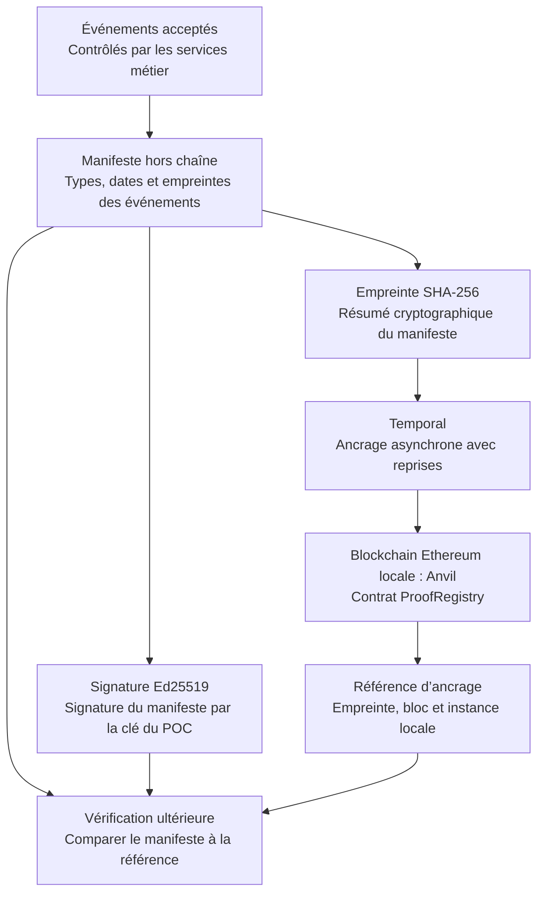

# Blockchain et Anvil : pourquoi conserver une preuve commune ?

[Retour au dossier d’architecture](README.md)

## D’abord, qu’est-ce qu’une blockchain ?

Une **blockchain** est un registre de transactions organisées en blocs, liés par des empreintes cryptographiques. Dans un réseau partagé, des participants appliquent des règles communes pour vérifier et enregistrer ces transactions. La possibilité pour plusieurs parties de vérifier la même référence est au cœur de son intérêt pour cette architecture.

**Anvil est le logiciel qui fait fonctionner notre blockchain Ethereum locale de développement.** Il permet d’exécuter de vrais programmes blockchain et de tester des transactions, sans réseau public ni argent réel. Le programme du POC, appelé *smart contract*, se nomme `ProofRegistry`. Il enregistre des empreintes de lots. [Présentation officielle d’Anvil](https://www.getfoundry.sh/anvil/index.html).

Une blockchain n’a pas besoin d’émettre une monnaie pour rendre ce service. Dans ce POC, les comptes de test servent aux transactions techniques ; ils ne constituent pas le portefeuille territorial envisagé pour une extension future.

## Le problème métier auquel elle peut répondre

Imaginons un vendeur MaaS, un opérateur de transport et un exploitant de parking. Après une journée d’activité, ils comparent leurs relevés pour expliquer une facture ou une régularisation. Si chacun conserve uniquement sa propre version, ils peuvent être en désaccord sur le lot qui faisait référence.

Un ancrage donne une empreinte vérifiable du lot retenu. Une version modifiée peut être comparée à cette empreinte. Dans une architecture cible, un registre partagé et une gouvernance définie entre les parties permettraient de conserver cette référence au-delà de la seule base de l’un des acteurs.

Il s’agit d’un bénéfice visé pour la coopération entre partenaires. Le réseau actuel est local et contrôlé par l’exploitant du POC ; il ne démontre pas encore cette indépendance de gouvernance.

## Le mécanisme du POC

Les événements sont conservés dans PostgreSQL. Le manifeste et sa signature restent hors chaîne ; le contrat reçoit l’empreinte et les informations techniques d’identification du lot. L’ancrage ne contient pas le dossier complet d’un voyageur.

Lors d’une vérification, on recalcule l’empreinte du manifeste et on la compare à la référence inscrite. On peut aussi vérifier la signature avec la clé publique correspondante. La signature du manifeste et l’ancrage blockchain jouent des rôles complémentaires : la première relie ce contenu à une clé ; le second fournit une référence enregistrée sur une chaîne déterminée.

## Les bénéfices, et ce que nous démontrons réellement

| Bénéfice | Utilité concrète | Situation du POC |
|---|---|---|
| **Détection d’altération** | Une version modifiée du lot ne correspond plus à son empreinte de référence. | Mécanisme d’ancrage et contrôles de comparaison testables sur Anvil local. |
| **Référence commune** | Les partenaires peuvent comparer leurs relevés au même lot, plutôt qu’à des exports divergents. | L’empreinte est consultable localement ; réseau et accords entre acteurs indépendants restent à concevoir. |
| **Historique de publication** | Identifier le bloc dans lequel une preuve a été inscrite aide à reconstruire la chronologie des dépôts. | Bloc et date locale affichés ; ce n’est pas un horodatage qualifié ni la preuve de l’heure réelle d’un passage. |
| **Règles d’enregistrement explicites** | Un programme commun peut refuser des dépôts incompatibles ou non autorisés. | `ProofRegistry` contrôle l’émetteur autorisé, accepte une répétition identique et refuse un conflit sur le même lot. |
| **Moins de dépendance au registre d’un seul acteur** | Avec une gouvernance distribuée adaptée, plusieurs parties peuvent vérifier les écritures sans se fier uniquement à la base d’un partenaire. | Bénéfice cible uniquement : Anvil reste un nœud local sous un contrôle unique. |
| **Support aux rapprochements** | Une preuve commune aide à identifier un lot contesté et à documenter une analyse. | Pas de répartition financière ni d’arbitrage automatique assurés par le contrat actuel. |

L’intérêt n’est donc pas « rendre toute donnée vraie » : il est de rendre une référence de contenu vérifiable. Même un registre partagé ne résout pas à lui seul un litige sur la qualité des données qui lui ont été soumises.

## Les limites à comprendre

**Des données fausses peuvent être ancrées.** L’empreinte prouve une concordance de contenu, pas la réalité d’un trajet, l’identité d’un signataire ou le règlement d’un paiement. Ces vérifications relèvent des services et des sources autorisées.

**Anvil n’apporte pas une immutabilité absolue.** La chaîne de développement peut être réinitialisée. Le POC conserve un identifiant d’instance et des références antérieures pour rendre cette situation visible. Une chaîne partagée exigerait des choix d’hébergement, de participation, de clés et de gouvernance qui ne sont pas réalisés ici.

**Un document hors chaîne doit rester disponible.** Une empreinte ne permet pas de reconstruire le manifeste. Sauvegarde, contrôle d’accès et conservation restent nécessaires. Une empreinte n’est pas non plus un mécanisme d’anonymisation automatique.

**Une blockchain ajoute un coût d’exploitation.** Un réseau public peut introduire frais et contraintes ; un réseau partagé privé exige aussi des règles de fonctionnement. Si tous les acteurs font confiance au même exploitant, un journal signé et correctement conservé pourrait suffire. Le POC permet d’éprouver l’option blockchain, pas de conclure qu’elle est indispensable à tous les déploiements.

## Sa place exacte dans l’architecture

La blockchain est utilisée **après les contrôles métier et hors du parcours critique de validation**. Une panne d’Anvil ne doit pas empêcher le voyageur d’utiliser un titre. Temporal organise l’ancrage et ses reprises ; Anvil enregistre la preuve. Les deux composants ont donc des responsabilités distinctes.

Le contrat actuel ne signe pas l’abonnement étudiant, ne calcule pas les commissions, ne garde pas les fonds et ne confirme pas le paiement Bridge. Ces extensions éventuelles doivent être décrites séparément et ne sont pas rendues présentes par le seul fait d’utiliser une blockchain.

Sources du dépôt : [contrat ProofRegistry](../../contracts/proofs/src/ProofRegistry.sol), [signature et ancrage](../../services/api/maas/proofs.py), [gestion de la réinitialisation locale](../../scripts/deploy_proof.py), [rapport des premières vérifications](../validation-2026-10-24.md).
