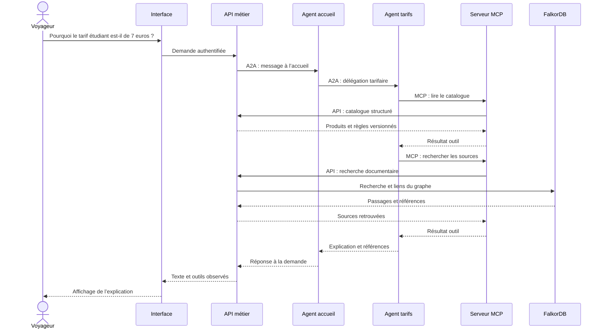
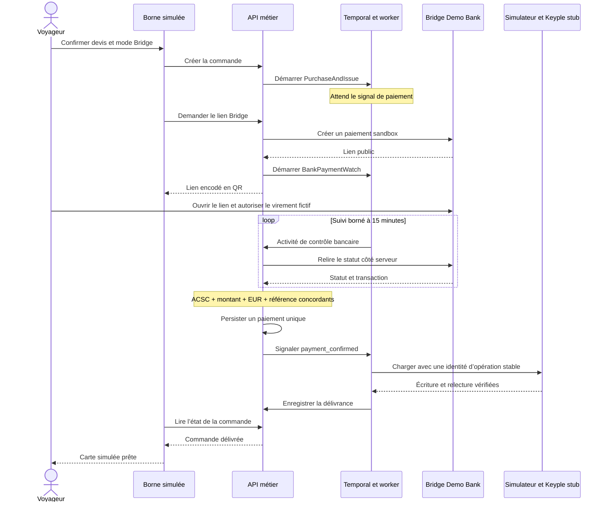
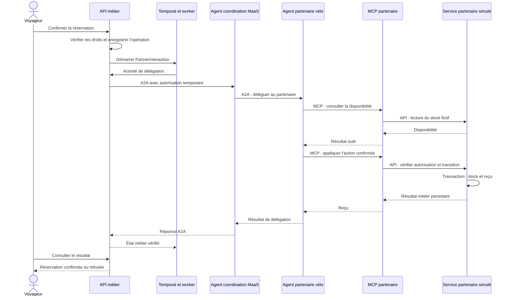

# Comprendre les parcours et les échanges

[Retour au dossier d’architecture](README.md)

Les diagrammes décrivent des parcours simplifiés du code actuel. Les variantes d’erreur et les détails HTTP sont expliqués dans les rapports d’essai liés à chaque section.

## 1. Une question tarifaire : comprendre, déléguer, consulter

Le voyageur demande pourquoi le transport étudiant coûte 7 €. L’accueil délègue à l’agent tarifaire par A2A. Celui-ci utilise MCP pour consulter le catalogue et rechercher les sources. Les outils reviennent aux API métier avec l’identité du demandeur.

Le dialogue explique l’offre ; les contrôles métier de l’interface permettent ensuite d’obtenir le devis et de confirmer la commande. Dans le catalogue fictif, le moteur choisit la meilleure réduction admissible sans cumuler les remises.

**À retenir :** A2A sert à déléguer ; MCP sert à consulter ; le moteur métier reste responsable du montant.

## 2. Un paiement QR sur la borne : attendre une preuve bancaire

La borne crée une commande à partir du devis confirmé. L’API démarre le workflow d’achat. Un lien Bridge sandbox est ensuite créé et présenté sous forme de QR code. La confirmation du virement a lieu sur la page bancaire, dans une session distincte.

Le lien de borne expire après 10 minutes ; la surveillance serveur possède une fenêtre de 15 minutes. Après cette fenêtre, un contrôle manuel est nécessaire. Une réponse bancaire incertaine n’autorise pas à recréer aveuglément un paiement.

La borne peut fermer son écran sans effacer la commande ni arrêter le workflow. Aucun appel d’agent IA n’est requis pour confirmer ce paiement. Le terminal CB proposé comme autre mode reste une simulation locale distincte.

**À retenir :** ouvrir un QR ou revenir sur une page de succès ne suffit pas ; seule la vérification bancaire déclenche la délivrance. Voir [le test complet du parcours](../automate-qr-2026-10-25.md).

## 3. Réserver un vélo : coopérer avec un partenaire

Après délivrance de la commande, le voyageur confirme une opération dans l’interface. Le service crée une opération durable. Pendant son traitement, il fournit une autorisation temporaire limitée à cette action.

Le runtime impose une consultation de disponibilité avant l’écriture, même si le modèle omet cet appel. Les paramètres d’action sont fixés par le service, pas par le texte du modèle. Le stock détermine l’acceptation de la réservation ; le reçu enregistré constitue la confirmation affichée.

Lors d’une fin d’usage, le service produit aussi un événement CloudEvents dans la transaction métier. Les agents coopèrent en A2A ; les remontées de validation utilisent le flux d’événements.

Voir [les cycles partenaires, la concurrence et les reprises](../partenaires-a2a-2026-10-24.md).

## 4. Après les validations : constituer une preuve

Les événements acceptés sont conservés dans PostgreSQL. Une demande d’ancrage constitue un manifeste de lot contenant types, dates et empreintes métier. Le POC signe ce manifeste en Ed25519. Temporal fait ensuite inscrire son empreinte SHA-256 dans le contrat local ProofRegistry sur Anvil.

Le manifeste reste hors chaîne. La console montre l’empreinte, le bloc, le réseau local et l’instance de déploiement ; la date du bloc est affichée en heure de Paris lorsqu’elle est disponible. Une comparaison ultérieure permet de détecter un manifeste modifié. Les contrôles métier vérifient les conditions d’acceptation ; l’ancrage permet de vérifier l’intégrité du lot conservé.

Une panne d’Anvil ne doit pas empêcher le traitement des validations : le workflow d’ancrage peut être repris séparément.
