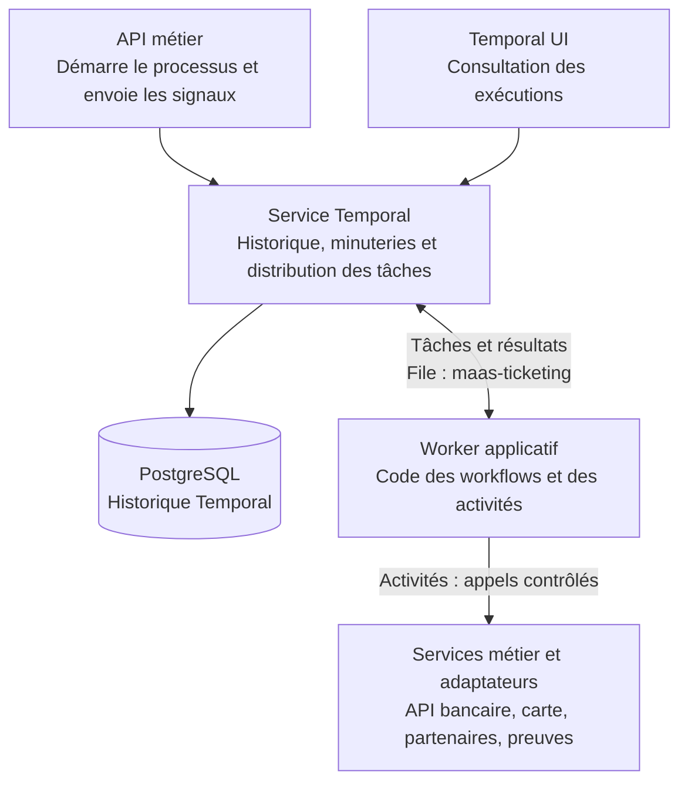

# Temporal : coordonner les opérations et reprendre après une panne

[Retour au dossier d’architecture](README.md)

## Le besoin : une commande ne doit pas dépendre d’un écran ouvert

Un achat comporte plusieurs étapes : conserver la commande, attendre le paiement, charger le titre et confirmer sa délivrance. Le paiement peut prendre du temps ; un service peut s’arrêter après une écriture mais avant d’avoir répondu.

**Temporal est le moteur d’orchestration durable du POC.** Il conserve l’historique de progression et organise la suite du processus. Fermer le navigateur ou redémarrer le worker ne doit pas faire oublier une commande engagée. Les traitements reprennent lorsque les services nécessaires sont de nouveau disponibles, dans les limites des délais et politiques définis.

Le serveur Temporal organise les tâches et conserve l’historique. Notre code applicatif, exécuté par le worker, définit quoi faire et sous quelles conditions. Les services métier gardent la responsabilité des montants, autorisations et effets.

## Les concepts, avec des exemples

| Concept | Explication | Dans le POC |
|---|---|---|
| **Définition de workflow** | Code décrivant l’enchaînement des étapes et des attentes. | `PurchaseAndIssue` attend le paiement, puis organise le chargement. |
| **Exécution de workflow** | Une réalisation concrète de ce code, identifiée et suivie séparément. | L’exécution d’achat correspondant à une commande précise. |
| **Activité** | Code qui effectue une opération externe au workflow : appel API, accès à un équipement ou écriture. | `issue_card` appelle le service de carte ; `check_bank` demande à l’API de relire Bridge. |
| **Worker** | Processus applicatif qui exécute le code des workflows et des activités. | Le conteneur `worker`, qui peut être arrêté puis redémarré. |
| **File de tâches** | Point de distribution : les workers y récupèrent le travail à effectuer. | `maas-ticketing`, utilisée par les workflows actuels. |
| **Signal** | Message envoyé à une exécution pour lui apporter une information et permettre sa progression. | `payment_confirmed` indique que le paiement a été vérifié ; `continue_issuance` autorise la reprise prévue par la démo. |
| **Query** | Lecture de l’état courant d’un workflow, sans le modifier. | `state` expose les indicateurs de paiement et de reprise. Ce n’est pas la lecture du dossier métier stocké en base. |
| **Minuterie durable** | Attente conservée par Temporal, même lorsque le worker est arrêté. | L’espacement des contrôles bancaires dans `BankPaymentWatch`. |
| **Retry, ou nouvelle tentative** | Réexécution d’une activité après une erreur, selon des règles de nombre et d’espacement. | Réessayer un chargement ou un ancrage lorsque le service redevient disponible. |
| **Timeout, ou délai maximal** | Limite de durée applicable à une tentative ou à une autre attente explicitement configurée. | `issue_card` dispose de 15 secondes par tentative au niveau du workflow. |
| **Historique d’événements** | Journal durable des faits d’exécution : démarrage, signaux, activités et résultats. | Il permet de comprendre où l’achat s’est interrompu et de reconstruire sa progression. |

Les types de timeout et les politiques sont choisis dans le code ; toutes les opérations n’ont pas une échéance globale automatique. La file de tâches Temporal n’est pas un bus CloudEvents. [Concepts Temporal](https://docs.temporal.io/glossary), [fonctionnement des tâches](https://docs.temporal.io/tasks).

## Qui fait quoi ?

Dans cette pile, le worker exécute à la fois les workflows et les activités. Les écritures de commande restent dans la base métier ; l’historique Temporal est conservé dans sa base dédiée. Ces deux stockages ont des responsabilités différentes.

## Comment fonctionne la reprise ?

Le worker peut reconstruire l’état d’une exécution en **rejouant son code à partir de l’historique** : c’est le *replay*. Les résultats d’activités déjà enregistrés sont réutilisés au lieu de réexécuter ces activités pendant ce replay. Le code du workflow doit donc rester compatible avec son historique et produire des décisions déterministes ; les appels réseau sont placés dans les activités. [Historique et reprise](https://docs.temporal.io/encyclopedia/event-history).

Il reste un cas important : une activité a produit son effet externe, mais sa réponse a été perdue avant enregistrement du résultat. Temporal peut alors la réessayer. **C’est l’idempotence du service appelé qui évite un second effet métier**, et non le seul usage de Temporal.

Exemple du POC : le simulateur a chargé la carte mais perd volontairement sa réponse. La nouvelle tentative réutilise la même identité d’opération, retrouve le chargement et confirme une seule délivrance. Temporal n’annule pas automatiquement une opération externe déjà effectuée et ne transforme pas tous les appels en transactions uniques.

## Le paiement QR comme exemple complet

1. L’API conserve la commande et démarre `PurchaseAndIssue`.
2. Le workflow attend le signal `payment_confirmed`, sans maintenir une requête du navigateur ouverte.
3. Sur la borne, `BankPaymentWatch` demande périodiquement à l’API de relire le statut Bridge. Les demandes passent par une activité ; les contrôles sont espacés par une minuterie durable.
4. L’API vérifie le règlement, le montant, la devise et la référence, puis persiste le paiement et envoie le signal au workflow d’achat.
5. Le workflow exécute les activités de délivrance et de mise à jour du dossier. La borne lit ensuite le résultat métier.

Un redémarrage du worker laisse l’historique et les signaux reçus côté Temporal. En revanche, si Temporal lui-même est indisponible, l’application doit gérer cette indisponibilité et reprendre lorsque son service revient.

La surveillance bancaire de la borne est bornée à 15 minutes ; le lien expire après 10 minutes. Une situation incertaine ou un règlement tardif peut demander un contrôle manuel. La confirmation du règlement vient de la relecture du prestataire par l’API. Voir [les essais du paiement QR](../automate-qr-2026-10-25.md).

## Les bénéfices dans les parcours

- **Continuité :** les opérations engagées ne dépendent plus de la durée d’un écran ou d’une requête HTTP.
- **Reprise contrôlée :** attentes, nouvelles tentatives et échecs sont explicites et consultables.
- **Compréhension :** l’historique permet de distinguer « paiement attendu », « paiement confirmé » et « délivrance en cours ».
- **Évolution :** de nouvelles étapes pourraient être ajoutées, comme un cycle d’abonnement, à condition de gérer la compatibilité des workflows déjà engagés. Ce cycle est décrit dans la feuille de route des articles.

Ces bénéfices ont un coût : service et base supplémentaires, code de workflow soumis à des contraintes, délais à configurer et effets externes à rendre idempotents. La répartition des responsabilités reste claire : les agents accompagnent, les services calculent et exécutent, OPA contrôle les habilitations et Temporal coordonne les étapes.

Les quatre workflows actuels et leur rôle sont recensés dans [les composants](composants.md). Le code de référence est [le worker du POC](../../services/worker/main.py).

## Facturation ABT et distribution des preuves

Le worker exécute aussi une boucle de service toutes les cinq secondes, distincte de ces workflows. Elle demande à l’API de traiter la facturation ABT et de distribuer les preuves métier en attente. Les contrats, échéances et résultats de prélèvement simulé sont persistés dans PostgreSQL et repris par des traitements idempotents ; ce n’est pas un workflow Temporal d’abonnement. La distribution des preuves démarre, elle, les workflows `ProofAnchoring` correspondant aux enregistrements déjà validés. Voir [le parcours ABT](../abt-transport-2026-10-29.md) et [les preuves de cycle de vie](../routage-achats-preuves-2026-10-29.md).
