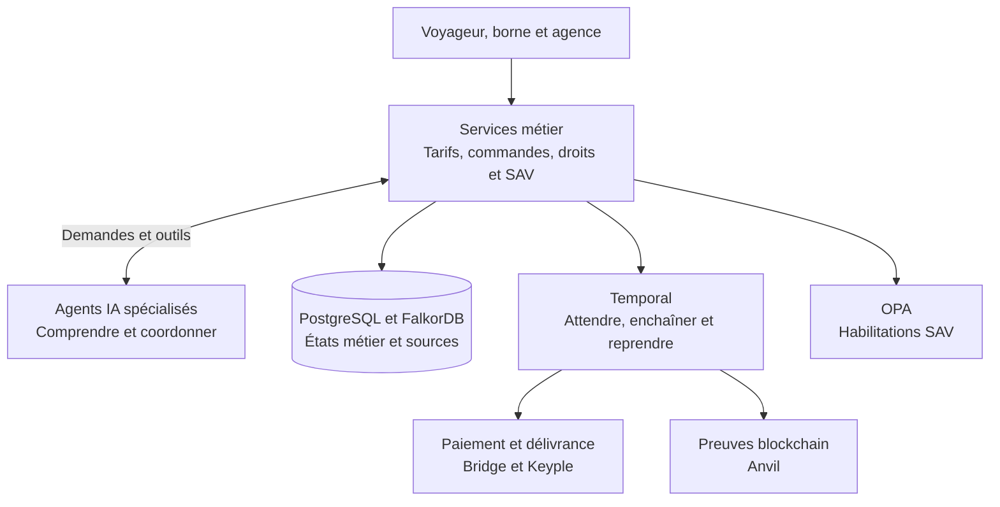
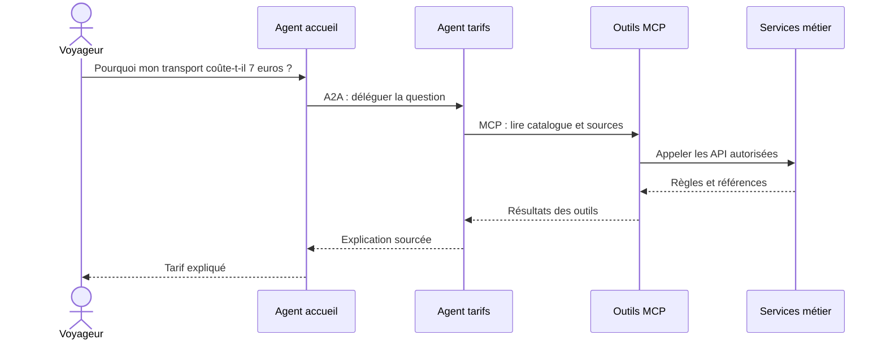

# MaaS agentique : des agents IA au service d’une billettique interopérable

Ajouter un nouvel acteur à une plateforme de mobilité. Faire intervenir une commune dans le financement d’un abonnement. Changer de partenaire sans reprendre tout le parcours de vente. Ces évolutions paraissent naturelles du point de vue de l’usager. Du côté du système d’information, elles traversent le catalogue, les droits, les interfaces, les paiements et les échanges entre acteurs.

C’est cette capacité d’évolution que je souhaite explorer avec **Alizé Lab**, un projet open source qui associe agents IA, services métier et orchestration durable.

**Alizé Lab est un POC personnel, et non un système opérationnel. Les scénarios utilisent des données de démonstration, une banque sandbox et des équipements ou partenaires simulés.** Ce premier article ouvre une série : partir d’un parcours qui fonctionne, puis observer comment son architecture accueille de nouveaux besoins.

Le **MaaS**, pour *Mobility as a Service*, consiste à réunir plusieurs services de mobilité dans un même parcours. La **billettique** couvre ici les offres, la vente, les droits d’accès et leur utilisation.

La finalité est de construire progressivement un socle capable de relier mobilité, services locaux et dispositifs de financement, en conservant une expérience compréhensible pour l’habitant et des responsabilités claires pour les acteurs.

## Un premier parcours pour poser les fondations

Le point de départ est volontairement concret : Léa souhaite acheter un titre de transport, une journée de parking relais et accéder à un service de vélo partagé.

Son profil étudiant ouvre une réduction de 30 % sur le transport : le prix passe de 10 € à 7 €. Le parking coûte 5 €. Le vélo sera calculé après utilisation. Le montant à payer immédiatement est donc de **12 €**.

Depuis une borne de vente représentée dans l’interface, Léa présente sa carte de démonstration, choisit ses produits et confirme son devis. Un QR code lui permet d’ouvrir le lien de paiement Bridge. Le serveur attend ensuite la confirmation bancaire avant de charger les droits et de vérifier leur relecture avec Keyple, la bibliothèque logicielle utilisée pour les échanges avec la carte.

Ce parcours réunit déjà plusieurs responsabilités : comprendre une offre, appliquer un tarif, identifier le vendeur, payer, délivrer un droit et suivre son utilisation. Les partenaires vélo et parking interviennent ensuite à partir de la commande délivrée.

Le même socle expose plusieurs points de vue : l’espace voyageur, la borne, l’agence de service après-vente et la console technique. Chacun présente les informations et actions adaptées à son usage, en s’appuyant sur les mêmes services métier.

## La séparation qui structure l’ensemble

J’ai retenu une règle d’architecture : **les agents comprennent et coordonnent ; les services métier calculent, autorisent et exécutent.**

Lorsqu’un voyageur demande pourquoi son titre coûte 7 €, un agent peut interpréter la question, consulter les règles et construire une explication. Le montant du devis provient, lui, du moteur tarifaire. Les réductions, leur validité et les arrondis sont appliqués par du code déterministe.

Cette séparation donne un rôle utile à chaque composant. Elle permet d’expérimenter avec différents modèles IA tout en conservant une référence stable pour les montants et les états de commande. Les agents accompagnent le parcours ; l’interface recueille les confirmations et les services contrôlent les effets.

Agno sert à construire les agents ; AgentOS les expose comme services. Les modèles peuvent être utilisés via Ollama en local ou OpenAI en cloud. Leurs outils retrouvent les informations nécessaires auprès des API métier, avec le périmètre du demandeur.

## A2A et MCP : deux échanges complémentaires

Deux sigles apparaissent souvent dans les architectures agentiques. Leur rôle devient plus clair avec un exemple.

**A2A, pour Agent-to-Agent**, permet à un agent de solliciter un autre agent spécialisé. Dans Alizé Lab, l’accueil délègue une question de prix à l’agent tarifaire. Pour une opération partenaire confirmée, l’agent de coordination MaaS sollicite l’agent vélo ou parking, exposé sur un service séparé.

**MCP, pour Model Context Protocol**, décrit et expose les outils qu’un agent peut utiliser. L’agent tarifaire peut lire le catalogue et rechercher les sources. L’agent partenaire peut consulter la disponibilité puis demander l’exécution de l’action confirmée.

A2A organise donc la coopération entre agents ; MCP leur donne accès à des capacités définies. Les services métier vérifient les droits et les paramètres à chaque étape.

Pour les partenaires, une autorisation temporaire lie l’opération à un voyageur, une commande et une action précise. Le service fixe ces éléments avant la délégation. Le stock et le reçu enregistré déterminent le résultat de la réservation.

Cette manière de découper les responsabilités prépare l’arrivée d’autres partenaires. Chaque ajout devra néanmoins être évalué sur son adaptation réelle au contrat d’interface et aux règles métier.

## Retrouver les règles avec un graphe

Les informations utiles à l’explication d’un tarif sont liées : un acteur propose une grille, cette grille contient des produits, des conditions s’appliquent et des documents les décrivent.

**FalkorDB** conserve ces relations ainsi que les passages documentaires. La recherche combine index textuel, vecteurs lexicaux locaux et parcours du graphe pour retrouver les sources associées à la demande.

C’est le principe d’une démarche **GraphRAG** : rechercher des éléments reliés dans un graphe avant de les utiliser pour générer une réponse. Le moteur de calcul travaille sur le catalogue structuré ; l’agent s’appuie sur les sources retrouvées pour expliquer le résultat.

L’intérêt est de pouvoir suivre à la fois la donnée utilisée dans le calcul et la règle présentée au voyageur. Un devis conserve également la version et les conditions retenues lors de sa création.

## Temporal : donner une mémoire au processus

Le paiement et la délivrance forment un processus qui dépasse la durée d’une requête ou d’un écran. Un voyageur peut prendre du temps pour confirmer son virement. Un service peut redémarrer entre deux étapes.

**Temporal est le moteur d’orchestration durable de ce parcours.** Un *workflow* décrit l’enchaînement des étapes ; un *worker* exécute son code. Les opérations externes, comme l’appel au service de carte, sont des *activités*. Un *signal* apporte une information au workflow, par exemple « paiement confirmé ».

Temporal conserve un historique qui permet au worker de reconstruire sa progression après une interruption. Une minuterie durable espace les contrôles bancaires ; les politiques de nouvelle tentative organisent les reprises.

L’API vérifie le statut Bridge, le montant, la devise et la référence de commande avant d’envoyer le signal attendu par le workflow d’achat. Celui-ci peut alors lancer la délivrance.

Un cas mérite une attention particulière : la carte a été chargée, mais la réponse se perd. La nouvelle tentative réutilise la même identité d’opération pour retrouver le chargement précédent. Cette propriété s’appelle **l’idempotence** : répéter une demande identifiée conserve un seul effet métier.

Temporal coordonne la reprise ; le service appelé protège l’unicité de l’effet. C’est leur association qui rend le parcours cohérent.

## Des règles exécutables et des preuves consultables

Le service après-vente ajoute une autre forme de contrôle. Un conseiller peut enregistrer une régularisation dans les limites de sa délégation. **OPA, Open Policy Agent**, évalue ici des règles d’habilitation selon le rôle, l’organisation et le montant. Les droits sont ainsi vérifiables dans le parcours et testables indépendamment du dialogue.

Les usages produisent aussi des événements : validation transport, restitution du vélo ou sortie du parking. Leur enveloppe commune utilise **CloudEvents** ; le service contrôle leur contenu, les doublons et les contradictions.

Enfin, un lot d’événements peut donner lieu à une preuve. Un manifeste est signé avec Ed25519, puis son empreinte SHA-256 est inscrite dans un contrat sur **Anvil, la blockchain Ethereum locale du projet**. Le contenu reste conservé hors chaîne ; l’empreinte fournit une référence pour détecter une modification ultérieure.

Dans une architecture partagée, cette référence pourrait aider les acteurs à comparer leurs relevés et à documenter leurs rapprochements. Les règles de participation et de gouvernance détermineraient alors la confiance accordée au registre. L’ancrage intervient en arrière-plan, indépendamment du traitement des validations.

OpenTelemetry et Jaeger rendent également consultables les traces de l’API et des workflows. On peut ainsi examiner les étapes exécutées et retrouver l’origine d’un état affiché.

## Ce que le premier parcours a permis de vérifier

Les comptes rendus du projet conservent les scénarios, leurs résultats et les captures associées. Parmi les observations documentées :

| Essai | Résultat observé |
|---|---|
| Achat de 12 € depuis la borne | Règlement Bridge confirmé, commande délivrée, un paiement et un chargement avec relecture Keyple vérifiée. |
| Redémarrage du worker pendant l’attente bancaire | Reprise du suivi, puis progression jusqu’à la délivrance. |
| Coopération vélo et parking avec Ollama | Délégations A2A, outils MCP et transitions métier observés sur les cycles partenaires. |
| Trois demandes concurrentes pour deux vélos | Deux réservations, un refus, deux ressources distinctes, avec le modèle déterministe de test. |

Les dernières vérifications documentées du 25 octobre comprennent **76 tests Python et 12 tests d’état du frontal**, ainsi que la compilation TypeScript et la construction Vite. Les [essais du paiement QR](https://github.com/MaillardBenjamin/agentic-maas-lab/blob/main/docs/automate-qr-2026-10-25.md) et les [essais partenaires](https://github.com/MaillardBenjamin/agentic-maas-lab/blob/main/docs/partenaires-a2a-2026-10-24.md) détaillent ces observations et leurs conditions.

Ce premier épisode établit un point de départ vérifiable : des responsabilités identifiées, des protocoles exécutés et un parcours observable. Les évolutions suivantes permettront de mesurer la souplesse du socle en comparant les composants réutilisés et les adaptations nécessaires.

## La suite : du parcours de mobilité aux services du territoire

La prochaine étape sera l’ajout d’un **service local** : théâtre, piscine, bibliothèque ou autre équipement de proximité. Un billet de spectacle et une inscription à une bibliothèque ont des règles différentes, mais peuvent partager des fonctions de catalogue, d’identité, de droits d’accès et, lorsque le service est payant, de vente et de paiement.

Ce sera un premier test de l’architecture : quels composants pouvons-nous reprendre ? Quelles hypothèses propres au transport faut-il faire évoluer ? Comment présenter le nouveau service sur le site, la borne et en agence ?

La série examinera ensuite le remplacement d’un connecteur partenaire, puis le passage à un abonnement étudiant annuel : contrat, échéancier et suivi de douze échéances. Les scénarios de panne et de reprise accompagneront ces évolutions.

Une autre perspective est le **portefeuille territorial d’aides**. Une région pourrait attribuer, dans un futur scénario, 300 crédits de démonstration à un habitant pour contribuer à ses usages de transport, de piscine ou de culture. Les droits, restrictions, consommations et restitutions permettraient d’explorer un financement partagé entre plusieurs services. Le modèle économique et les modalités de règlement entre acteurs feraient partie des choix à expliciter.

Le fil conducteur est le même : **rendre l’ajout d’un service, d’un acteur ou d’une règle compréhensible et maîtrisable**. Pour l’habitant, cela pourrait se traduire par un parcours cohérent entre des services aujourd’hui séparés. Pour les opérateurs et financeurs, par des responsabilités, des droits et des mouvements traçables.

## Une série ouverte, construite par évolutions successives

Je souhaite documenter chaque étape avec la même méthode : un besoin concret, un changement d’architecture, les éléments réutilisés, les adaptations réalisées et les résultats des essais. Le coût du changement deviendra ainsi un objet d’observation au fil des articles.

Le code et le [dossier d’architecture](https://github.com/MaillardBenjamin/agentic-maas-lab/tree/main/docs/architecture) sont disponibles dans [agentic-maas-lab sur GitHub](https://github.com/MaillardBenjamin/agentic-maas-lab). Le code original est sous licence MIT ; les composants tiers conservent leurs licences respectives.

Le prochain épisode partira de cette base pour intégrer un premier service local. C’est par ces évolutions successives que je compte apprécier ce que l’architecture apporte à la coopération entre services et acteurs d’un territoire.
