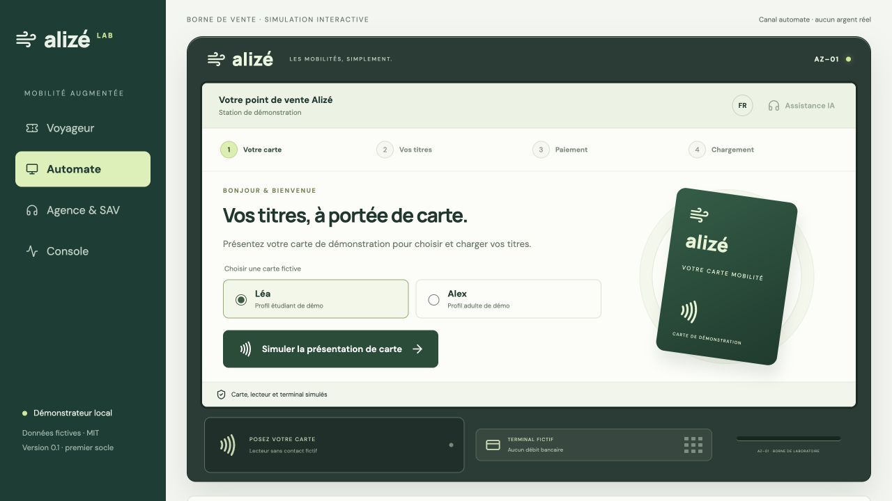

# Borne tactile simulée et précisions des IHM — 24 octobre 2026

La vue **Automate** dispose désormais d'un parcours distinct de l'espace Voyageur : un écran tactile dans un habillage de borne AZ–01, avec carte de démonstration, lecteur sans contact et terminal fictifs. Elle utilise les API métier existantes pour les tarifs, les commandes et la délivrance. Les prix sont calculés par le moteur métier, sans calcul de prix confié au modèle IA.

## Parcours de la borne

1. Choisir la carte fictive de Léa ou d'Alex, puis simuler sa présentation. Cette étape sélectionne une identité locale de démonstration ; elle ne lit aucun support NFC physique.
2. Choisir les produits transport, parking et/ou vélo avec les grandes touches de sélection.
3. Consulter le devis calculé côté serveur et confirmer explicitement ses produits et son montant. Un devis expiré doit être recalculé.
4. Créer la commande avec `channel=automate`, puis simuler son paiement sur le terminal dessiné. Ce terminal ne débite aucune carte bancaire.
5. Attendre le résultat de Temporal et Keyple. L'écran ne déclare la carte prête que si la commande est délivrée et si le SDK confirme la relecture après écriture sur carte stub.
6. Retirer virtuellement la carte et terminer la session. Le bouton de fin de session et l'inactivité ferment également le contexte de cet écran, sans effacer les commandes enregistrées.

La borne utilise `local_simulator` pour le paiement. Le parcours Bridge sandbox reste disponible dans la vue Voyageur. Les réservations et usages vélo/parking se poursuivent aussi depuis cette vue, en retrouvant la commande avec la même identité fictive.

L'assistance ouvre une fenêtre modale utilisant les agents déjà branchés. Elle n'envoie aucune demande au modèle tant que l'utilisateur n'a pas soumis de question. La voix conserve son statut expérimental ; aucun nouvel essai audio n'a été effectué.

## Sessions et reprise

Chaque présentation possède son jeton de profil, son devis, sa sélection et sa clé de commande. Les anciens résultats asynchrones sont écartés après la fermeture de cette session. La borne ne liste pas les commandes des voyageurs précédents.

Après **120 secondes sans interaction**, la borne revient à l'accueil ; un avertissement apparaît pendant les vingt dernières secondes et permet de continuer. Une opération de borne en cours suspend ce délai. Les appels métier ont un délai de réponse limité pour éviter de bloquer indéfiniment le terminal simulé. Le suivi de commande s'appuie sur les états du serveur, sans progression de chargement fictive.

Une erreur réseau ne supprime pas la clé de commande : les nouvelles tentatives réutilisent la même demande. « Reprendre le suivi » réessaie le démarrage du workflow et le signal de paiement enregistré, sans lancer une autre commande. Le statut délivré et la relecture Keyple restent les critères de réussite.

La fermeture de session ne remplace pas un dispositif d'authentification ou de sécurisation d'une borne publique. Les identités locales et leur sélection sont des fonctions de laboratoire, disponibles dans l'application de démonstration.

## Vérifications réalisées

| Vérification | Résultat |
|---|---|
| Construction TypeScript/Vite | Réussie |
| Tests d'état de la borne | 10 réussis : garde de session, confirmation du paiement, paiement déjà enregistré, relecture obligatoire, devis expiré, délais d'inactivité |
| Carte Léa, transport + parking + vélo | Devis de 12 € ; confirmation obligatoire avant création et paiement |
| Achat depuis le navigateur | Commande `order-a77ab54ffa5719eba5008672ea79674b`, canal `automate`, paiement `local_simulator` |
| Délivrance réelle dans le POC | 1 paiement fictif, 1 chargement de carte stub, relecture Keyple vérifiée |
| Inactivité | Retour automatique à l'accueil observé ; commande conservée en PostgreSQL |
| Nouvelle carte Alex | Offre transport seul à 10 € ; aucun devis ni reçu de Léa affiché |
| Fin de session manuelle | Retour à l'accueil, sélection de carte réinitialisée et devis adulte effacé de l'écran |
| Assistance | Ouverture de la modale et fermeture par Échap vérifiées, sans appel modèle ni microphone |

Le [résultat métier du test](evidence-automate-2026-10-24.json) conserve les références, montants et compteurs. Les dix tests de l'interface sont exécutés par `docker compose run --rm --no-deps web npm test` et intégrés à `make test`, donc à la vérification CI existante. Aucune nouvelle dépendance de tests n'a été ajoutée ; le lanceur utilise le test runner de Node et son support expérimental de retrait des types TypeScript.

## Précisions dans les autres vues

- **Voyageur** : espace personnel d'un site ou d'une application, historique des commandes et accès aux agents partenaires.
- **Automate** : session d'achat guidée sur une borne tactile simulée ; pas d'historique global dans son écran.
- **Agence & SAV** : consultation des dossiers et régularisations comptables fictives contrôlées par les habilitations ; aucun remboursement bancaire exécuté.
- **Console** : supervision technique de Temporal, des preuves A2A/MCP et des événements de passage fictifs. Les valideurs physiques X/Y ne sont pas connectés.

Le panneau de périmètre précise que les événements X/Y sont injectés par des simulateurs : réception et déduplication opérationnelles, sans agent constructeur A2A. Il distingue également les agents et outils partenaires opérationnels des vélos, places et opérateurs externes fictifs.

Le lecteur, la présentation de carte, le terminal bancaire et les ressources physiques restent simulés. Le SDK Keyple, Temporal, les API métier, les règles de prix et la persistance sont exécutés par les services du POC. Aucun matériel NFC, TPE réel, SAM ou réseau de transport exploitable n'a été raccordé lors de ce travail.
