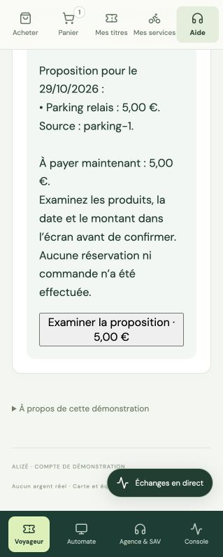

# Coopération entre organisations — correction du 28 octobre 2026

Cette correction aligne les parcours de consultation, préparation commerciale, SAV et commissions sur les responsabilités prévues dans `plan-maas-agentique.md` (§3) et `plan-implementation-poc.md` (§3–4). Le déploiement conserve deux runtimes locaux ; les compétences peuvent être regroupées sans confondre les périmètres des fournisseurs.

## Responsabilités et parcours

| Demande | Parcours |
|---|---|
| « Peux-tu me donner le tarif du parking ? » | Accueil → coordinateur Tarifs → organisation Parking → MCP de consultation Parking. |
| Disponibilité avant achat | Accueil → MaaS → fournisseur concerné → stock observé, sans engagement de réservation. |
| Offre transport + parking + vélo | Accueil → MaaS → agents des trois fournisseurs → devis déterministe → examen dans l’écran Voyageur ou Agence → confirmation métier. |
| Incident parking | Accueil → SAV → Parking → seules ses lignes, réservations et données d’usage de la commande sélectionnée ; règles MaaS en complément. |
| Commissions et répartition | Accueil → Commissions → fournisseurs concernés → contrats et parts propres à chacun ; relevé global calculé par le service métier. |
| Réserver, commencer ou terminer un usage | Confirmation dans l’écran → Temporal → `mobility_operations` → `bike_operations` ou `parking_operations` → outils d’exécution limités. |

L’assistant du conseiller passe aussi par l’Accueil : il peut demander une information tarifaire, un diagnostic SAV ou la préparation d’une vente selon la demande, dans le contexte du voyageur sélectionné.

## Organisations et données d’autorité

Le catalogue publié distingue le distributeur MaaS `alize` et les organisations `transport-alize`, `parking-relais` et `velo-partage`. Chaque fournisseur possède un identifiant, ses produits, son agent et son graphe documentaire. Les corpus FalkorDB sont `maas_demo`, `transport_demo`, `parking_demo` et `mobilites_demo` pour le vélo. Le service choisit le graphe depuis l’organisation autorisée ; le modèle ne fournit aucun nom de graphe.

Le catalogue global reste une projection publiée pour les écrans et le moteur déterministe. Les agents coordinateurs consultent les agents fournisseurs pour expliquer une offre. Les conditions d’une commande acceptée restent prioritaires sur le catalogue courant.

Chaque ligne de nouveau devis conserve le fournisseur, son organisation et l’instantané du contrat fournisseur-vendeur, avec son taux et sa version. Le relevé conserve les agrégats existants et expose `per_provider` : montant prépayé, régularisation, prix net, commission, part fournisseur et créance postpayée. Les commissions sont arrondies par ligne avant totalisation. Le récapitulatif de proposition affiché au voyageur est produit directement depuis le devis structuré ; les montants transmis au modèle sont déjà formatés en euros et pourcentages, sans conversion de centimes à lui demander. Une régularisation peut viser un produit ; sinon elle est ventilée au prorata des montants restants, avec conservation des centimes.

Les anciens devis utilisent leurs conditions et leur taux enregistrés. La migration du stock copie une seule fois les données de l’ancien identifiant ; elle ne recrée pas de ressources déjà réservées. Les réservations et événements existants restent accessibles.

## Lecture et exécution

Le contexte de coordination signé lie l’acteur, son organisation, son rôle, le voyageur, le vendeur et la commande sélectionnée. Une délégation `maas-provider-read` donne accès à une seule organisation et, pour un dossier, à ses seules lignes et usages. Elle ne peut pas autoriser une écriture partenaire.

`read_provider_context` ne nécessite aucune commande pour consulter les offres et le stock. La disponibilité est datée et explicitement sans garantie de réservation. La préparation d’un devis ne crée ni achat ni réservation ; les écrans demandent toujours leur propre consentement avant commande et paiement.

Les agents de consultation et les agents d’exécution sont des points d’entrée distincts. Les autorisations d’exécution conservent l’action, la commande, le partenaire et le fournisseur IA déjà confirmés. Les services vérifient les droits, le stock, les transitions, l’idempotence et le reçu persistant.

Le runtime impose une consultation sourcée si le modèle d’un coordinateur ou d’une organisation omet son premier appel de consultation. Ce contrôle est nécessaire notamment parce que l’adaptateur Ollama installé ne transmet pas `tool_choice`. Il emprunte la boucle d’outils Agno habituelle, avec une lecture limitée au périmètre autorisé. Un échec de consultation se propage à l’API ; un simple texte de réponse ne suffit pas à valider le parcours.

## Vérifications

Validation finale : **107 tests Python, 33 tests web et 5 tests du runtime réussis**. Les cinq parcours passent avec le double de modèle et avec Ollama réel. Les six actions confirmées du cycle vélo/parking passent aussi. [Rapport de preuve](evidence-cooperation-organisations-2026-10-28.json).

Sur cette exécution locale, les cinq demandes ont pris entre 30,89 s et 170,67 s. La coopération est vérifiée ; la latence locale reste un axe d’amélioration.

- Tests Python : règles tarifaires, contrats distincts, versions acceptées, ventilation des régularisations, arrondis par ligne, conservation des montants, isolation fournisseur/voyageur, migration du stock et contrôles existants.
- Tests du runtime : consultation obligatoire pour le SAV et le fournisseur, synthèse après retour outil, aucun outil d’exécution généré par ce contrôle.
- `make test-cooperation` : cinq parcours sur de véritables échanges A2A/MCP avec un double de modèle explicitement simulé.
- `make test-cooperation-local` : mêmes cinq parcours avec Ollama réel ; les preuves sont écrites dans `data/cooperation-evidence/cooperation-ollama.json`.
- `make test-partners` : cycles d’usage confirmés, reçu métier, stock restauré, événements dédupliqués et accès hors périmètre refusés.

Contrôle visuel dans le navigateur : la proposition Parking affiche 5,00 €, puis ouvre le panier à la date demandée. Le consentement est décoché et le bouton de confirmation reste désactivé.

[Panier avant consentement](cooperation-panier-confirmation-2026-10-28.jpg).

Les rapports antérieurs datés décrivent l’ancienne version ; les parcours courants sont dans le dossier `docs/architecture/` et ce document. La vérification de justificatifs et les connecteurs industriels restent les extensions identifiées dans le périmètre général du projet.
