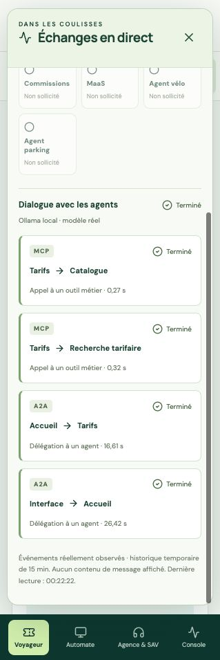
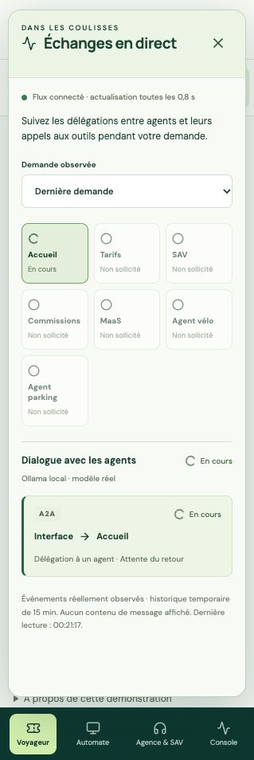

# Échanges entre agents en direct

Ajout du 28 octobre 2026, intégré aux interfaces Voyageur, Automate, Agence/SAV et Console. Le panneau **Échanges en direct** s’ouvre automatiquement lorsqu’une demande est envoyée à l’assistant ou lorsqu’une action partenaire est confirmée. Son bouton permet aussi de l’ouvrir manuellement ; la croix ou Échap le ferme.

## Ce qui est affiché

- Agents sollicités, avec état en cours, terminé ou en échec ; les autres restent indiqués comme non sollicités.
- Pour chaque échange : émetteur, destinataire, protocole A2A ou MCP et durée mesurée au retour.
- Dernière demande par défaut, ou choix d’une demande récente.
- Fournisseur réel Ollama/OpenAI ou modèle de test explicitement simulé. Les outils partenaires restent identifiés comme services simulés.
- État de la connexion au suivi et reconnexion automatique après interruption.

Exemple observé : **Interface → Accueil → Tarifs**, puis **Tarifs → Catalogue** et **Tarifs → Recherche tarifaire**. L’ordre des appels est celui choisi et exécuté par le runtime ; la vue ne préprogramme pas d’étapes fictives. Le statut des appels ne représente pas une progression interne du modèle.

## Collecte

Le runtime publie des événements de début et de fin autour des appels HTTP A2A et des appels MCP existants. L’API ouvre une demande corrélée lors de `/api/chat` ou de la coopération partenaire lancée par Temporal. Un identifiant de suivi est propagé entre runtimes. Les publications utilisent un jeton dédié au suivi (`ACTIVITY_TOKEN`) et le JWT du demandeur ; un utilisateur du navigateur ne peut pas publier avec son seul JWT. Le jeton global des services métier n’est pas communiqué aux agents pour cette fonction.

La vue lit un flux incrémental via `GET /api/agent-activity?after=<curseur>`, toutes les **800 ms**, sans requêtes concurrentes du panneau. Il s’agit d’un rafraîchissement périodique, pas d’un WebSocket ou de SSE. La fermeture arrête ce rafraîchissement. Après redémarrage de l’API, le changement de génération provoque une remise à zéro du curseur.

Les événements contiennent uniquement les identifiants techniques, acteurs, protocole, état, horodatage et durée. Aucun prompt, résultat d’outil, transcription ou jeton n’entre dans ce flux. Le voyageur ne consulte que ses propres demandes ; Console et superviseur peuvent consulter celles de leur organisation. Les autres organisations restent exclues.

Les demandes expirent à quinze minutes et la lecture déclenche leur nettoyage. Les tampons sont bornés à 64 demandes et 4 096 événements côté API ; la vue propose les vingt dernières demandes et conserve au plus 512 échanges. Une rupture dans le tampon est signalée. Le flux est en mémoire, perdu au redémarrage, et ne remplace pas l’audit métier persistant.

La publication par les agents est facultative et limitée à 700 ms : une panne du suivi n’interrompt ni un outil métier ni un échange A2A. Dans ce cas, des événements peuvent manquer. Cette vue ne remplace pas la corrélation distribuée OpenTelemetry, qui reste à compléter.

## Vérifications

**84 tests Python et 20 tests front réussis**, construction TypeScript/Vite réussie. Les nouveaux contrôles couvrent authentification, refus de publications depuis le navigateur, propriétaire exact du suivi, organisation, expiration, limites, lecture incrémentale, début/échec, éviction sans interruption métier et fusion des états sans doublons ou régression.

Test réel local : **Qwen3:14b → Accueil → A2A Tarifs → MCP Catalogue et Recherche tarifaire**. Huit événements ont été reçus, dont les événements de début alors que la réponse n’était pas encore terminée. L’échange complet a duré 47,314 secondes ; catalogue 0,332 s, recherche 0,448 s et délégation Tarifs 20,648 s. Le compte Alex ne pouvait consulter aucun événement de cette demande Léa. Preuve locale, hors Git : `data/activity-evidence/agent-activity-local.json`.

Les six opérations vélo/parking (réserver, démarrer, terminer) ont également passé le test de protocole existant, avec Agno/A2A/MCP réels et un **double déterministe de modèle**. Stock rétabli et contrôles de confirmation, de périmètre et de déduplication réussis. Ce test n’est pas présenté comme une inférence LLM partenaire.

Une lecture du flux après ces opérations a confirmé, pour chacun des six suivis, la délégation MaaS vers le runtime partenaire séparé et les deux outils de disponibilité et d’action. Le flux contenait alors 68 événements, en incluant le dialogue local précédent.

Test final depuis le navigateur : envoi de « Pourquoi le tarif étudiant est-il de 7 € ? » dans Voyageur/Aide. Ouverture automatique du panneau pendant le calcul, puis appels Catalogue (0,27 s), Recherche tarifaire (0,32 s), délégation Tarifs (16,61 s) et réponse globale (26,42 s). Le panneau reste ouvert après la réponse. Vérification visuelle sur la largeur mobile de l’interface intégrée.





Commandes réexécutables après construction :

```sh
docker compose build api agents web
docker compose up -d --no-deps api agents partners mcp partner-mcp web
make test-agent-activity
make test-agent-activity-local   # exige Ollama local déjà sélectionné ; aucun basculement cloud
```

Pour une démonstration, se connecter comme Léa, ouvrir Aide puis envoyer une question tarifaire. Le panneau s’ouvre pendant le calcul. Les fonctions déterministes comme le calcul d’un panier ne créent pas artificiellement des échanges entre agents.
