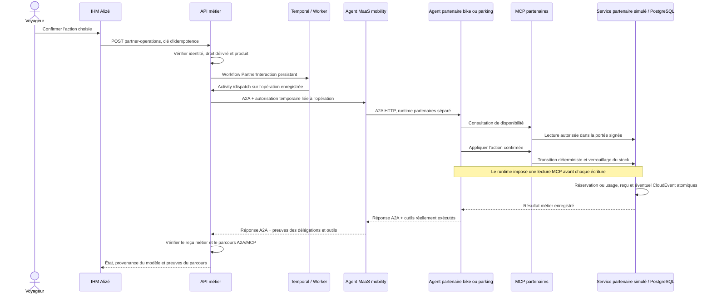
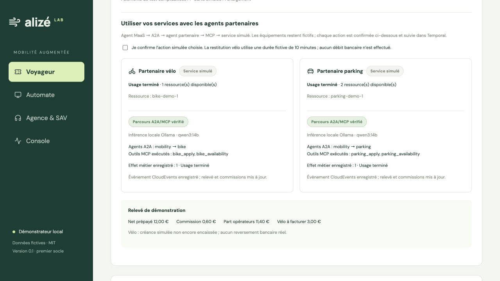

# Agents partenaires vélo et parking — 24 octobre 2026

La coopération agentique est désormais exécutée pour les deux partenaires : **agent MaaS → A2A HTTP → agent vélo ou parking → MCP HTTP → service métier simulé avec état**. Temporal orchestre l'interaction et ses reprises. Les protocoles et agents Agno sont réels ; les ressources et les opérateurs externes sont fictifs.

## Architecture implémentée



Le runtime MaaS expose cinq agents : `conversation`, `tariffs`, `sav`, `clearing`, `mobility`. Le service Docker `partners` expose deux agents Agno : `bike` et `parking`. `partner-mcp` expose `bike_availability`, `bike_apply`, `parking_availability`, `parking_apply`. Les quatre outils de lecture billettique existants restent dans le service `mcp`.

Les deux agents partenaires partagent un runtime séparé du runtime MaaS. Leurs services métier simulés sont hébergés dans l'API du POC et PostgreSQL ; il ne s'agit pas de deux opérateurs externes avec authentification fédérée et bases indépendantes.

## Actions et garanties

- **Réserver** : attribuer une ressource libre, deux vélos et deux places fictives au départ.
- **Démarrer** : passer de réservation à usage actif.
- **Terminer** : restituer le vélo ou sortir du parking, libérer la ressource et enregistrer un CloudEvent.
- **Annuler** : libérer une réservation non utilisée ; une nouvelle réservation reçoit une nouvelle référence.

Chaque action nécessite une commande délivrée contenant le produit correspondant et une confirmation explicite. Le jeton de dix minutes lie l'opération, le voyageur, son organisation, le partenaire, l'action, le mode de test et le fournisseur IA choisi. Il reste dans les échanges serveur : il n'est pas transmis au modèle ni retourné au navigateur. Les outils d'écriture ne prennent aucun argument permettant au modèle de modifier la commande, l'action ou la durée.

Le runtime impose un appel MCP de disponibilité avant chaque écriture, y compris si le modèle oublie cet appel ou tente des outils en parallèle. Cette précondition est exécutée par le code du runtime ; elle n'est pas présentée comme une décision autonome du modèle. L'attribution finale dépend d'un verrou PostgreSQL et du moteur d'états déterministe.

Le stock, l'état de la réservation, le reçu de l'opération et l'événement de fin d'usage sont persistés dans une transaction. La répétition d'une clé conserve la même opération. Une répétition de l'effet retrouve le reçu, sans attribuer une deuxième ressource ni créer une seconde créance. Les événements des partenaires et les injections manuelles de la console partagent le même registre CloudEvents et ses contrôles de doublons.

Le texte produit par le LLM ne prouve jamais la réservation : l'API vérifie le résultat métier persisté, les identifiants des agents délégués et les outils MCP exécutés. Les preuves de protocole proviennent du runtime, pas d'une déclaration du modèle.

Une panne du Worker laisse le workflow dans Temporal. Une panne pendant l'interaction peut relancer la même opération ; l'effet reste idempotent. Après épuisement des tentatives ou un refus métier, l'utilisateur peut confirmer **Reprendre l'opération confirmée** : un nouveau parcours Temporal reprend la même opération, conserve les erreurs précédentes et respecte le reçu déjà enregistré. **Relancer le suivi Temporal** réessaie aussi le démarrage d'une opération persistée dont le workflow n'aurait pas été lancé.

Le fournisseur IA est lié à l'opération. Un changement de fournisseur entre confirmation et exécution ne déclenche aucun basculement automatique. Les réservations applicatives cloud existantes s'appliquent aux tentatives OpenAI ; les essais décrits ici utilisent Ollama ou un double de modèle, sans appel OpenAI.

## Tests effectués

| Vérification | Résultat |
|---|---|
| Suite Python | 71 tests réussis ; contrôles du mode désactivé, des autorisations et de la lecture des réponses A2A couverts |
| Agent Cards A2A | 5 agents MaaS et 2 agents partenaires découverts sur leurs runtimes |
| Cycle complet, modèle déterministe | Vélo et parking : réserver, démarrer, terminer ; vrais échanges A2A/MCP et workflows Temporal |
| Cycle complet, modèle réel | Qwen3:14b local, six actions terminées et preuves de délégation/outils présentes |
| Stock et comptabilité | Stock restauré ; deux CloudEvents ; vélo de 600 secondes donnant une créance simulée de 3 € |
| Répétitions | Même opération ; un seul paiement local et chargement carte ; réinjection des événements sans seconde créance |
| Concurrence PostgreSQL | Trois réservations simultanées pour deux vélos : deux ressources distinctes attribuées et un refus |
| Reprise après refus | Demande refusée reprise après libération du stock ; confirmation et contrôle d'accès requis |
| Arrêt du Worker | Workflow mis en attente sans effet, puis A2A/MCP exécutés une fois au redémarrage |
| Autorisations | Voyageur tiers refusé ; jeton voyageur ordinaire refusé sur les outils d'écriture ; outil d'un autre partenaire refusé ; confirmation obligatoire |
| Non-régression billettique | Achat, reprise carte, doublons multiconstructeurs, facture vélo, SAV OPA et commissions testés à nouveau |
| IHM | Construction TypeScript/Vite réussie ; contrôles de réservation et provenance du parcours affichés |

Preuves : [modèle réel Ollama](evidence-partenaires-ollama-2026-10-24.json), [cycle de protocole sans LLM](evidence-partenaires-fixture-2026-10-24.json), [concurrence et reprise](evidence-partenaires-concurrence-2026-10-24.json), [reprise du Worker](evidence-partenaires-reprise-2026-10-24.json).

Un contrôle complémentaire de [réservation et annulation avec réponses textuelles](evidence-partenaires-reponses-2026-10-24.json) vérifie aussi les réponses A2A renvoyées par Agno dans `history`, sans `artifacts`. L'annulation a nécessité trois tentatives du workflow ; le reçu métier et le stock ont conservé un seul effet. La réponse du modèle est consultable dans l'IHM, séparément du reçu déterministe.



Lors d'une exécution locale, les six opérations ont pris entre **13,4 et 34,8 secondes chacune**, avec Qwen3:14b. Il s'agit d'un relevé ponctuel, pas d'une garantie de latence. Le parcours est asynchrone et suivi dans l'IHM ; il ne constitue pas le dialogue vocal à faible latence prévu par ailleurs.

Un premier essai local avait révélé un appel d'écriture avant consultation de disponibilité. Le service l'a refusé sans début d'usage. La précondition imposée par le runtime corrige ce cas ; la réservation de cet essai a été annulée par un parcours A2A/MCP de test, avec conservation de l'historique.

## Reproduire

Après construction et démarrage du socle :

```sh
make test-partners
make test-partners-concurrency
make test-partners-resilience
make ai-local
make test-partners-local
```

Ces scénarios partagent le stock de démonstration : les exécuter successivement, avec les deux vélos libres avant le test de concurrence. Ils ajoutent des commandes fictives et conservent l'historique. Les fixtures utilisent un double de modèle explicitement identifié et des opérations marquées `test_only` préparées par le script ; le point d'entrée utilisateur ne permet pas de créer des opérations fixture. Les tests sont inclus dans `make verify`, sans appel cloud implicite. La configuration GitHub Actions n'a pas été exécutée sur GitHub pendant ce travail.

Dans l'IHM, choisir une commande délivrée puis **Utiliser vos services avec les agents partenaires**. Confirmer chaque action, attendre le résultat Temporal et lire le reçu A2A/MCP. Les boutons vélo/parking qui injectaient directement une fin d'usage ont été remplacés par ce parcours. L'API d'injection manuelle d'événements reste disponible pour les tests de connecteurs et d'incidents.

## Limites conservées

Un cycle d'usage terminé par partenaire et par commande ; plusieurs réservations sont possibles avant usage si les précédentes sont annulées. La durée vélo est explicitement simulée à dix minutes dans l'IHM. Pas de géolocalisation, d'ouverture de barrière, de déverrouillage physique, de réservation chez un fournisseur externe ni d'encaissement bancaire postpayé. Le tarif et les commissions viennent toujours du moteur métier et des conditions du devis accepté.

Les nouveaux parcours ont été validés avec Qwen3 local et le modèle de test. L'option OpenAI utilise le même fournisseur Agno déjà intégré, mais ce nouveau cycle partenaire n'a pas été exécuté avec OpenAI. Le graphe, les notifications bancaires publiques, la voix et les autres extensions conservent les limites décrites dans le README.

Référence du protocole utilisé : [interfaces A2A d'Agno](https://docs.agno.com/agent-os/interfaces/a2a/introduction). La compatibilité est vérifiée par les échanges sur la version Agno figée dans le projet.
