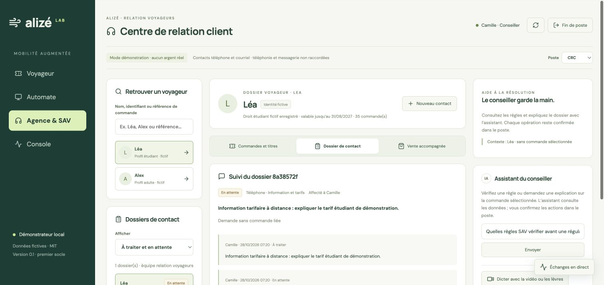

# Poste conseiller en gare et en centre de relation client

Refonte du 28 octobre 2026. La vue **Agence & SAV** ouvre un poste de relation voyageurs dédié, distinct de la console technique et du parcours Voyageur.

## Parcours du conseiller

1. **Prendre son poste** : choisir Agence en gare ou CRC, puis le profil de démonstration Camille (conseiller) ou Sam (superviseur). La session est locale et simulée ; aucun SSO d’entreprise n’est présenté comme raccordé.
2. **Retrouver un voyageur** par nom, identifiant ou référence de commande. Les profils fictifs Léa et Alex proviennent du socle existant. Une recherche par référence sélectionne la commande correspondante du voyageur.
3. **Consulter le dossier** : profil tarifaire, commandes, canal de vente, règlement, état de délivrance, régularisations, net prépayé et historique des usages effectivement enregistrés. Le changement de voyageur remplace le contexte de consultation et de l’assistant.
4. **Ouvrir un dossier de contact** : accueil en gare, téléphone ou courriel ; motif, demande initiale et éventuelle commande liée. Le dossier est affecté au conseiller connecté. Les notes et états À traiter / En attente / Résolu sont persistés ; une réponse est requise avant clôture. Les dossiers peuvent être rouverts.
5. **Vendre avec le voyageur** : choisir les produits et la date, calculer un devis avec le vendeur Agence Alizé, recueillir la confirmation, créer la commande puis enregistrer le règlement local simulé. Le suivi conserve les mécanismes Temporal et la vérification de délivrance existants. Le lien Bridge sandbox reste disponible si cette intégration est activée, sans envoi automatique au voyageur.
6. **Régulariser une commande** : montant en euros, motif, confirmation de la référence et reçu de l’opération. Le conseiller est limité à 5 € par opération ; le superviseur à 1 000 €, toujours dans la limite du prépayé restant. Le serveur conserve le contrôle OPA et l’idempotence. Aucune opération n’est déduite d’une réponse de l’IA.

Le poste en gare met en avant l’accueil physique ; le CRC propose le téléphone comme canal initial. Les modes partagent le dossier du voyageur et les dossiers de contact de l’équipe. Le canal reste une donnée saisie par le conseiller : le POC ne simule pas une véritable ligne téléphonique connectée, une file d’appels ou une boîte de courriels. Lecteur physique, terminal et imprimante ne sont pas raccordés. Le chargement s’effectue sur la carte stub existante.

## Organisation de l’écran

Sur bureau : recherche et dossiers de contact à gauche, dossier voyageur et actions au centre, assistant du conseiller à droite. Les trois onglets de travail sont **Commandes et titres**, **Dossier de contact** et **Vente accompagnée**. Les colonnes se réorganisent sur petit écran. Les échanges entre agents restent accessibles dans le panneau en direct.

L’assistant SAV reçoit la commande sélectionnée et consulte les API métier dans le périmètre du conseiller. Les notes de contact ne sont pas automatiquement envoyées au modèle ni injectées dans le graphe. Elles sont conservées dans PostgreSQL pour le suivi humain.

## Données et contrôles

`services/api/maas/agency.py` ajoute :

- `GET /api/agency/cases` : les cent dossiers récents de l’organisation, réservés aux conseillers et superviseurs ;
- `GET /api/agency/cases/{id}` : demande, notes et statut ;
- `POST /api/agency/cases` : création idempotente avec validation de la liaison voyageur/commande ;
- `POST /api/agency/cases/{id}/updates` : note et changement de statut, avec révision attendue, verrou transactionnel et clé d’idempotence.

Un dossier d’une autre organisation est inaccessible. Les voyageurs et le profil Console ne peuvent consulter ces dossiers. Un conflit de modification renvoie 409, conserve la note saisie dans le poste et demande de relire le dossier actualisé. Les notes sont bornées à 2 000 caractères et cent entrées par dossier. Les opérations sont auditées avec leurs références et leur auteur ; le journal d’audit ne recopie pas le texte des notes.

La vente et la régularisation réutilisent les API métier existantes. Un devis expiré, d’un autre voyageur, d’une autre sélection ou du vendeur Application ne peut confirmer une vente agence. Les confirmations sont réinitialisées au changement de contexte. Les reprises réseau utilisent la même clé d’intention.

## Vérifications

**89 tests Python et 24 tests du frontal réussis**, construction TypeScript/Vite réussie. Les nouveaux contrôles couvrent rôles et organisation, liaison client/commande, création et mise à jour sans doublon, concurrence de révision, clôture documentée, saisie en euros, plafonds et prépayé restant, devis devenu obsolète et recherche d’une référence appartenant au bon voyageur.

Test complet sur les services locaux : vente agence transport pour Léa à **7 €**, règlement simulé, délivrance vérifiée sur carte stub, ouverture d’un contact CRC téléphonique, refus serveur d’une régularisation de **6 €** par le conseiller, régularisation de **2 €** rejouée sans second effet, puis note et clôture du dossier. Deux notes persistées, une seule régularisation de 2 €. Aucun remboursement bancaire exécuté. Preuve locale hors Git : `data/agency-evidence/agency-crc.json`.

Essai navigateur sur bureau : ouverture du poste CRC, sélection de Léa, consultation d’une commande, création d’une demande téléphonique **sans commande liée**, ajout d’une note et mise en attente. Le dossier et son historique sont retrouvés après sélection d’Alex puis retour au dossier de Léa ; aucune commande d’Alex ou commande implicite n’est associée à la demande.

Contrôles finaux : recherche d’une référence ancienne ouvrant bien cette commande, devis agence de Léa à 7 € puis disparition de ce devis au passage à Alex, conservation des notes après rechargement, et navigation sur petit écran qui amène directement au dossier choisi. Le poste en gare est laissé ouvert dans l’interface de démonstration.

```sh
docker compose build api web
docker compose up -d --no-deps --wait api web
make test-agency
```

Le test de bout en bout utilise les services du socle et ajoute uniquement des données de démonstration ; il conserve les volumes et les dossiers existants.


