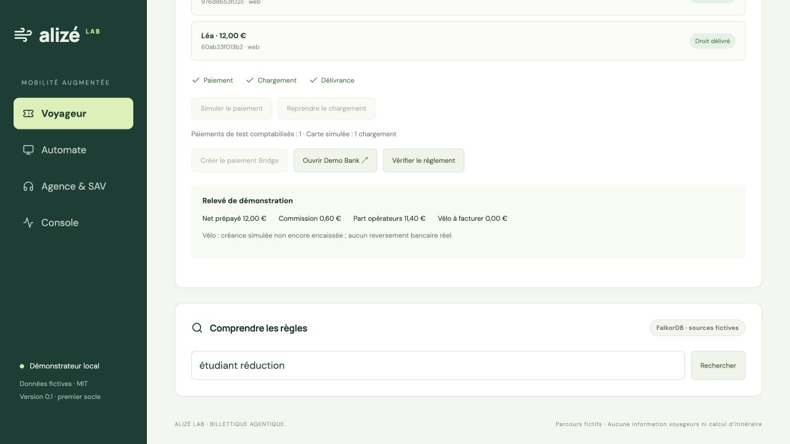

# Paiement Bridge sandbox de bout en bout — 24 octobre 2026

Le parcours **achat → Bridge Pay by Link → Demo Bank → relecture serveur → Temporal → Keyple** a réussi sur Docker Desktop Mac. Le montant est de **12 € fictifs** ; aucune banque réelle et aucun argent réel ne sont utilisés. La confirmation des CGS a été donnée explicitement par l'utilisateur avant de poursuivre le parcours.

## Preuves observées

| Contrôle | Résultat |
|---|---|
| Commande | `order-6eff2bd926743a200ec38aca2b56120a` |
| Payment link Bridge | `01a16ef5-48cb-7a92-a13b-76a09156fc5b` |
| Payment request issue de Demo Bank | `01a16ef555dd7e94b6cd5c4b46a3e13b` |
| Avant confirmation bancaire | Statuts `CREA`, puis `ACTC` ; 0 paiement, aucune carte chargée |
| Parcours navigateur | Bannière environnement de test, Demo Bank, compte fictif avec validation SMS, code de test, confirmation de 12 € |
| Confirmation serveur | Statut `ACSC` de la demande et de sa transaction, montant 12 EUR, référence de la commande vérifiée |
| Temporal | Commande passée à `fulfilled` après signal de paiement confirmé |
| Keyple | 1 chargement sur carte stub ; relecture après écriture vérifiée par le SDK |
| Répétition de la création du lien | Même identifiant, aucun second lien créé par le point d'entrée applicatif |
| Répétition du contrôle bancaire après fin du workflow | Réponse correcte, toujours 1 paiement et 1 chargement |
| Répétition de la confirmation de commande | Même commande grâce à la clé d'idempotence |
| Tentative de paiement par le simulateur sur cette commande Bridge | Refus HTTP 409 |
| Relevé | 12 € prépayés ; commission agence 0,60 € ; part opérateurs 11,40 € |

Le [résultat JSON](evidence-bridge-2026-10-24.json) contient les compteurs et références du test. Il ne contient aucun secret. Le relevé calcule une répartition ; aucun reversement bancaire n'est exécuté.



## Adaptation au compte sandbox disponible

Le compte autorise Pay by Link avec son bénéficiaire configuré. La création directe de payment requests retourne HTTP 403 ; l'ajout d'un bénéficiaire dynamique retourne également 403, code `payment_link.dynamic_beneficiary_not_allowed`. L'adaptateur utilise donc `BRIDGE_FLOW=payment_link` et `BRIDGE_BENEFICIARY_MODE=default`. Les identifiants sélectionnent exclusivement la sandbox et le connecteur choisit Demo Bank, identifiant `574`.

Un premier lien de test a expiré avant la saisie bancaire. Son scénario est archivé dans le volume de preuves ; sa commande reste visible en rapprochement pour conserver l'historique. Le scénario réussi utilise une nouvelle commande et un lien d'une heure. Aucun statut de paiement n'a été forcé dans la base pour faire réussir le test.

Le callback navigateur n'est jamais utilisé comme preuve de paiement. Le serveur lit le lien puis recherche la demande associée par `payment_link_id`. Un lien `completed` ne suffit pas : seule la confirmation bancaire exacte `ACSC` déclenche la délivrance. Zéro demande signifie attente ; plusieurs tentatives imposent ici un rapprochement manuel.

Une création distante dont la réponse est perdue reste incertaine et ne fait pas l'objet d'une nouvelle création automatique. Les refus HTTP explicites sont enregistrés séparément avec un code assaini. Le contrôle bancaire peut être répété après la fin du workflow sans tenter un second effet métier.

## Reproduire

Après configuration locale des secrets sandbox et démarrage du socle :

```sh
make test-bridge-prepare
# Ouvrir consent_url dans le navigateur.
# Demo Bank : identifiant public de test id-acsc ; mot de passe fictif > 6 caractères.
# Choisir le compte avec SMS ; code de test > 6 caractères ; confirmer 12 € fictifs.
make test-bridge-status
make test-bridge-verify
```

Le scénario conservé dans `/proofs/bridge-e2e-success.json` interdit une nouvelle préparation implicite. Sur un essai non payé, l'option explicite `prepare --new` archive le scénario et crée une nouvelle commande sans effacer l'ancienne. Un essai déjà payé est préservé et refuse cette option. Les commandes de vérification relisent Bridge et ajoutent au besoin le signal de reprise ; elles n'initient aucun second paiement.

## Limites du test

Vérifications automatiques après les corrections : **55 tests Python réussis**, construction TypeScript/Vite réussie, scénario de sécurité réussi (accès interorganisation refusés, JWT absent refusé, notification non signée refusée, aucune réservation de budget cloud). Les contrôles du refus d'un service désactivé s'exécutent uniquement lorsque ce service est effectivement désactivé ; ici Bridge et Ollama sont actifs. L'analyse des sources n'a trouvé aucune clé OpenAI ni aucun secret Bridge ; `.env` est exclu et conserve les permissions `0600`. La suite Python conserve un avertissement de dépréciation `websockets.legacy`.

La confirmation a été obtenue par **relecture serveur à la demande**. Aucun secret webhook ni callback public n'a été configuré : la livraison réelle de notifications signées depuis Bridge n'a pas été testée. Les contrôles locaux couvrent la signature sur corps brut et la distinction entre identifiants de lien et de demande. Aucun tunnel public n'a été ouvert.

La carte et le lecteur sont des stubs ; le SDK Keyple est réel. Aucun titre exploitable sur un réseau de transport n'a été produit. Le remboursement bancaire, l'encaissement postpayé et les reversements aux partenaires restent hors de ce parcours.

Documentation fournisseur consultée : [Demo Bank et scénarios de test](https://docs.bridgeapi.io/docs/testing-your-payment-flow), [création d'un lien](https://docs.bridgeapi.io/docs/create-your-first-payment-api), [recherche des demandes d'un lien](https://docs.bridgeapi.io/reference/getpaymentrequests), [statuts de liens et différence avec l'exécution bancaire](https://docs.bridgeapi.io/docs/payment-links-statuses-1), [notifications de paiement](https://docs.bridgeapi.io/docs/payments-account-webhooks), [signature sur corps brut](https://docs.bridgeapi.io/docs/secure-your-webhooks).
