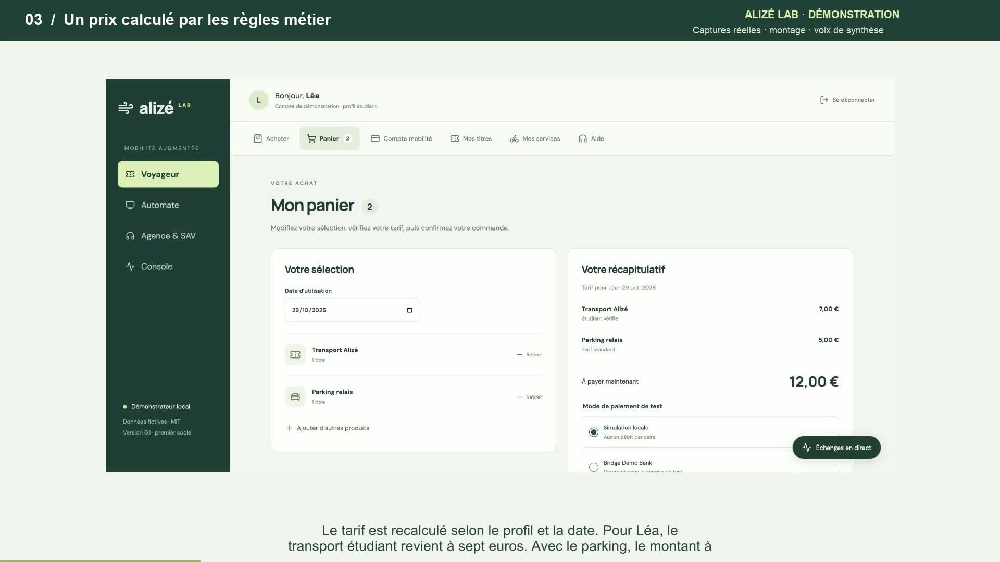

# Vidéo de démonstration Alizé Lab

Version française du **29 octobre 2026**, fondée sur l’interface réelle du démonstrateur local.

[Voir ou télécharger la vidéo MP4](alize-lab-demo-2026-10-29.mp4) · [Sous-titres SRT](alize-lab-demo-2026-10-29.srt) · [Transcription](alize-lab-demo-2026-10-29-transcription.md)

## Contenu

La vidéo présente la connexion Voyageur, le panier, une commande Transport/Parking, son paiement simulé et la délivrance sur carte stub ; puis le compte mobilité ABT, l’échéancier, une consultation réelle Ollama avec échanges A2A/MCP, le poste agence en gare, le suivi d’un contact en CRC, la borne et les options webcam/audio.

| Début | Séquence |
|---|---|
| 00:00 | Bienvenue dans Alizé Lab |
| 00:11 | Composer son panier |
| 00:21 | Un prix calculé par les règles métier |
| 00:34 | Commande, paiement, délivrance |
| 00:44 | Un titre chargé et relu |
| 00:56 | Le compte mobilité ABT |
| 01:10 | Droits et échéances visibles |
| 01:24 | Poser une question aux agents |
| 01:35 | Voir les échanges pendant l’exécution |
| 01:49 | Une réponse issue des outils métier |
| 02:00 | Un poste conseiller en gare |
| 02:13 | Le même dossier au centre de relation client |
| 02:26 | Un parcours dédié à la borne |
| 02:38 | Webcam locale, audio facultatif |
| 02:53 | Des parcours réunis, des responsabilités claires |

## Format et réalisation

- **3 min 04 s**, 1920 × 1080, 16:9, 25 images/s ; vidéo H.264 et audio AAC stéréo. Taille d’environ 7 Mo.
- Quinze chapitres dans le MP4, sous-titres français incrustés et fichier SRT séparé.
- Voix off de synthèse française générée localement avec la voix Thomas de macOS. Elle commente la démonstration ; elle n’est pas une réponse vocale de l’assistant.
- Montage de captures réelles, avec coupes et attentes raccourcies. La séquence agents inclut des captures successives pendant l’exécution ; ce montage ne mesure pas la latence du modèle.

## Périmètre et vérifications

Les données et opérations sont fictives. Le tournage a créé une commande payée dans le simulateur local, puis consulté un compte ABT et un dossier CRC préexistants. Aucun règlement Bridge n’a été effectué pour cette vidéo. Le passage webcam montre la configuration et l’option audio décochée : les appareils personnels n’ont pas été activés et aucune image n’a été transmise à OpenAI.

Le fichier complet a été décodé sans erreur avec FFmpeg. Les flux, la résolution, la durée et les quinze chapitres ont été contrôlés avec FFprobe ; des images des séquences principales ont été inspectées et le niveau audio vérifié. Ces contrôles portent sur le livrable vidéo. Les [audits fonctionnels](../audit-tests-hors-abt-2026-10-29.md) précisent les essais et limites du démonstrateur.

Les captures brutes et fichiers de montage restent dans le dossier local `artifacts/demo-video-2026-10-29/`, exclu de Git. Ce dossier documentaire conserve la vidéo livrée, son aperçu, ses sous-titres et sa transcription. Voir aussi le [guide de démonstration](../guide-demonstration.md) et l’[index de la documentation](../README.md).
