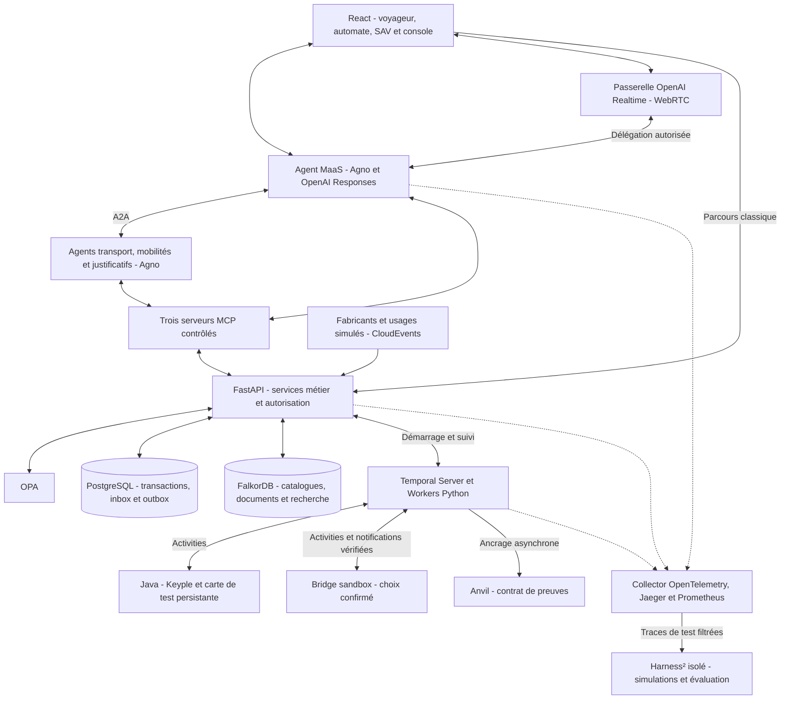

# Plan d’implémentation — POC MaaS agentique

> Code original et documentation sous [licence MIT](LICENSE), copyright 2026 Benjamin Maillard. Les composants tiers conservent leurs licences.
>
> Plan établi le 23 octobre 2026. **Réalisation engagée le 24 octobre :** une première version locale exécutable est maintenant disponible. Le présent document reste le plan cible ; consulter le [README](README.md) pour les composants effectivement testés, les simulations et les intégrations restant à valider. Le texte OpenAI et Ollama ainsi que l'authentification Bridge ont été testés ; aucun paiement réel n'a été exécuté.
>
> Références de périmètre : [proposition de POC](proposition-poc-maas-agentique.md) et [architecture cible](plan-maas-agentique.md).

## 1. Décisions et périmètre

### Choix confirmés par Benjamin

| Décision | Choix |
|---|---|
| Exécution | Docker Compose sur Mac Apple Silicon, puis portabilité vers Linux. |
| Agents et modèles | Agno et API cloud OpenAI pour les agents métier. |
| Voix | Passerelle audio OpenAI dédiée autorisée ; délégation aux agents Agno. |
| Graphe | FalkorDB. |
| Budget IA | Enveloppe de départ de 50 € par mois pour les essais OpenAI. |
| Paiement | Bridge en premier pour la sandbox France/zone euro ; TrueLayer en alternative si l’accès ou les capacités ne conviennent pas. Aucun compte prestataire existant. |
| Licence du code original | MIT. |
| Technologies à montrer | A2A, MCP, GraphRAG, Temporal, OPA, CloudEvents, OpenTelemetry, Keyple, blockchain locale et expérience Harness². |
| Hors réalisation actuelle | Calcul d’itinéraires, IV, lecture labiale, argent réel, certification bancaire et équipements physiques obligatoires. |

### Décision bancaire confirmée

Prestataire bancaire confirmé par Benjamin : **Bridge en premier, TrueLayer en alternative**. L’accès effectif, les identifiants et les capacités de la sandbox seront vérifiés au lot 0. Si Bridge ne convient pas, documenter le motif du recours à TrueLayer. Aucune création de compte n’est effectuée par ce plan.

Les choix techniques détaillés ci-dessous sont des recommandations de réalisation. Une modification qui change le fournisseur, ajoute un service obligatoire, dépasse le budget ou élargit le périmètre sera soumise à Benjamin avant le travail concerné.

### Scénario commun

Une étudiante achète une offre transport + vélo + parking sur un parcours prédéfini. Les agents expliquent son éligibilité, obtiennent ses confirmations et coordonnent la vente. Une panne après paiement démontre la reprise. Deux fabricants simulés remontent les validations. La consommation, les commissions et une régularisation SAV sont calculées. Les preuves sont ancrées sur la chaîne locale et les opérations sont visibles dans la console.

Autopartage et covoiturage disposent de fiches d’offres et de transitions simples sur le même connecteur partenaire ; ils n’exigent pas un second parcours complet.

## 2. Pile logicielle proposée

Les numéros ci-dessous fixent une famille cible lorsqu’elle est utile. Les versions exactes, images et dépendances transitives seront verrouillées après les essais du lot 0. Aucun tag `latest` ou `edge` ne doit subsister dans la livraison reproductible.

| Couche | Choix proposé | Responsabilité |
|---|---|---|
| Interface | TypeScript, React, Vite, Tailwind CSS, composants accessibles ; Node.js 24 LTS pour le build. | Vues voyageur/mobile, automate, SAV et console ; une application responsive. |
| Backend | Python 3.12, uv, FastAPI, Pydantic, Uvicorn, HTTPX. | API, règles métier, adaptateurs et intégration des agents. |
| Agents | Agno + AgentOS auto-hébergé, intégration OpenAI Responses. | Quatre agents, sessions, appels d’outils et exposition A2A. |
| A2A | Interface A2A AgentOS et client du SDK Python A2A. | Échanges réels entre agents distants. Figer la version commune après test ; ne pas confondre version du paquet et version du protocole. |
| MCP | SDK Python MCP officiel, `FastMCP` du SDK pour trois serveurs ; `MCPTools` Agno en Streamable HTTP. | Exposer les outils contrôlés. Éviter de mélanger sans justification le paquet autonome FastMCP et la classe homonyme du SDK. |
| Transactions | PostgreSQL 17, SQLAlchemy 2, psycopg, Alembic. | Commandes, droits, devis acceptés, paiements, factures, commissions, audit, inbox et outbox. |
| Mémoire Agno | Backend PostgreSQL pris en charge par la version Agno retenue. | Historique de sessions séparé des tables financières et des connaissances. |
| Graphe | FalkorDB, client Python officiel `falkordb`. | Catalogues approuvés, acteurs, versions, clauses et liens documentaires. |
| Recherche | Index textuels et vectoriels FalkorDB + requêtes Cypher paramétrées et fusion RRF côté service. | Recherche hybride, parcours du graphe et sources ; pas de Qdrant ou Elasticsearch supplémentaire. |
| Embeddings | OpenAI `text-embedding-3-small`, 1536 dimensions, via adaptateur d’embeddings dédié. | Vectoriser les passages fictifs et les questions ; cache par empreinte/version. |
| GraphRAG | Service applicatif `knowledge` avec client FalkorDB ; génération finale par Agno. | Assembler le contexte du graphe et des documents. Pas de second framework d’agents ni de pipeline Microsoft GraphRAG imposé. |
| Documents | Volume Docker privé, extraction texte PDF avec pypdf ; Tesseract pour un scan fictif. | Une attestation connue et une dizaine de documents ; pas de stockage objet obligatoire. |
| Workflows | Temporal Server local persistant, UI Temporal et SDK Python `temporalio`. | Vente/émission, SAV, clôture, réservation et ancrage. |
| Autorisations | OPA et politiques Rego. | Autoriser les actions avec contexte vérifié, plafond et approbation. |
| Identité locale | Fournisseur OIDC de démonstration dans le backend, Authlib/PyJWT et clés de test. | Personnes et rôles fictifs. Ce n’est pas une intégration FranceConnect ou identité nationale. |
| Événements | SDK Python CloudEvents, JSON Schema, inbox/outbox PostgreSQL et consommateur applicatif. | Livraison au moins une fois, déduplication et projections ; pas de Kafka pour ce POC. |
| Blockchain | Anvil de Foundry, Solidity 0.8.x, Forge, `web3.py`. | Chaîne EVM locale et contrat minimal de preuve. |
| Billettique | Java 21, Maven, Keyple/Keypop, plugins Stub et extension Calypso adaptés. | Petit service HTTP de lecture/chargement et carte simulée persistante. |
| Banque | Bridge retenu, client HTTPX ; TrueLayer en alternative. | Création du paiement sandbox, consentement et suivi du statut. |
| Voix | SDK OpenAI et API Realtime, WebRTC navigateur, connexion de contrôle côté serveur si supportée par la configuration choisie. | Audio rapide et appel d’un outil de délégation vers Agno. |
| Télémétrie | OpenTelemetry Python/Java, instrumentation Agno/OpenInference, Collector Contrib, Jaeger et Prometheus. | Traces corrélées et métriques ; console React liée aux opérations métier. |
| Harness² | Dépôt Google Research dans un conteneur laboratoire isolé, révision verrouillée. | Adapter un cas SAV et comparer référence/variante. Aucun lien automatique de compatibilité avec Agno n’est supposé. |
| Qualité | pytest, Ruff, mypy, Vitest, Playwright, Forge tests et `opa test`. | Tests métier et de contrats, parcours navigateur, politiques et contrat de preuve. |
| Exécution | Docker Compose et Makefile. | Profils de services, initialisation, scénarios, sauvegarde et remise à zéro contrôlée. |

Pas de GPU local obligatoire. La mémoire disponible du Mac devra être relevée avant de lancer toute la pile ; les services de laboratoire et d’observabilité avancée restent activables séparément. Aucun dimensionnement fiable n’est annoncé avant mesure.

### Modèles et routage

| Usage | Modèle de départ | Politique |
|---|---|---|
| Agents MaaS, transport, partenaires et justificatifs | `gpt-6-luna`, Responses via `agno.models.openai.OpenAIResponses`. | Raisonnement faible pour les parcours simples, sorties typées, liste d’outils limitée ; vérifier les paramètres réellement transmis par Agno. |
| Analyse difficile et évaluateur distinct | `gpt-6.1-sol`, Responses via Agno. | Désactivé par défaut ; activation explicite et budget réservé. Pas d’escalade systématique à chaque appel. |
| Conversation vocale | `gpt-realtime-2.1-mini`, API Realtime dédiée. | Français, interruptions, outil unique de délégation métier ; comparer sur le scénario réel avant validation du choix. |
| Recherche sémantique | `text-embedding-3-small`. | Corpus réduit, cache et réindexation lors d’un changement de modèle ou de dimension. |

Les noms ont été vérifiés dans les documentations au moment du plan ; leur accès sur le compte, leurs limites et la combinaison exacte Agno/SDK ne sont pas encore testés. Ne pas substituer silencieusement un modèle si l’accès manque. Enregistrer l’identifiant renvoyé, la configuration, la version de prompt et le modèle utilisé pour chaque essai.

### Budget OpenAI de 50 € par mois

- Répartition initiale proposée, non prévision de dépense : 25 € agents texte, 15 € voix, 5 € recherche/extraction et 5 € laboratoire/évaluation. Réaffectation manuelle possible dans la même enveloppe.
- Journaliser l’usage et le prix de référence daté par modèle, y compris l’audio. Les tarifs facturés, change et taxes peuvent différer de l’estimation.
- Alertes applicatives à 30 € et 40 € ; admission réservant un coût maximal par appel/session et arrêt des nouveaux essais avant épuisement de l’enveloppe estimée. Limiter la durée audio et arrêter les sessions inactives.
- L’estimation locale et les limites configurées chez le fournisseur réduisent le risque ; elles ne garantissent pas une facture exacte de 50 €. Surveiller l’usage réel du projet API dédié. Les coûts bancaires éventuels et l’hébergement futur ne sont pas inclus.
- Tests ordinaires avec doubles de modèles ; appels réels réservés aux tests d’intégration marqués. Aucun appel payant requis pour exécuter les tests métier.

## 3. Architecture d’exécution et frontières



### Répartition précise Agno / Temporal / harness

- Agno pilote la compréhension, le choix d’outils et les réponses ; AgentOS expose les agents. Ses workflows métier persistants et son scheduler ne deviennent pas un deuxième moteur de commande.
- Les outils MCP d’écriture appellent une API métier qui démarre ou signale le workflow Temporal et rend une référence. La réponse « accepté » ne signifie pas « opération terminée ».
- Temporal orchestre des Activities déterministes dans leur contrat, dont les effets sont contrôlés et idempotents ; les I/O et appels de modèles restent hors du code de Workflow déterministe. Un appel Agno nécessaire à un dossier durable peut être exécuté dans une Activity bornée, avec résultat enregistré.
- La conversation temps réel reste indépendante. Elle consulte la progression de la commande ; arrêter la voix ou un agent n’annule pas un paiement déjà soumis.
- Le harness fixe les instructions, budgets et outils de chaque agent. Harness² ne change que des variantes autorisées dans son laboratoire ; la promotion est manuelle et versionnée.

### Quatre agents et trois domaines MCP

| Agent | Responsabilité et accès |
|---|---|
| MaaS | Accueil, comparaison, vente et aide au SAV ; délégation A2A aux trois autres, outils MaaS autorisés. |
| Transport | Catalogue transport, devis déterministe, état du chargement et validations de son périmètre. |
| Mobilités | Offres vélo/P+R, réservation et usage simulés ; fiche autopartage/covoiturage et droits séparés par fournisseur. |
| Justificatifs | Analyse d’un document fictif, contrôle de source simulé, résultat motivé ; aucun outil de paiement. |

Serveurs MCP : `maas` (vente, SAV, connaissances), `transport` et `partners` (mobilités, profils et vérification). Dans `partners`, chaque client obtient une liste d’outils et une autorisation d’exécution correspondant à son rôle ; une même URL ne confère pas les mêmes droits.

Les agents transport et partenaires sont déployés avec des URL A2A distinctes. Employer l’interface A2A documentée par AgentOS ; persister ou reconstruire ses tâches et contextes avec un adaptateur testé. Ne pas présenter un appel à une fonction Python locale comme une preuve A2A.

## 4. Données, recherche et règles

### Sources de référence

| Données | Stockage et contrat |
|---|---|
| Catalogue et règles approuvées | Graphes FalkorDB par acteur ; publication d’une version complète avec marqueur d’activation. Devis accepté et instantané de calcul conservés dans PostgreSQL. |
| Commande, paiement, droit et solde | PostgreSQL ; clés uniques, montants en unités monétaires entières, devise et contrôle de concurrence. |
| Carte Calypso simulée | État indépendant du Worker, détenu par le service Java et persisté sur volume/base de test. PostgreSQL conserve les demandes et résultats de chargement. |
| Justificatifs | Documents fictifs privés sur volume ; PostgreSQL pour état de revue et droit accordé. Aucun index général des pièces personnelles. |
| Clauses, références et passages | Documents sources + nœuds FalkorDB avec version, dates et provenance. |
| Événements | Inbox/outbox PostgreSQL, données originales et version normalisée ; remise en traitement sans double comptabilisation. |
| Blockchain | Empreintes et références non personnelles ; jamais registre de solde ni preuve automatique d’encaissement. |

### Graphe et GraphRAG avec FalkorDB

- Graphes autorisés : `transport_demo`, `mobilites_demo`, `maas_demo`. L’application détermine le graphe depuis l’identité ; le modèle ne fournit pas librement son nom.
- Entités principales : opérateur, vendeur, accord de distribution, produit, version tarifaire, condition d’éligibilité, clause, document et passage. Relations explicites et sourcées.
- Chargement initial depuis fixtures JSON/YAML validées ; aucune extraction IA ne publie seule un tarif ou une règle financière.
- Prix et éligibilité : requêtes Cypher préparées, version/date explicites, règles structurées et moteur Python déterministe. Éviter un service de génération de Cypher libre.
- Explications : recherche textuelle et vectorielle sur les graphes autorisés, fusion RRF, extension aux relations voisines sur 1 à 2 sauts, sélection de quelques passages et synthèse Agno citant les références.
- Appliquer l’autorisation avant de constituer le contexte. Si les filtres requis ne sont pas compatibles avec l’index de la version choisie, restreindre d’abord le graphe/corpus ou utiliser une recherche exacte sur le petit sous-ensemble autorisé. Un simple filtrage après top-k ne démontre pas l’isolation.
- Commencer avec 10 à 15 documents et environ 20 questions de référence, dont cas contradictoires ou sans réponse. Aucun réordonnancement par modèle supplémentaire dans la première version.
- Le SDK GraphRAG de FalkorDB reste optionnel. Le POC utilise d’abord son client et les index directement pour conserver tous les agents sous Agno et maîtriser les requêtes ; l’implémentation vérifie la disponibilité des index sur la release retenue.

### États et invariants essentiels

- Commande : `draft → quoted → confirmed → payment_pending → paid → issuance_pending → fulfilled`, avec `failed` et `reconciliation_required` selon l’incident. Les sous-opérations disposent de leurs propres états.
- Consentement UI signé côté session, lié à un devis, un montant et une version ; il n’est pas déduit d’un texte libre généré par l’agent.
- Clé idempotente stable pour émission, remboursement, commande et ancrage ; unicité garantie dans le service responsable.
- Si une réponse de paiement/chargement manque, marquer le résultat incertain et consulter l’état réel. Ne pas réémettre une écriture sans preuve de son absence.
- Autorisation OPA avant exécution et après une attente/reprise, avec plafond et référence d’approbation. Contrôle du montant restant et verrou transactionnel dans le service métier.
- Les versions passées d’un catalogue ne sont pas écrasées ; conserver les dates d’effet et l’instantané du devis accepté.
- Pour le prépayé, distinguer droit sur carte et solde central : pas de deuxième débit à la remontée d’une consommation déjà effectuée sur le support.

## 5. Workflows et événements

Workflows : `PurchaseAndIssue`, `AfterSales`, `PartnerReservation`, `BillingAndSettlement`, `EvidenceReview` et `ProofAnchoring`. Réaliser d’abord les deux premiers ; les autres arrivent avec leurs scénarios.

- Temporal local doit conserver son état après arrêt d’un conteneur : PostgreSQL dédié logiquement à ses bases et schémas, volumes persistants et bootstrap reproductible. Les Workers peuvent être arrêtés indépendamment des services de paiement et carte.
- Les notifications validées sont persistées et acquittées après commit, puis corrélées au workflow par une inbox ; doublons et absence temporaire du Worker sont tolérés.
- Transactions PostgreSQL + outbox pour publier les événements métier ; consommateur avec déduplication au moins une fois, sans prétendre à une livraison exactement une fois.
- CloudEvents 1.0 en JSON : identité source/événement stable, `type`, `time`, `dataschema`, corps métier et provenance. Conserver séparément heure du passage et réception.
- Fabricant X en JSON, fabricant Y en fichier CSV : deux connecteurs réels vers simulateurs, puis même événement canonique. Prévoir duplicata intercanaux et événement tardif.
- Les projections du graphe sont reconstruites à partir d’un état source ou de l’outbox. La comptabilité ne dépend pas du délai d’indexation.

## 6. Intégrations concrètes

### Banque : Bridge retenu, TrueLayer en alternative

- Créer une application sandbox dans le dashboard avec les identifiants fournis par le prestataire. Prévoir `client_id`, `client_secret`, secret webhook et URL de retour ; rien dans le dépôt ni le navigateur.
- Parcours : créer une payment request en EUR → afficher son URL de consentement → paiement Demo Bank → notification signée → vérification et GET du statut → signal au workflow.
- Prendre `ACSC` comme état d’émission du scénario sandbox, après vérification des statuts réellement renvoyés par la version d’API retenue. Le retour navigateur et `PDNG` ne suffisent pas.
- Vérifier le HMAC de la notification sur le corps brut selon la documentation, puis dédupliquer et reconsulter le paiement avec le client serveur. Ne pas faire confiance à un `X-Forwarded-For` fourni directement par un appelant.
- Un endpoint HTTPS accessible par le prestataire est nécessaire pour les webhooks : tunnel temporaire limité à cette route, ou petit relais de test. Le mécanisme sera choisi lors du raccordement ; ne pas exposer OPA, FalkorDB ou Temporal à Internet.
- Succès, refus et callback en doublon ; les identifiants de tests et durées de transition sont tirés de la documentation, pas inventés. Conserver les preuves car les paiements sandbox peuvent être purgés par le prestataire.
- Un timeout de création est un résultat incertain : consulter par références disponibles avant toute nouvelle requête. Vérifier la capacité d’idempotence native du prestataire ; ne pas la présumer.
- Remboursement : simulation explicite dans le POC si l’API sandbox ne le fournit pas ; ne pas annoncer un remboursement bancaire réel après une simple écriture interne.
- Le postpayé peut créer un nouveau paiement ponctuel avec consentement ; aucun mandat récurrent n’est supposé.

### Blockchain : Anvil et un contrat Solidity

- Anvil sur réseau Docker privé, sans fork de réseau public. Images/binaire arm64 et amd64 vérifiés au lot 0 ; état de chaîne exporté/restauré sur volume.
- Contrat `ProofRegistry` : rôle de publication, `anchor(batch_id, digest, schema_version)` et consultation. Identifiant déjà utilisé avec autre empreinte refusé ; même demande reconnue comme déjà traitée.
- Référence de preuve : réseau/chain-id, adresse et version de contrat, transaction, bloc et empreinte. Ne pas confondre numéro de confirmation local et finalité d’un réseau public.
- Canonicaliser les données métier, calculer SHA-256 hors chaîne, signer le manifeste avec Ed25519, puis stocker le digest bytes32 sur chaîne. Exclure les métadonnées de transport variables. Pas de publication d’identifiants personnels, même comme simple hash individuel.
- Une Activity soumet, mémorise la transaction, attend le reçu et vérifie le contrat avant de réessayer. Le journal et le batch sont persistés avant l’ancrage.
- Démonstration : vérification du lot, altération d’une copie et panne Anvil avec ancrage différé. Aucun blocage de vente ou validation si la chaîne est indisponible.

### Keyple/Calypso

- Service Java HTTP mince avec identifiants de commande et d’opération, sans clefs réelles. Maven verrouille les bibliothèques Keyple/Keypop et leurs licences.
- Vérifier le plugin Stub et les réponses APDU requises sur un scénario lecture/chargement limité ; conserver la description exacte de ce qui est simulé et de la crypto couverte.
- Le simulateur doit évoluer selon son état, pas retourner seulement une suite fixe de réponses : même commande après redémarrage, opération déjà écrite et réponse perdue.
- Tester d’abord compatibilité des versions et contrat carte ; si la simulation ne prouve pas l’écriture attendue, traiter ce point comme écart identifié avant de poursuivre la démonstration.

### Voix OpenAI et agents Agno

- Navigateur WebRTC vers OpenAI ; le backend crée la session avec des credentials éphémères adaptés au protocole. Aucune clé permanente côté client.
- La passerelle vocale expose un outil `delegate_to_maas` ; la demande est exécutée par Agno, puis le résultat métier contrôlé revient au canal vocal.
- Le modèle audio peut demander une précision et signaler une attente. Il n’invente pas de prix, ne possède aucun outil de débit direct et n’émet pas de titre.
- Corréler session audio, tour et tâche Agno ; rejeter les résultats obsolètes après correction. Confirmation engageante via le même contrôle serveur que le parcours texte.
- Premier test : demande en français → devis sourcé via Agno → interruption → correction du profil. Mesurer premier retour utile, devis final et délai d’arrêt audio séparément.

### Harness²

- Conteneur Linux indépendant, révision source et dépendances verrouillées, données fictives et outils réseau restreints aux simulateurs.
- Adapter une tâche SAV au format réellement attendu par le projet. Vérifier les exécuteurs et accès modèles requis ; ni support natif Agno ni exécution exclusivement OpenAI ne sont acquis.
- Première expérience : un harness de référence, une variante de contexte/indications d’outils, un essai borné et un jeu distinct de vérification.
- Sans droit de modifier tarifs, politiques, workflows financiers ou secrets. Aucun endpoint métier réel, bancaire sandbox ou carte accessible au candidat.
- Les éventuels besoins d’exécuteur Codex, d’autre fournisseur ou de facturation distincte sont des choix structurants à présenter avant activation. Un laboratoire maison ne sera pas étiqueté Harness² en cas d’incompatibilité.

## 7. Déploiement Docker et structure du dépôt

Profils Compose proposés :

- `core` : frontend, backend, quatre agents Agno issus de la même image, trois endpoints MCP regroupables par processus, PostgreSQL, FalkorDB, OPA, Temporal et Worker, service Java et simulateurs.
- `proofs` : Anvil et job de déploiement du contrat ; exigé pour la démonstration finale.
- `observability` : Collector, Jaeger, Prometheus et UI Temporal ; conserver au minimum le Collector et les journaux filtrés dès le début.
- `lab` : Harness² et évaluations, lancés à la demande.
- `bank-webhook` : tunnel ou relais à choisir au raccordement.

Services accessibles sur localhost uniquement ; le frontend sert d’entrée normale. Bases, graphes, chaîne et fichiers ont des volumes identifiés. Ne pas supprimer les volumes pendant un test de reprise.

Arborescence cible :

```text
apps/web/                    # React, parcours et console
services/api/                # domaine, API et adaptateurs
services/agents/             # quatre configurations Agno et A2A
services/mcp/                # trois serveurs et contrats d’outils
services/worker/             # workflows et Activities Temporal
services/keyple/             # service Java et simulateur de carte
packages/contracts/          # OpenAPI, JSON Schema, outils, événements
contracts/proofs/            # Solidity et tests Forge
knowledge/                   # corpus fictif, modèle graphe, ingestion
policies/                    # Rego et tests
fixtures/                    # tarifs, profils et scénarios fictifs
lab/harness2/                # adaptateur, manifeste de révision, résultats
infra/                       # Compose, OTel et configuration
scripts/                     # seed, scénarios, export et reset contrôlé
tests/                       # contrats, intégration et end-to-end
docs/                        # décisions, procédures et mesures
```

Commandes à livrer : `make bootstrap`, `make up`, `make seed`, `make demo`, `make test`, `make evidence`, `make stop`. `make reset-demo` doit demander une action explicite et annoncer les données supprimées ; une remise à zéro de fixtures n’est pas une procédure de reprise après panne.

## 8. Lots d’implémentation et critères de sortie

| Lot | Travail et dépendances | Critère de sortie |
|---|---|---|
| 0 — Compatibilité | Accès modèles via Agno ; tool calling Responses ; aller-retour A2A et MCP ; FalkorDB vectoriel/textuel arm64 ; Keyple Stub ; sandbox banque ; ancrage Anvil ; entrée Harness². | Rapport de versions et capacités réellement testées, accès manquants et décisions. Pas de fausse promesse d’intégration. |
| 1 — Socle | Dépôt, Compose, PostgreSQL, FalkorDB, fixtures, API, identités locales, OTel initial et CI sans appels payants. | Seed reproductible, healthchecks, isolation des identités et règles déterministes testées. |
| 2 — Vente classique | Catalogue approuvé, devis, réduction étudiant/âge, cumul, confirmation, paiement simulé, Temporal et émission Keyple. | Parcours web fonctionnel et panne/reprise sans double effet. Modèles IA non nécessaires pour tester les invariants. |
| 3 — Agents et connaissances | Quatre agents Agno, exposition A2A, outils MCP, recherche hybride et sources. Extraction d’un justificatif fictif. | Devis correct et sourcé ; question sans preuve signalée ; outil interdit inaccessible au rôle. |
| 4 — Banque sandbox | Compte et HTTPS disponibles ; raccordement prestataire, signatures, statuts et reprises. | Paiement externe de test confirmé et corrélé ; refus, doublon et réponse incertaine correctement traités. |
| 5 — SAV et contrôle | OPA complet, historique, préparation/remboursement simulé, approbation, reprise après révocation. | Résolution visible, autorisation réévaluée, absence de double régularisation. |
| 6 — Usages et répartition | Fabricants X/Y, CloudEvents, vélo/P+R, postpayé simple, deux vendeurs et commissions. | Relevé équilibré malgré doublon et événement tardif ; justificatifs de calcul disponibles. |
| 7 — Preuves | Lots signés, contrat local, activité d’ancrage et vérification. | Altération détectée ; panne puis reprise de chaîne ; aucune donnée personnelle en transaction. |
| 8 — Voix | Passerelle Realtime, délégation vers Agno et gestion des interruptions. | Devis obtenu par voix, correction possible, confirmation d’achat contrôlée et latences mesurées. |
| 9 — Laboratoire | Adaptateur Harness², expérience bornée, comparaison et revue. | Résultats réels reproductibles ; gain non présupposé ; aucune promotion automatique. |
| 10 — Livraison MIT | Console finale, scénarios réinitialisables, documentation, versions, notices et article à partir des mesures. | Installation depuis une copie propre, démonstration de 15–20 minutes et preuves exportables. |

Les lots 3, 4 et 8 peuvent être préparés après les essais correspondants du lot 0. Leur connexion au scénario attend les contrats de commande stables. OTel n’est pas repoussé au dernier lot. Aucun calendrier ferme avant le lot 0 ; les comptes externes, Keyple et Harness² sont les principales incertitudes.

## 9. Validation et preuves attendues

### Tests intégrés à chaque lot

**Un lot n’est terminé que lorsque ses critères de sortie sont vérifiés par les tests appropriés.** Les tests sont réalisés pendant l’implémentation ; le dernier lot assemble les preuves et la recette complète.

- Pour chaque comportement métier critique, définir le résultat attendu à partir des fixtures et du contrat, puis tester le succès, le refus et les incidents pertinents. Les attentes financières ne sont pas calculées par la fonction que le test cherche à vérifier.
- À chaque changement, exécuter les tests concernés et les contrôles requis ; élargir aux parcours transverses quand le changement touche un contrat, une règle partagée, une migration ou la concurrence. Corriger les échecs avant de déclarer le lot validé.
- Vérifier l’idempotence avec les effets réellement persistés, pas seulement le nombre de réponses HTTP : une commande, un paiement, une émission ou une régularisation ne doivent produire qu’un effet métier prévu.
- Compléter les tests rapides Temporal à horloge contrôlée par un essai avec arrêt réel du Worker et conservation des volumes. Vérifier aussi la perte de réponse après l’effet externe et la réception d’un événement avant l’attente du workflow.
- Réaliser les tests d’intégration PostgreSQL, FalkorDB, OPA, MCP/A2A, Keyple et Anvil sur les composants réellement retenus. Les bouchons représentent les partenaires absents ; ils ne remplacent pas la vérification du protocole ou du composant annoncé comme réel.
- La CI par défaut reste reproductible sans clé ni appel payant. Les validations OpenAI et Bridge sont identifiées séparément ; un test ignoré faute d’accès est signalé comme non exécuté, jamais comme réussi.
- Conserver pour chaque lot les commandes exécutées, versions, résultats, échecs corrigés et limites restantes. Les évaluations IA comparent aussi sources, outils appelés, autorisations et résultat métier ; elles ne reposent pas uniquement sur l’avis d’un autre modèle.

### Couverture de recette

- Tests déterministes : montants, règles temporelles, cumul, commission, plafond, clé d’idempotence et concurrence sur remboursement.
- Tests de protocoles : Agent Card, création/suivi/annulation de tâche A2A, outils MCP et isolation ; ne pas déduire la conformité du seul chargement de la page de documentation.
- Tests de recherche : une vingtaine de questions sourcées, erreurs/contradictions, refus d’un document hors organisation ; comparaison hybride seule et enrichissement par relations.
- Tests de reprise : arrêt réel du Worker, notification répétée, réponse perdue après effet Keyple, compensation partielle et approbation différée.
- Tests OPA : matrice des droits, preuve d’approbation, politique invalide et révocation. Les traces ne sont pas le registre exhaustif des décisions.
- Tests end-to-end Playwright : voyageur, automate simulé et SAV ; trois vues, même commande.
- Tests Anvil/Forge : rôle de publication, conflit de lot, idempotence et vérification d’empreinte ; état restauré après arrêt.
- Tests payants séparés et déclenchés explicitement : modèle OpenAI, voix et expérience Harness². Sandbox bancaire distincte d’un simulacre local.
- Chaque scénario exporte un manifeste : versions des composants/modèles, jeu de données, commande et tâches, mesures, statuts réel/sandbox/simulé, limites connues et sources utilisées.

Conditions bloquant la démonstration finale : double effet financier/émission, action hors délégation, fuite de pièce ou secret, paiement présenté comme confirmé sans preuve, connexion externe simulée présentée comme réelle. Les échecs d’amélioration Harness² ou l’absence de gain de latence sont des résultats à rapporter, pas à maquiller.

## 10. Publication et licences

Le code original reste MIT. Agno est documenté sous Apache-2.0. FalkorDB est une dépendance serveur sous SSPLv1, tandis que son client Python est MIT : ne pas annoncer une pile intégralement MIT ou entièrement permissive. Les conditions de redistribution et d’exposition d’un service devront être examinées pour la forme de publication ou d’hébergement retenue ; ce plan local n’est pas une conclusion juridique de compatibilité universelle.

Livrer un inventaire des dépendances et licences correspondant aux versions figées, les mentions requises et les liens de sources ; ne pas recopier ni requalifier le code serveur FalkorDB comme MIT. La distribution du code du POC et une offre SaaS publique sont deux situations à examiner distinctement.

Les API OpenAI/Bridge relèvent de leurs conditions de service et ne sont pas redistribuées avec le dépôt. Aucune clé, pièce personnelle, facture réelle ou identifiant bancaire réel ne doit être inclus dans les fixtures.

## 11. Sources techniques vérifiées pour les choix

Consultation le 23 octobre 2026 ; documentation à confronter aux versions effectivement installées au lot 0.

- [Agno — MCP Streamable HTTP](https://docs.agno.com/tools/mcp/transports/streamable_http) : client MCP et `OpenAIResponses`.
- [Agno — interface A2A](https://docs.agno.com/agent-os/interfaces/a2a/introduction) : exposition, scopes et contexte des tâches.
- [Agno — tracing](https://docs.agno.com/tracing/overview) : instrumentation et configuration du provider OpenTelemetry.
- [Agno — licence](https://github.com/agno-agi/agno/blob/main/LICENSE).
- [OpenAI — GPT-6 Luna](https://developers.openai.com/api/docs/models/gpt-6-luna) et [GPT-6.1 Sol](https://developers.openai.com/api/docs/models/gpt-6.1-sol).
- [OpenAI — Realtime 2.1 Mini](https://developers.openai.com/api/docs/models/gpt-realtime-2.1-mini) et [WebRTC](https://developers.openai.com/api/docs/guides/realtime-webrtc).
- [OpenAI — embeddings](https://developers.openai.com/api/docs/guides/embeddings).
- [FalkorDB — index](https://docs.falkordb.com/cypher/indexing.html), [client Python](https://github.com/FalkorDB/falkordb-py), [licence serveur](https://github.com/FalkorDB/FalkorDB/blob/main/LICENSE) et [licence client](https://github.com/FalkorDB/falkordb-py/blob/main/LICENSE).
- [Temporal — Durable AI](https://docs.temporal.io/ai).
- [Bridge — sandbox](https://docs.bridgeapi.io/docs/testing-your-payment-flow), [premier paiement](https://docs.bridgeapi.io/docs/initiate-your-first-payment-1) et [signature des webhooks](https://docs.bridgeapi.io/docs/secure-your-webhooks).
- [TrueLayer — sandbox alternative](https://docs.truelayer.com/docs/test-payments-in-sandbox).
- [Foundry — Anvil](https://www.getfoundry.sh/anvil/index.html).
- [Keyple — plugin Stub Java](https://github.com/eclipse-keyple/keyple-plugin-stub-java-lib).
- [Harness² — dépôt et prérequis](https://github.com/google-research/harness2).
