# MaaS agentique : des agents IA au service d’une billettique interopérable

> **Réalisation du POC :** le [plan d’implémentation](plan-implementation-poc.md) fixe la pile et les lots ; la présente page décrit l’architecture cible et ses concepts.


> **Open source :** code original et documentation du POC sous [licence MIT](LICENSE), copyright 2026 Benjamin Maillard. Les composants tiers conservent leurs propres licences. Publication publique à réaliser ; aucune application exécutable n’est encore livrée.


> **Sous-titre proposé :** Une architecture et un POC associant coopération A2A, base de connaissances GraphRAG, paiements prépayés et postpayés, open banking, open payment, billettique Calypso et preuves partagées.
>
> **Positionnement :** démonstrateur technologique futuriste de billettique orientée IA, sans développement de calcul d’itinéraires ni d’information voyageurs (IV).
>
> **Périmètre :** blockchain locale et open banking en sandbox inclus dans le POC ; lecture labiale et déploiement blockchain interorganisations réservés aux axes futurs.
>
> **Statut :** trame d’article et de POC. Les choix techniques sont des propositions ; les résultats seront renseignés après expérimentation.

## Vue d’ensemble — Architecture de haut niveau

Cette vue regroupe les responsabilités en grandes couches. Les blocs représentent des capacités logiques, pas nécessairement des applications ou des serveurs distincts. L’architecture peut accueillir plusieurs opérateurs, vendeurs et fabricants ; les échanges détaillés sont décrits plus loin.

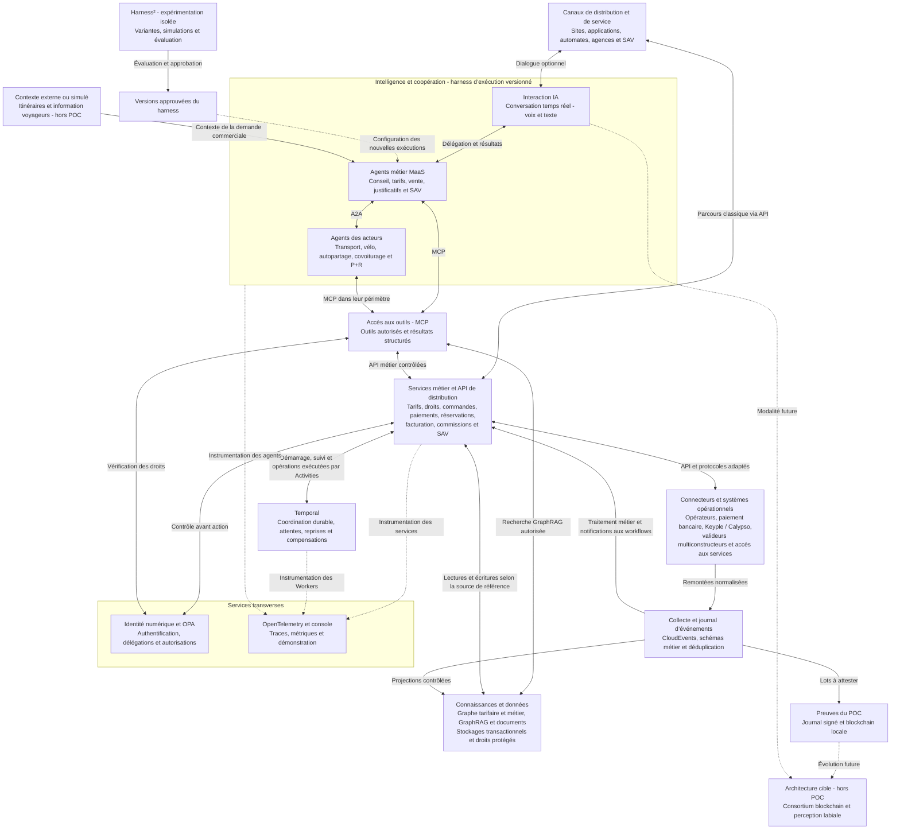

**Lecture de la vue :** les canaux utilisent les services métier directement ou avec l’assistance des agents. A2A relie les agents indépendants ; MCP leur ouvre des outils contrôlés. Temporal coordonne les opérations longues. Les connecteurs assurent l’intégration des équipements et partenaires, puis CloudEvents uniformise l’enveloppe des remontées. Le graphe et GraphRAG apportent les connaissances ; les stockages transactionnels conservent les opérations de référence.

**Frontières à conserver :** les outils MCP et données de chaque acteur restent soumis à ses habilitations ; les regroupements visuels n’impliquent pas une base ou un serveur partagé sans isolation. OPA contrôle les autorisations, tandis que les services métier garantissent leurs invariants transactionnels. La validation locale et les flux audio/vidéo ne dépendent pas de la blockchain ni d’un aller-retour Temporal. OpenTelemetry observe les traitements ; il ne remplace pas leur journal métier. La blockchain atteste des lots, sans transporter toutes les données voyageurs ni prouver à elle seule la réalité des usages.

## 1. Introduction — Un parcours voyageur, plusieurs systèmes à faire coopérer

Le MaaS couvre aussi la location de vélos, l’autopartage, le covoiturage, les parkings relais (P+R) et d’autres services de mobilité. La billettique interopérable s’inscrit dans un parcours associant titres, réservations et droits d’usage ; tous les services ne sont pas exploités dans le cadre d’une DSP.

- Ouvrir sur un cas concret : un voyageur veut acheter une offre combinant deux réseaux, charger sa carte et voyager sans comprendre les frontières entre opérateurs.
- Présenter les difficultés : gammes tarifaires, éligibilité, distribution, paiement, supports, validation et partage des recettes.
- Poser la question centrale : comment des agents IA peuvent-ils coordonner ce parcours tout en préservant la fiabilité des transactions et la responsabilité de chaque acteur ?
- Définir MaaS : Mobility as a Service ; DSP : délégation de service public ; A2A : communication agent à agent.
- Annoncer le périmètre : architecture orientée technologies 2026 et démonstrateur mesurable.

### Périmètre confirmé — La billettique comme objet du démonstrateur

L’objectif est de démontrer une architecture de billettique centrée sur les agents IA, de la demande voyageur à la vente, aux droits d’usage, à leur validation et au SAV. Le calcul d’itinéraires et l’information voyageurs sont des systèmes externes ; le POC peut recevoir leurs résultats ou utiliser des données de scénario prédéfinies. Aucun moteur de routage, calcul d’horaires ou service de perturbations n’est à construire.

| Dans le démonstrateur | À l’extérieur ou simulé |
|---|---|
| Dialogue temps réel, compréhension de la demande commerciale et explication des offres. | Calcul d’itinéraires, horaires et information voyageurs. |
| Échanges A2A, outils MCP, GraphRAG, profils et justificatifs. | Fournisseurs réels de données et émetteurs d’attestations non raccordés. |
| Tarification, devis combinés, vente, paiement, émission et suivi des droits. | Acquisition bancaire et matériel non disponibles : sandbox ou simulateur clairement identifié. |
| Réservation commerciale d’un vélo, véhicule, place de covoiturage ou parking ; suivi des droits d’accès et consommations. | Gestion de flotte, conduite, optimisation d’exploitation et commande physique des équipements non intégrés. |
| Collecte des validations, facturation postpayée, commissions, preuves et SAV. | Déploiement industriel et intégration exhaustive de tous les fournisseurs. |

La reconstitution d’usages à partir des validations reste dans le périmètre pour calculer la facture postpayée. Elle décrit ce qui a été consommé ; elle ne calcule pas un itinéraire à proposer au voyageur.

### Ambition de démonstration — Rendre visibles les capacités IA

- Un agent conversationnel reçoit une demande commerciale par voix ou texte, explique les offres et reste interactif pendant les appels métier.
- Des agents opérateurs coopèrent via A2A pour produire une proposition commerciale compatible avec les droits du voyageur et les produits des partenaires.
- GraphRAG retrouve les conditions et les clauses qui expliquent un prix, une commission ou une décision de SAV.
- L’agent justificatifs coordonne l’analyse des pièces et les vérifications disponibles ; les incertitudes sont visibles et peuvent être reprises par le conseiller.
- L’agent vente et SAV coordonne les actions autorisées et démontre une résolution d’incident entre plusieurs systèmes.
- La lecture labiale est un axe futur de l’architecture cible ; le POC utilise la voix et le texte.
- Le POC conserve un journal signé de lots et de relevés ; les empreintes sont ancrées sur une blockchain locale ; la gouvernance interorganisations reste future.
- Une console de démonstration affiche les tâches A2A, appels MCP, sources consultées, états métier, décisions humaines et latences, sans exposer de secrets ni de raisonnement interne du modèle.

Le caractère futuriste sera démontré par ces interactions observables. Les calculs de prix et écritures financières restent déterministes pour que les résultats du démonstrateur soient vérifiables.

## 2. Du MaaS au MaaS agentique

- Définir un agent IA : modèle de langage, outils, contexte, mémoire éventuelle et périmètre d’action explicite.
- Expliquer ce qu’il apporte : compréhension d’une demande, recherche d’informations, coopération et traitement des situations inhabituelles.
- Distinguer coopération entre agents, appels d’API et exécution des transactions.
- Énoncer le principe d’architecture : les agents comprennent, proposent et coordonnent ; les services métier calculent, autorisent et exécutent.
- Identifier les décisions qui restent humaines : validation d’une gamme tarifaire, arbitrage contractuel, dérogation et litige hors délégation.

## 3. Les agents IA et leurs responsabilités

| Agent | Missions proposées | Limites et services de référence |
|---|---|---|
| Conseiller mobilité | Comprendre le besoin, demander les précisions utiles et expliquer les offres. | Catalogue publié, conditions d’éligibilité et confirmation du voyageur. |
| Expert tarifaire | Rechercher et comparer les combinaisons autorisées ; expliquer le tarif proposé. | Moteur tarifaire déterministe et règles versionnées. |
| Vente et après-vente | Coordonner achat, paiement, chargement et résolution d’incidents. | Workflow transactionnel, habilitations et plafonds de remboursement. |
| Agent de vérification des justificatifs | Vérifier la complétude, extraire les champs, coordonner les contrôles et préparer un résultat motivé. | Une extraction IA ne prouve pas l’authenticité ; attribution du droit par le service habilité, avec revue humaine si nécessaire. |
| Agent de mobilité partagée | Rechercher une disponibilité, préparer une réservation et suivre une location ou un covoiturage auprès du fournisseur. | Inventaire et réservation confirmés par le service opérateur ; droits limités à chaque fournisseur. |
| Agent de chaque opérateur | Exposer les offres et traiter les demandes reçues via A2A. | Données et actions limitées au périmètre de son organisation. |
| Analyste DSP | Consulter les contrats, rapprocher les indicateurs et expliquer les écarts. | Sources identifiées, règles contractuelles validées et arbitrage humain. |
| Agent conversationnel temps réel, à faible latence | Assurer le dialogue vocal ou textuel en agence, sur automate et dans l’application ; gérer interruptions et délégation aux agents métier. | Aucun prix inventé ; résultats métier confirmés avant annonce ; confirmation explicite avant achat. |
| Agent de perception labiale — cible future, hors POC | Piloter la reconnaissance visuelle de la parole, contrôler la qualité et transmettre des hypothèses de transcription horodatées. | Module expérimental ; modèle spécialisé VSR ; abstention et correction utilisateur ; aucun droit de vente. |

### Services de mobilité — Vélo, autopartage, covoiturage et parkings relais

L’architecture cible représente chaque fournisseur de mobilité et son périmètre d’action, qu’il s’agisse d’un opérateur sous DSP ou d’un partenaire commercial. Un agent peut représenter le fournisseur via A2A ; si celui-ci ne dispose pas d’agent, un adaptateur MCP côté MaaS donne accès à ses API autorisées sans lui attribuer artificiellement une capacité A2A.

| Service | Informations et opérations spécifiques | Tarification à représenter |
|---|---|---|
| Vélo en libre-service ou location | Stations ou zones, disponibilité, réservation si proposée, déverrouillage, début et fin d’usage, restitution. | Abonnement, frais de départ, durée, franchise et plafonds selon l’offre. |
| Autopartage | Véhicule et catégorie, créneau, éligibilité vérifiée par l’opérateur, réservation, accès, restitution et incident. | Durée, distance, forfait, dépôt ou préautorisation éventuelle et frais contractuels. |
| Covoiturage | Trajet proposé, horaire, points de rencontre, places, demande de réservation, acceptation, annulation et réalisation du trajet. | Prix de la place, frais de service et règles d’annulation ; attribution du rôle de vendeur et de bénéficiaire selon l’accord. |
| Parking relais (P+R) | Localisation, horaires, capacité, disponibilité, réservation si proposée, accès, entrée, sortie et session de stationnement. | Durée, forfait ou tarif combiné avec le transport ; réduction conditionnée à un usage du réseau si l’accord le prévoit. |
| Transport collectif | Offre, zones, droit de transport, chargement éventuel et validation. | Ticket, abonnement, correspondances et plafonnement prépayé ou postpayé. |

#### Un parcours coordonné, des états propres à chaque service

- Exemple : vendre les droits nécessaires à un parcours transport collectif puis vélo fourni par un système externe ou prédéfini dans le scénario. Comparer les offres commerciales applicables sans recalculer le parcours.
- Recevoir le parcours externe comme contexte ; séparer devis commercial, disponibilité observée, réservation demandée et réservation confirmée. Une disponibilité affichée ne constitue pas une garantie de réservation.
- Vérifier en direct la disponibilité et les conditions dans l’API du fournisseur avant engagement. GraphRAG apporte le contexte des offres et contrats ; un index potentiellement ancien ne décide pas de la disponibilité.
- Conserver une commande MaaS avec des sous-commandes, réservations ou locations par fournisseur et leurs références externes. Aucun engagement global n’est annoncé tant que les composantes nécessaires ne sont pas confirmées.
- Orchestrer les engagements successifs avec reprises et compensations : libérer une réservation temporaire ou annuler selon les conditions si une autre partie du parcours échoue. Ne pas supposer une transaction atomique entre fournisseurs.
- Distinguer paiement anticipé, préautorisation ou dépôt, consommation et montant final. Une préautorisation n’est ni une facture ni un encaissement définitif.
- Confirmer la restitution et la clôture d’usage auprès du fournisseur avant de considérer une location terminée. Pour le covoiturage, distinguer demande, acceptation et réalisation du trajet.
- Collecter les événements de réservation et d’usage au même titre que les validations de transport, avec leur propre schéma, provenance et déduplication. Un événement de location n’est pas une validation Calypso.
- Appliquer aux offres combinées les accords tarifaires, commissions de distribution et règles de reversement propres à chaque fournisseur.

#### Outils MCP et périmètres des agents

Outils proposés, à adapter aux capacités réelles de chaque API : `search_availability`, `quote_mobility_service`, `create_reservation`, `get_reservation_status`, `cancel_reservation`, `start_rental`, `end_rental` et `get_usage_record`. Pour le parking relais, prévoir aussi `get_parking_availability`, `quote_parking`, `get_parking_session` et, si le fournisseur le permet, `reserve_parking` et `request_parking_access`. Chaque appel engageant requiert les droits, confirmations et contrôles métier correspondants ; certains fournisseurs n’exposeront pas toutes ces opérations.

- Les agents échangent des demandes et résultats via A2A ; les outils MCP appellent les services déterministes de réservation, d’accès et de facturation.
- L’ouverture d’un véhicule ou le déverrouillage d’un vélo passent par le mécanisme sécurisé de l’opérateur, jamais par une commande générique improvisée par le modèle.
- Le SAV en agence retrouve les réservations et usages autorisés : vélo non déverrouillé, restitution non enregistrée, véhicule indisponible, conducteur ou passager absent, contestation du montant final. Les actions restent limitées au contrat du partenaire.
- Ajouter au graphe : FournisseurMobilité, Mode, Station, ZoneDeService, CatégorieVéhicule, ParkingRelais, PointAccès, OffreCombinée, Offre, ConditionsÉligibilité et AccordPartenaire. Les réservations, disponibilités et usages ont leur état de référence dans les services opérateurs et le suivi transactionnel ; le graphe ne reçoit que les projections utiles.

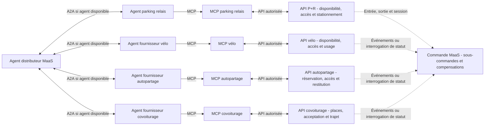

### Parking relais — Articuler stationnement et transport collectif

- Représenter le gestionnaire du parking comme un acteur distinct, avec ses offres, son accord de distribution et ses éventuelles règles de partage des recettes.
- Distinguer capacité totale, disponibilité observée, place réservable et réservation confirmée. Ne pas promettre une place lorsque le parking ne fournit qu’une estimation d’occupation.
- Prévoir un parcours : rechercher un P+R → obtenir le devis stationnement et transport → réserver si possible → entrer → utiliser le réseau → sortir → calculer et régler le montant final.
- Modéliser une session de stationnement avec références d’entrée et de sortie, droit d’accès, tarif applicable et état de paiement. La session et l’occupation ont leur état de référence chez le gestionnaire ; le graphe conserve les relations et projections autorisées.
- Pour une offre combinée, définir précisément la preuve d’usage du transport donnant droit à une réduction : produit éligible, période, réseau et validation acceptée. Traiter une preuve absente ou reçue tardivement selon une procédure explicite de facturation ou de régularisation.
- Séparer les supports possibles : ticket ou code d’accès, carte compatible ou reconnaissance de plaque si le parking la propose. L’accès P+R ne suppose ni Calypso ni une reconnaissance de plaque systématique ; limiter les identifiants exposés au graphe et aux agents.
- Les équipements locaux contrôlent la barrière et les conditions d’accès. L’agent demande une action via le service autorisé ; il ne pilote pas directement une barrière et ne contourne pas ses contrôles de sécurité.
- Prévoir le prépaiement d’un forfait ou la facturation à la sortie, selon l’offre. Relier les commissions du distributeur et la part du gestionnaire aux accords approuvés.
- Étendre le SAV agence aux réservations non retrouvées, accès refusés, sorties non enregistrées, durées contestées et réductions transport non appliquées, selon les délégations du gestionnaire.
- Tester parking complet après consultation, réservation expirée, double événement d’entrée, sortie manquante, indisponibilité réseau et validation transport reçue après facturation du parking.

### Gestion des gammes tarifaires

- Séparer assistance à la conception d’une gamme, simulation, approbation et publication.
- Conserver les versions et dates d’effet des règles.
- Relier chaque proposition commerciale à une version du catalogue et à un calcul reproductible.

### Profils voyageurs — Calculer le tarif selon les droits applicables

Le prix peut dépendre de l’âge, du statut étudiant, de la résidence, d’un abonnement ou d’autres critères définis par chaque offre. Le profil est un ensemble d’attributs et de droits vérifiés, et non une catégorie unique : un voyageur peut être à la fois étudiant, résident et abonné.

| Élément | Traitement proposé |
|---|---|
| Âge | Évaluer le seuil à la date prévue par la règle : voyage, achat ou début d’abonnement. Ne pas présumer un seuil commun à tous les réseaux. |
| Statut étudiant | Associer une attestation vérifiée à une période de validité et au périmètre dans lequel elle est reconnue. |
| Résidence ou statut particulier | Vérifier uniquement les éléments exigés par l’offre et la procédure de l’organisme compétent. |
| Abonnement ou droit existant | Consulter le droit actif et les avantages qu’il ouvre pour le transport, le vélo ou le parking. |
| Cumul de réductions | Appliquer les règles explicites de cumul, d’exclusion, de priorité et de plafonnement de chaque produit. |

#### Service de profils et d’éligibilité

- Prévoir un service de profils et de droits, avec un stockage de référence protégé : attributs nécessaires, organisme vérificateur, état de vérification, dates de validité et révocation éventuelle.
- Conserver les justificatifs dans un espace documentaire à accès restreint. Le graphe métier représente les catégories et conditions d’éligibilité ; les éventuelles projections individuelles sont minimisées et filtrées. Ne pas indexer par défaut les pièces personnelles dans GraphRAG.
- Exposer un MCP profils et éligibilité pour les agents habilités : outils proposés `get_verified_entitlements`, `check_offer_eligibility` et `get_evidence_requirements`. Les résultats privilégient un droit vérifié et sa période de validité plutôt que les pièces brutes.
- L’agent demande les informations manquantes et explique les conditions. Il ne déduit ni l’âge ni le statut étudiant à partir du visage, de la voix, de la lecture labiale ou d’une supposition.
- Sans justificatif validé, permettre une simulation clairement conditionnelle ; ne pas attribuer automatiquement le droit réduit. La possibilité de vendre sur déclaration ou avec contrôle ultérieur dépend d’une règle explicite de l’offre.
- Chaque fournisseur applique ses propres conditions. Une attestation acceptée par un réseau ne crée pas automatiquement un avantage chez un loueur de vélo, un gestionnaire de parking ou un autre opérateur.
- L’éligibilité à conduire un véhicule en autopartage et l’éligibilité à un tarif réduit sont deux contrôles distincts.

#### Calcul, vente et contrôle

1. Identifier le voyageur ou recueillir les critères nécessaires à une simulation anonyme, sans imposer un compte lorsqu’il n’est pas requis.
2. Obtenir les droits applicables à la date et au produit concernés auprès du service d’éligibilité.
3. Faire calculer le devis par le moteur tarifaire : prix de référence, réduction autorisée, règles de cumul et montant final.
4. Afficher le motif du tarif, les justificatifs ou contrôles éventuellement requis et la durée de validité du devis.
5. Revérifier les droits lors de l’engagement selon la politique du produit ; conserver les références de règles et de droits utilisées pour expliquer la vente, sans recopier inutilement les justificatifs.
6. Pour le postpayé, appliquer la règle temporelle contractuelle aux trajets, avec un historique des droits. Ne pas recalculer tous les anciens trajets à partir du seul profil actuel.

**Exemple fictif :** une offre à 10 € prévoit une réduction étudiant de 30 %, non cumulable avec une réduction d’âge de 20 %. Si la règle prévoit le tarif admissible le plus bas et que les deux droits sont valides, le devis est de 7 €. Les seuils, pourcentages et conditions sont des données de démonstration, pas des tarifs réels.

- La commission du vendeur est calculée sur l’assiette prévue par son accord : prix effectivement payé ou autre base contractuelle. Une réduction voyageur ne détermine pas à elle seule la commission.
- Le SAV en agence permet de consulter les droits autorisés, soumettre un justificatif et suivre sa validation. L’attribution ou la correction d’un droit exige l’habilitation appropriée ; une régularisation rétroactive dépend des règles du produit.
- Tester anniversaire entre achat et voyage, attestation expirée, profil incomplet, cumul interdit, droits différents entre opérateurs et réduction découverte après facturation.

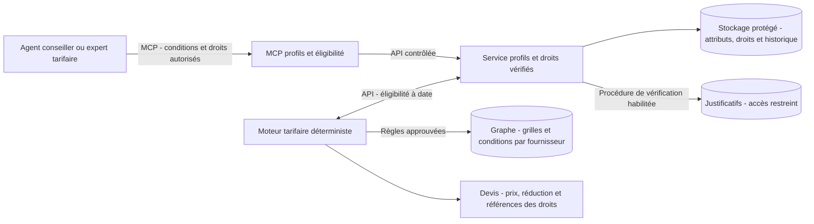

### Agent de vérification des justificatifs

Ajouter un agent spécialisé, sollicité via A2A par le conseiller MaaS ou l’agent de SAV. Il orchestre les contrôles via un MCP justificatifs, sans donner aux autres agents un accès général aux pièces personnelles.

- **Dépôt :** le voyageur ou le conseiller d’agence transmet la pièce dans un espace protégé. Les échanges A2A contiennent une référence de dossier autorisée, pas le document brut.
- **Analyse documentaire :** vérifier le type et la lisibilité, extraire les champs nécessaires par OCR ou modèle documentaire et repérer les informations manquantes. Conserver la provenance des champs et signaler l’incertitude.
- **Cohérence :** comparer les champs requis au dossier, aux périodes de validité et aux conditions de l’offre. Une divergence n’est pas automatiquement une fraude.
- **Authenticité :** lorsque cela est disponible et autorisé, vérifier une signature numérique, un justificatif vérifiable ou une attestation auprès de l’émetteur. Une URL ou un QR code présent sur une pièce n’est pas une source de confiance à lui seul : utiliser des connecteurs et émetteurs approuvés.
- **Décision :** produire un résultat motivé avec les contrôles réellement effectués. Le service d’éligibilité attribue ou refuse le droit selon une politique approuvée ; l’agent ne s’accorde pas lui-même le pouvoir de valider.
- **Revue humaine :** transmettre au personnel habilité les cas ambigus, contradictoires ou sans preuve suffisante. Prévoir correction et réexamen ; ne pas annoncer une authenticité vérifiée lorsque seule la cohérence visuelle a été examinée.
- **Cycle de vie :** conserver la version de politique, l’auteur de la décision, la période du droit et les éventuels événements d’expiration ou de révocation. Limiter la conservation des pièces selon la politique du service.

Outils MCP proposés : `get_evidence_requirements`, `extract_document_fields`, `check_document_consistency`, `verify_issuer_evidence`, `submit_verification_result` et `request_human_review`. Ils sont à implémenter ; les contrôles auprès d’émetteurs restent conditionnés à la disponibilité de leurs interfaces et aux autorisations.

Séparer les états du document (**reçu, illisible, analysé, source vérifiée, non vérifiable**) de ceux du dossier (**à compléter, en revue, accepté, refusé, expiré**). L’acceptation d’un droit peut suivre une procédure humaine sans preuve cryptographique ; cette distinction doit rester visible dans l’audit.

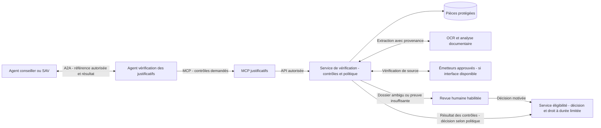

Dans le POC, utiliser uniquement des justificatifs fictifs et un émetteur simulé. Tester document illisible, attestation expirée, nom divergent, pièce cohérente mais non authentifiable et instruction malveillante dans le document. Le contenu d’une pièce est une donnée à analyser, jamais une instruction à exécuter. Mesurer séparément extraction correcte, faux accords, faux refus et taux de revue humaine.

### Gestion des DSP

- Analyser les clauses et retrouver les pièces justificatives.
- Préparer les indicateurs de recettes et de qualité de service.
- Expliquer les écarts entre ventes, validations et reversements.
- Distinguer interprétation assistée du contrat et application de règles approuvées.

## 4. Architecture cible — Coopérer sans confondre les responsabilités

- **Canaux de vente :** automates, sites web, applications mobiles opérateurs ou MaaS, guichets, revendeurs et autres partenaires autorisés ; parcours classique ou conversationnel selon le canal.
- **Harness :** environnement d’exécution versionné des agents ; Harness² pour expérimenter des améliorations en simulation, sans modifier les politiques métier.
- **Couche agentique :** agent conversationnel temps réel, conseiller, agents opérateurs et agents spécialisés.
- **Interaction temps réel :** audio et texte ; délégation des tâches métier en parallèle du dialogue. La perception labiale reste une extension future.
- **Communication A2A :** découverte des capacités, délégation de tâches, suivi et résultats structurés.
- **Données et connaissances :** base graphe métier, documents sources et recherche GraphRAG pour les agents ; stockage transactionnel de référence pour les opérations.
- **Services métier :** catalogue, tarification, commande, droits de transport, paiement et rapprochement.
- **Exécution durable :** Temporal pour les workflows de vente, réservation, justificatifs, SAV, facturation et ancrage des preuves ; validation locale et médias temps réel indépendants.
- **Billettique terrain :** supports et lecteurs compatibles, composants Keyple pour les équipements retenus, moyens cryptographiques adaptés et parcs de valideurs de plusieurs fabricants.
- **Collecte multiconstructeur :** connecteurs par interface fabricant, normalisation, contrôles, déduplication et conservation de la provenance des validations.
- **Événements et preuves :** journal des opérations, rapprochement interopérateurs et preuves signées et blockchain locale ; consortium en cible future.
- **Contrôles transverses :** identité numérique, autorisations exécutables avec OPA et supervision humaine.
- **Observabilité :** OpenTelemetry pour corréler agents, outils, décisions et workflows dans la console.
- **Événements :** enveloppes CloudEvents et schémas billettiques versionnés pour les remontées multiconstructeurs.

### Identité numérique et droits — Deux éléments complémentaires

L’identité numérique permet d’établir qui est le voyageur ou le conseiller et de rattacher les opérations à une identité authentifiée. Les attestations établissent des attributs ou droits supplémentaires, comme le statut étudiant. Une identité authentifiée ne prouve pas automatiquement l’éligibilité à toutes les réductions.

- Prévoir un adaptateur vers un fournisseur d’identité numérique ; le fournisseur, les attributs disponibles et les conditions d’intégration restent à choisir. Utiliser une identité fictive dans le POC tant qu’aucune connexion réelle n’est validée.
- Distinguer identité du voyageur, du conseiller, de l’agent logiciel et de l’équipement ; conserver l’organisation et la délégation utiles à l’action.
- Utiliser des références internes protégées et ne communiquer aux agents que les attributs nécessaires. Maintenir les parcours anonymes lorsque le produit les permet.
- Les portefeuilles d’attestations restent une extension à évaluer ; l’identité numérique constitue le point d’entrée du parcours authentifié, sans imposer un portefeuille particulier.

### OPA — Autorisations exécutables

**Choix retenu : Open Policy Agent (OPA)** pour les décisions d’autorisation, à implémenter dans le démonstrateur. Les services métier et adaptateurs MCP sont les points d’application ; OPA évalue les politiques et ne réalise ni remboursement ni calcul tarifaire.

- Définir des politiques Rego versionnées : organisation, rôle, délégation, action, vendeur, produit, montant, devise, dossier et approbations requises.
- Fournir à OPA un contexte établi par les services de confiance. Un identifiant de conseiller ou une mention « approuvé » produits par un modèle ne constituent pas une preuve.
- Exemple : autoriser un remboursement uniquement dans le périmètre du vendeur, sous le plafond de délégation et avec une confirmation liée à cette opération ; sinon refuser ou déclencher un parcours d’approbation distinct.
- Contrôler l’action au moment de l’exécution et lors d’une reprise Temporal. Une autorisation accordée avant une longue attente peut avoir expiré ou été révoquée.
- La décision d’autorisation ne remplace pas les contrôles transactionnels : montant remboursable restant, concurrence et idempotence sont vérifiés dans le service métier au moment de l’écriture.
- En cas de politique absente, de contexte incomplet ou d’indisponibilité d’OPA, refuser les actions sensibles. Ne pas ajouter de dépendance OPA distante à la validation locale au portillon.
- Tracer le résultat, le motif, la version de politique et l’identifiant d’opération, sans enregistrer les secrets ou justificatifs bruts.
- Démontrer trois cas : action permise, action hors délégation, action refusée après révocation pendant une attente Temporal. Les plafonds du POC sont fictifs et configurables.

Référence : [Open Policy Agent](https://www.openpolicyagent.org/docs).

### OpenTelemetry — Observer le parcours complet

**Choix retenu : OpenTelemetry**, avec instrumentation, Collector et export vers un backend de traces et métriques à choisir. La console de démonstration relie les faits métier aux traces autorisées ; elle ne publie pas les données internes du voyageur.

- Corréler session, tâche A2A, appel MCP, identifiant de commande, workflow Temporal et événement de validation. Conserver des identifiants métier distincts du `trace_id` ; une opération longue ou asynchrone peut couvrir plusieurs traces liées.
- Instrumenter les appels de modèles, recherche GraphRAG, outils, API et décisions OPA : durée, résultat, erreur, tentatives et consommation mesurable. Afficher les coûts estimés comme tels.
- Instrumenter séparément les Workflows et Activities, en évitant de compter les rejeux déterministes comme de nouvelles ventes ou inférences. Distinguer tentatives techniques et opérations métier uniques.
- Propager le contexte de trace lorsque les protocoles et SDK le permettent ; utiliser des liens entre spans pour les traitements différés et lots multiconstructeurs.
- Figer les versions des SDK et conventions sémantiques, notamment GenAI, dans une matrice de compatibilité. Les champs métier complémentaires disposent d’un espace de noms documenté.
- Filtrer avant export : aucun jeton, numéro bancaire, justificatif, audio, vidéo ou prompt contenant des données personnelles par défaut. Contrôler aussi les attributs et erreurs susceptibles de contenir ces données.
- Les traces peuvent être échantillonnées et ne constituent pas le registre financier ni le journal exhaustif des autorisations. Une panne du backend de télémétrie ne doit pas bloquer la vente ; l’audit métier suit sa propre politique de persistance.
- La console montre : appel A2A → outil MCP → décision OPA → workflow Temporal → Activity → résultat externe, avec le détail des latences et reprises.

Référence : [conventions OpenTelemetry](https://opentelemetry.io/docs/specs/semconv/).

### CloudEvents — Enveloppe des événements multiconstructeurs

**Choix retenu : CloudEvents 1.0** pour envelopper les événements normalisés de validation, mais aussi de paiement, réservation et usage. Le schéma billettique reste porté par `data` ; CloudEvents ne fournit ni bus, ni garantie de livraison, ni authentification.

- Renseigner `specversion`, `id`, `source` et `type` ; utiliser `time`, `subject`, `datacontenttype` et `dataschema` selon le contrat. Les extensions et schémas sont documentés et versionnés.
- L’identifiant et la source sont établis par le connecteur de confiance, avec une correspondance stable vers l’événement fabricant. Le couple `(source, id)` identifie les répétitions du même événement ; il ne suffit pas à reconnaître deux représentations du même passage issues de chemins différents.
- Conserver la provenance fabricant, l’heure de réception et la qualité de l’horloge dans `data`. Ne pas remplacer silencieusement l’heure du passage par celle de réception.
- Utiliser des références pseudonymisées pour le support et éviter les identifiants voyageurs ou plaques en clair dans `subject`.
- Valider l’enveloppe puis le schéma métier, authentifier la source au niveau du transport, persister, dédupliquer et router vers le traitement adapté. Les événements non conformes vont en quarantaine.
- Un consommateur métier authentifié convertit les événements pertinents en Signals ou Updates Temporal ; le modèle IA n’interprète pas librement ces notifications comme des ordres.
- Pour une preuve blockchain, définir une sérialisation canonique du contenu métier attesté. Les métadonnées de transport ajoutées à la livraison, comme le contexte de trace, ne doivent pas changer l’empreinte de la preuve.

Exemple fictif d’événement normalisé ; les domaines `.invalid` ci-dessous sont des identifiants de démonstration non opérationnels :

```json
{
  "specversion": "1.0",
  "id": "validation-x-001",
  "source": "https://operator-a.invalid/validators/device-042",
  "type": "maas.ticketing.validation.accepted.v1",
  "time": "2026-10-18T08:15:00Z",
  "datacontenttype": "application/json",
  "dataschema": "https://schemas.invalid/validation/v1",
  "data": {
    "operator_id": "operator-a",
    "device_id": "device-042",
    "source_event_id": "manufacturer-event-123",
    "support_ref": "pseudonym-demo-789",
    "result": "accepted",
    "received_at": "2026-10-18T08:20:00Z",
    "clock_quality": "unknown"
  }
}
```

Référence : [spécifications CloudEvents](https://github.com/cloudevents/spec).

```mermaid
flowchart LR
    AGENT["Agent IA"]
    MCP["Serveur MCP et API métier - application des droits"]
    POLICY["OPA - décision de politique"]
    TEMP["Temporal - workflow et Activities"]
    ACTION["Service métier - contrôle transactionnel et effet"]
    CONNECT["Connecteurs fabricants"]
    CE["CloudEvents - enveloppe et données validées"]
    BUS["Journal et bus d’événements"]
    CONS["Consommateur métier - déduplication et corrélation"]
    COL["OpenTelemetry Collector - données filtrées"]
    CONSOLE["Backend de télémétrie et console de démonstration"]
    AGENT -->|"MCP"| MCP
    MCP <-->|"Décision sur contexte de confiance"| POLICY
    MCP -->|"Opération autorisée"| TEMP
    TEMP -->|"Activity"| ACTION
    ACTION <-->|"Autorisation à l’exécution"| POLICY
    CONNECT --> CE
    CE --> BUS
    BUS --> CONS
    CONS -->|"Signal ou Update vérifié"| TEMP
    MCP -.->|"Traces et métriques"| COL
    POLICY -.->|"Instrumentation de la décision"| COL
    TEMP -.->|"Instrumentation SDK et Workers"| COL
    CONS -.->|"Traces et métriques"| COL
    COL --> CONSOLE
```

### Harness des agents et Harness² — Exécution contrôlée et amélioration expérimentale

**Référence confirmée : [Harness² de Google Research](https://github.com/google-research/harness2).** Le plan prévoit une couche de harness pour l’exécution des agents et une expérimentation Harness² sur des scénarios simulés. L’adaptation au domaine billettique, aux clients MCP/A2A et au runtime choisi reste à réaliser ; aucune compatibilité native ni intégration opérationnelle n’est présumée.

#### Référence et statut

Harness² explore l’amélioration de l’environnement d’un agent, sans modifier les poids de son modèle, à deux niveaux : ajustement pour la tâche courante et conservation d’enseignements pour les tâches suivantes. Il s’agit d’un projet de recherche, pas d’une solution billettique prête à l’emploi. Ses résultats publiés ne démontrent pas des gains sur nos scénarios.

Sources consultées le 19 octobre 2026 : [dépôt officiel Harness²](https://github.com/google-research/harness2) et [article de recherche](https://arxiv.org/abs/2610.14224).

#### Harness d’exécution dans le démonstrateur

- Encadrer chaque agent avec une configuration versionnée : modèle, instructions, construction du contexte, outils visibles, compétences, budget d’appels, temps maximal et conditions d’arrêt.
- Séparer mémoire de session, connaissances GraphRAG et état transactionnel. Une information mémorisée par l’agent ne remplace pas une vérification dans le service de référence.
- Valider les entrées et sorties structurées, sélectionner les outils autorisés et enregistrer les actions observables. Les refus OPA restent applicables même si le harness propose l’action.
- Émettre des traces OpenTelemetry avec les versions du modèle et du harness ; relier l’exécution aux tâches A2A, outils MCP et workflows Temporal.
- Utiliser une version figée pour chaque exécution métier. Les évolutions sont activées sur de nouvelles exécutions, avec possibilité de revenir à une version antérieure ; les opérations en cours conservent leurs références.

#### Boucle Harness² proposée pour le POC

L’intégration ci-dessous est notre adaptation expérimentale, pas une capacité billettique livrée par le projet.

1. Exécuter un harness de référence sur des cas fictifs : choix d’une réduction, justificatif incomplet, incident de chargement et demande de remboursement.
2. Produire des variantes limitées aux instructions, à la sélection du contexte, aux indications d’usage des outils et aux stratégies de délégation autorisées.
3. Exécuter les essais dans un environnement isolé avec services simulés réinitialisables, sans possibilité de débiter, rembourser ou charger un support réel.
4. Comparer les variantes à budget comparable sur des résultats métier vérifiables : exactitude, appel d’outil pertinent, coût, latence, respect des droits et absence de double action.
5. Vérifier les variantes retenues sur un jeu de scénarios distinct, puis approuver une version avant activation dans la démonstration. Ne pas confondre auto-évaluation d’un agent et validation indépendante.
6. Conserver les enseignements autorisés et leur provenance, avec séparation des organisations et sans pièces personnelles ou secrets.

- Les politiques OPA, plafonds de délégation, règles tarifaires, validations humaines, secrets et invariants financiers restent hors du périmètre modifiable par cette boucle.
- Les candidats générés sont traités comme du code ou des configurations non fiables : contrôle des différences, exécution isolée et accès réseau limité aux ressources de test nécessaires.
- Fixer un nombre maximal de variantes et de cycles ; arrêter l’expérience si le gain ne compense pas le coût ou si une régression apparaît.
- La boucle d’amélioration n’est pas exécutée pendant chaque vente ni sur le chemin audio temps réel. Une variante expérimentale ne modifie pas silencieusement une opération en cours.

#### Répartition des responsabilités

| Composant | Rôle |
|---|---|
| Harness d’exécution | Encadrer le contexte, la boucle modèle/outils et les limites de l’agent. |
| Harness² | Explorer et évaluer des améliorations de cet environnement dans une expérience isolée. |
| A2A et MCP | Échanger avec les agents indépendants et appeler les outils. |
| Temporal | Assurer la progression durable des engagements métier et leurs reprises. |
| OPA et services métier | Décider des autorisations et appliquer les invariants transactionnels. |
| OpenTelemetry | Observer les appels, résultats, versions, coûts et latences. |

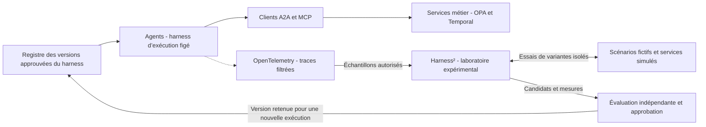

**Scénario de démonstration :** un agent de SAV demande inutilement des informations déjà disponibles. La boucle expérimentale propose une meilleure sélection du contexte et de l’outil de consultation ; la variante est comparée à la référence, puis activée uniquement après vérification. Montrer aussi un candidat rejeté parce qu’il suggère une action hors délégation.

### Temporal — Exécution durable des opérations billettiques

**Choix retenu pour le démonstrateur : Temporal**, à intégrer au POC ; aucun déploiement n’est encore réalisé. A2A organise la coopération des agents, MCP expose leurs outils, et Temporal conserve la progression des opérations longues et coordonne leur reprise.

| Workflow proposé | Responsabilité |
|---|---|
| `PurchaseAndIssueWorkflow` | Suivre le devis accepté, attendre le paiement, demander l’émission ou le chargement, vérifier le résultat et traiter les échecs. |
| `CombinedReservationWorkflow` | Suivre les réservations partenaires et leurs délais ; appliquer les compensations autorisées en cas d’échec partiel. |
| `EvidenceReviewWorkflow` | Coordonner l’analyse des justificatifs, les contrôles de source et l’attente d’une décision humaine. |
| `AfterSalesWorkflow` | Préparer la régularisation, attendre l’approbation requise, exécuter puis vérifier la reprise ou le remboursement. |
| `BillingAndSettlementWorkflow` | Clôturer une période, calculer les montants, commissions et parts, puis suivre les encaissements et règlements. |
| `ProofAnchoringWorkflow` | Publier les preuves de lots sur blockchain, attendre leur confirmation et reprendre après une indisponibilité du registre. |

#### Positionnement technique

- Les API métier de commande, réservation ou SAV démarrent les workflows avec un identifiant stable incluant l’organisation et l’opération. Les outils MCP appellent ces API et reçoivent une référence de suivi, sans garder la conversation bloquée jusqu’au règlement final.
- Les Workers exécutent les Workflows et Activities. Le code de Workflow doit rester déterministe ; les appels de modèles IA, MCP, A2A et API externes nécessaires à ces workflows sont effectués dans des Activities.
- Le dialogue audio, la perception labiale et la validation locale continuent sur leurs chemins temps réel. Temporal suit les engagements métier, pas chaque trame audio, vidéo ou échange NFC.
- Les notifications bancaires, validations d’approbation et résultats partenaires passent par des services d’entrée authentifiés et dédupliqués, puis par Signals ou Updates selon l’interaction choisie. Les délais sont représentés par des timers durables.
- Définir pour chaque Activity les délais, tentatives et erreurs non réessayables. Après un résultat externe incertain, consulter l’état réel avant de réémettre une demande de débit, de remboursement ou de chargement.
- Une Activity peut être exécutée de nouveau. Temporal ne garantit pas à lui seul l’unicité d’un effet externe : conserver les clés d’idempotence, contraintes et contrôles d’état dans les services métier.
- Les compensations constituent des opérations métier explicites. Un chargement réalisé ou un paiement encaissé ne s’annule pas par un simple retour arrière technique.
- Conserver les références des modèles, prompts, règles et devis utilisés ; enregistrer les résultats d’Activities plutôt que rappeler le modèle pendant un rejeu. Prévoir la compatibilité des versions de workflows en cours.
- L’historique Temporal sert à l’exécution durable ; il ne remplace ni le journal financier, ni le graphe de connaissances, ni les preuves blockchain. Limiter les données conservées dans ses payloads et utiliser des références protégées pour les justificatifs.

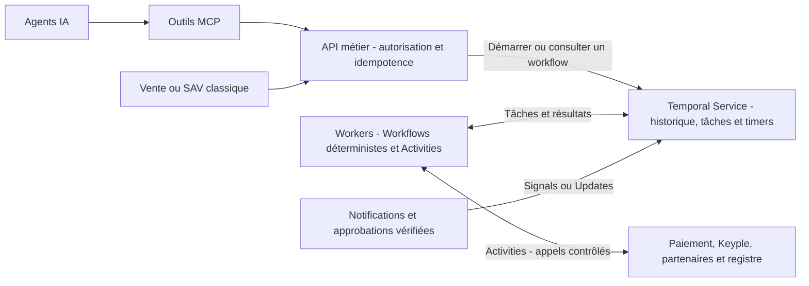

**Démonstration centrale :** arrêter un Worker après la confirmation du paiement et avant le chargement, puis le relancer. Montrer la reprise de la même commande, l’absence de second débit et la vérification de l’état du support avant toute nouvelle écriture. Ajouter une panne après l’effet externe mais avant réception de sa réponse pour éprouver l’idempotence et le rapprochement.

Références : [Temporal Durable AI](https://docs.temporal.io/ai), [Workflows, Activities et rejeu](https://docs.temporal.io/tasks), [exemple d’agent durable](https://learn.temporal.io/tutorials/ai/durable-ai-agent/).

### Distribution multicanale — Tous les points de vente utilisent le même socle métier

Un titre peut être vendu par un automate, un site web, une application mobile, un guichet ou un partenaire. Le canal de vente, le distributeur commercial, l’opérateur qui accepte le titre et le support délivré sont des notions distinctes.

| Canal | Parcours proposé | Délivrance à prévoir selon ses capacités |
|---|---|---|
| Automate | Sélection tactile ou assistance conversationnelle optionnelle. | Chargement Calypso si lecteur et moyens de sécurité disponibles ; autres supports selon l’offre. |
| Site web | Boutique classique et, au choix, dialogue avec l’agent. | Création du droit puis chargement différé sur un équipement compatible ; titre numérique seulement si pris en charge par le réseau. |
| Application mobile opérateur ou MaaS | Achat dans l’application, avec assistance texte ou voix optionnelle. | Chargement NFC si terminal et environnement compatibles, ou autre mode de délivrance autorisé. |
| Guichet ou agence | Vente par un agent humain, avec assistance IA facultative. | Chargement via le poste équipé et suivi des opérations. |
| Revendeur ou partenaire | Intégration par API de distribution ; agent partenaire A2A possible s’il existe. | Délivrance limitée aux produits, supports et actions autorisés par le contrat de distribution. |

- Les parcours classiques passent par l’API de distribution ; les agents IA invoquent les services correspondants via MCP. Les deux chemins appliquent les mêmes règles métier et contrôles d’autorisation.
- L’agent conversationnel à faible latence est une interface optionnelle. Une vente ne nécessite ni conversation, ni caméra, ni lecture labiale.
- Chaque canal dispose d’une identité technique et d’habilitations : produits vendables, tarifs applicables, moyens de paiement, modes de délivrance, remboursements et éventuels frais ou commissions approuvés.
- La commande enregistre le canal d’origine, le distributeur, les opérateurs concernés, le devis accepté et ses versions tarifaires. Les règles de reversement peuvent ainsi tenir compte des accords de distribution.
- Un achat web réussi ne signifie pas que la carte physique est déjà chargée. Séparer les états payé, droit créé, chargement en attente, chargé et échec de délivrance.
- Une reprise sur un autre canal est possible après authentification appropriée et vérification de la commande ; employer des identifiants et traitements idempotents pour éviter paiement ou émission en double.
- Dans le graphe, ajouter les entités CanalDeVente, Distributeur et AccordDeDistribution, reliées aux offres, versions tarifaires et modes de délivrance autorisés.

### Rémunération du vendeur — Commission et reversement de distribution

Selon l’accord de distribution, le vendeur peut percevoir une rémunération sur les titres qu’il vend. Le modèle doit distinguer le prix payé par le voyageur, la commission du vendeur, les éventuels frais de paiement et les recettes attribuées aux opérateurs. Une commission n’implique pas automatiquement une majoration du prix voyageur.

Le vendeur est l’entité commerciale bénéficiaire de l’accord, pas nécessairement le fabricant de l’automate, l’éditeur de l’application, l’agence physique ou l’opérateur de transport. Enregistrer séparément ces rôles et le canal d’origine.

| Élément contractuel | Informations à modéliser |
|---|---|
| Bénéficiaire | Vendeur, organisation payeuse, accord de distribution et périmètre des produits. |
| Calcul | Montant fixe, pourcentage ou combinaison ; assiette exacte, devise, règles d’arrondi, minimum ou plafond éventuel. |
| Temporalité | Version du contrat, dates d’effet et événement qui détermine la version applicable. |
| Acquisition de la commission | Vente, encaissement, consommation ou autre condition contractuelle explicite. |
| Règlement | Commission retenue par le vendeur lors du reversement, ou payée séparément au vendeur ; échéance et référence de règlement. |
| Régularisation | Annulation, remboursement partiel ou total, impayé, contestation et reprise éventuelle de commission. |

#### Chaîne de calcul et de règlement

1. À la vente, identifier le vendeur et l’accord applicable ; conserver sa version avec chaque ligne de commande.
2. Déterminer l’assiette et calculer la commission par un moteur déterministe ; identifier si le montant est estimé, acquis ou encore conditionnel.
3. Répartir les recettes entre acteurs selon un ordre contractuel explicite. Pour une offre combinée, préciser si la commission est déduite avant répartition ou supportée par certains opérateurs.
4. Produire un relevé de distribution distinguant ventes, remboursements, commissions acquises, régularisations et net à régler.
5. Faire exécuter le règlement par le service financier ou de paiement autorisé ; enregistrer son résultat et effectuer le rapprochement bancaire.
6. En cas de correction, créer une écriture de régularisation liée à l’opération initiale plutôt que réécrire un relevé clôturé.

**Exemple purement fictif, hors frais et fiscalité :** un titre est vendu 10 € et l’accord prévoit une commission de 5 % sur ces 10 €. Le vendeur reçoit 0,50 € ; il reste 9,50 € à répartir selon les accords entre opérateurs. Si le vendeur a encaissé les 10 €, il peut retenir 0,50 € et reverser 9,50 €. Si la plateforme a encaissé les 10 €, elle peut régler 0,50 € au vendeur. Ces deux modalités sont alternatives et doivent éviter tout double paiement de commission.

- Pour le postpayé, l’attribution à un vendeur ne se déduit pas automatiquement du canal d’inscription : l’accord définit le bénéficiaire et les consommations éligibles. Le montant définitif peut dépendre du tarif après plafonnement, des encaissements et des régularisations.
- Pour un crédit prépayé, préciser si la commission rémunère le rechargement ou la consommation ; ne pas la compter aux deux étapes sans disposition explicite.
- Stocker les accords et règles approuvées dans le graphe, avec bénéficiaires, périmètres et versions. Conserver les montants calculés, dettes, paiements et écritures de régularisation dans le stockage transactionnel.
- L’agent analyste DSP et distribution peut expliquer le calcul via le MCP d’analyse : outils proposés `get_distribution_agreement`, `preview_seller_commission`, `get_seller_statement` et `get_settlement_status`. Il ne fixe pas un taux et ne déclenche pas librement un virement.
- Une preuve du relevé peut être ancrée dans le registre partagé. Cet ancrage ne vaut pas preuve d’encaissement ou de règlement bancaire.

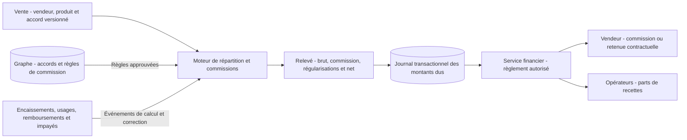

### Interface SAV en agence — Un poste de travail pour le conseiller

Prévoir une application web de SAV utilisée par le personnel habilité en agence, distincte du parcours voyageur et de l’interface de vente. Le conseiller humain reste l’utilisateur du poste ; l’agent IA vente et après-vente l’assiste sans être obligatoire.

#### Écrans et fonctions à prévoir

| Écran | Fonctions |
|---|---|
| Recherche et identification | Retrouver un dossier par référence de commande, compte mobilité, référence protégée du support ou lecture d’une carte compatible ; vérifier l’identité et le droit d’accès avant d’afficher les données personnelles. |
| Vue du dossier | Présenter les achats de tous les canaux autorisés, titres, chargements, paiements, soldes prépayés, relevés postpayés et demandes SAV précédentes. |
| Chronologie de l’incident | Relier vente, paiement, chargement et validations multiconstructeurs ; afficher provenance, dates, états confirmés, retards de remontée et informations manquantes. |
| Diagnostic assisté | Proposer une explication sourcée, les contrôles à effectuer et les solutions permises par les règles applicables. |
| Préparation d’une action | Afficher montant, motif, justificatifs, effet attendu sur le droit ou le solde et niveau d’approbation requis avant confirmation. |
| Suivi et clôture | Afficher actions en cours, résultats vérifiés, escalade à un opérateur, justificatif remis au voyageur et résolution effective. |

#### Actions métier proposées

- Reprendre un chargement interrompu après vérification de son état réel, avec lecteur et Keyple sur les postes équipés.
- Préparer un remboursement total ou partiel via le service de paiement, selon l’éligibilité, les plafonds et les droits du conseiller.
- Corriger un trajet incomplet ou une facturation postpayée selon une règle approuvée, avec recalcul et régularisation traçables.
- Régulariser un solde prépayé uniquement par un mouvement justifié dans le journal transactionnel.
- Traiter une demande de remplacement de support ou de transfert de droits selon les capacités du réseau et sa procédure d’invalidation de l’ancien support ; ne pas dupliquer les droits actifs.
- Créer une réclamation et l’escalader à l’opérateur responsable si la résolution dépasse le périmètre de l’agence.

#### Intégration et contrôle des actions

- Le poste appelle l’API SAV avec l’identité du conseiller, de l’agence et de l’organisation. Le service applique les habilitations, indépendamment de l’interface et de l’assistance IA.
- Le MCP SAV expose des outils proposés tels que `get_case_timeline`, `diagnose_loading`, `prepare_remediation`, `submit_remediation` et `get_remediation_status`. Le serveur vérifie la délégation et les approbations ; la déclaration d’un agent ne vaut pas preuve d’accord du conseiller.
- Les opérations sensibles disposent d’un aperçu explicite et d’une confirmation liée à l’action, au montant et au dossier. Une approbation supplémentaire peut être requise selon les plafonds définis pour le POC.
- Les connecteurs d’opérateurs effectuent les opérations chez leur propriétaire. Un dossier agrégé ne donne pas à une agence le droit de modifier tous les réseaux.
- Conserver un journal des décisions : demande, auteur humain ou agent, preuves consultées, approbation, action exécutée et résultat. Distinguer demande acceptée, traitement en cours, réussite et échec.
- Rendre les reprises idempotentes et revérifier les états avant exécution : deux conseillers ou deux canaux ne doivent pas rembourser ou recharger deux fois la même opération.
- Le SAV reste utilisable si l’agent IA ou GraphRAG est indisponible, sous réserve de disponibilité des services métier nécessaires.

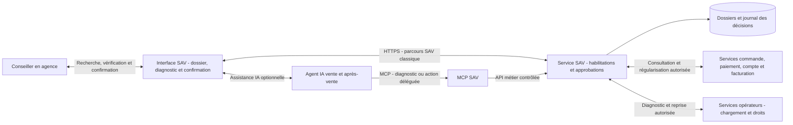

### Schéma des interactions — A2A, MCP et systèmes métier

Ce schéma décrit l’architecture cible proposée. Pour le premier POC, les rôles de conseiller, expert tarifaire et vente peuvent être regroupés dans l’agent distributeur MaaS ; les deux agents opérateurs restent distincts. Les blocs MCP représentent des adaptateurs à développer autour des services, pas des capacités supposées natives de Keyple ou du prestataire bancaire.

```mermaid
flowchart TB
    EXTERNE["Hors POC - itinéraire et IV externes ou scénario prédéfini"]
    EXTERNE -->|"Contexte commercial - aucune fonction de routage"| CONSEIL
    subgraph CANAUX["Canaux de vente"]
        APP["Applications mobiles - opérateurs et MaaS"]
        WEB["Sites web et boutiques en ligne"]
        BORNE["Automates de vente"]
        GUICHET["Guichets et agences - vente"]
        SAVUI["Poste conseiller agence - interface SAV"]
        PARTENAIRE["Revendeurs et autres canaux autorisés"]
        API["API de distribution - identité et droits par canal"]
        MODAL["Microphone, haut-parleur et écran"]
        CAMERA["Futur hors POC - caméra activée par l’usager"]
        BORNE <-->|"Interface multimodale optionnelle"| MODAL
        GUICHET <-->|"Assistance optionnelle"| MODAL
    end

    subgraph AGENTS["Agents IA - harness versionné et clients MCP"]
        CONSEIL["Conseiller et distributeur MaaS"]
        ACCUEIL["Agent conversationnel temps réel - faible latence"]
        LABIAL["Futur hors POC - agent de perception labiale"]
        VSR["Futur hors POC - moteur VSR"]
        TARIF["Expert tarifaire"]
        VENTE["Vente et après-vente"]
        DSP["Analyste DSP"]
        VERIF["Agent vérification des justificatifs"]
        OPA["Agent opérateur A"]
        OPB["Agent opérateur B"]
        MOB["Agents vélo, autopartage, covoiturage et parking relais"]
    end

    APP -->|"HTTPS - parcours de vente"| API
    WEB -->|"HTTPS - parcours de vente"| API
    BORNE -->|"HTTPS - parcours de vente"| API
    GUICHET -->|"HTTPS - vente assistée"| API
    SAVUI -->|"HTTPS - identité du conseiller et habilitations"| SAVAPI
    SAVUI <-->|"Assistance IA optionnelle - dossier autorisé"| VENTE
    PARTENAIRE -->|"API partenaire authentifiée"| API
    API -->|"API - catalogue et devis"| CALCUL
    API -->|"API - commande et suivi"| COMMANDE
    APP <-->|"WebRTC ou WebSocket - dialogue optionnel"| ACCUEIL
    WEB <-->|"WebRTC ou WebSocket - dialogue optionnel"| ACCUEIL
    MODAL <-->|"WebRTC audio - WebSocket texte et événements"| ACCUEIL
    CAMERA -->|"Flux vidéo local - session active"| VSR
    LABIAL <-->|"API locale - pilotage et hypothèses"| VSR
    LABIAL -.->|"WebSocket - transcription horodatée et qualité"| ACCUEIL
    ACCUEIL <-->|"A2A - activer la tâche ou demander une reprise"| LABIAL
    ACCUEIL <-->|"A2A - délégation du parcours"| CONSEIL
    CONSEIL <-->|"A2A - comparer les offres"| TARIF
    CONSEIL <-->|"A2A - dossier de justificatifs autorisé"| VERIF
    VENTE <-->|"A2A - vérification pour le SAV"| VERIF
    CONSEIL <-->|"A2A - achat ou incident"| VENTE
    CONSEIL <-->|"A2A - offres et disponibilité"| MOB
    VENTE <-->|"A2A - réservation et incident"| MOB
    TARIF <-->|"A2A - offres et conditions"| OPA
    TARIF <-->|"A2A - offres et conditions"| OPB
    VENTE <-->|"A2A - émission ou reprise"| OPA
    VENTE <-->|"A2A - émission ou reprise"| OPB
    DSP <-->|"A2A - justificatifs et écarts"| OPA
    DSP <-->|"A2A - justificatifs et écarts"| OPB

    subgraph OUTILS["Serveurs MCP - outils autorisés selon l'agent et l'organisation"]
        MK["MCP connaissances"]
        MPROF["MCP profils et éligibilité"]
        MVERIF["MCP justificatifs"]
        MT["MCP tarifs MaaS"]
        MTA["MCP tarifs DSP A"]
        MTB["MCP tarifs DSP B"]
        MV["MCP vente et paiement"]
        MSAV["MCP SAV - outils limités par délégation"]
        MA["MCP opérateur A"]
        MB["MCP opérateur B"]
        MD["MCP analyse DSP"]
        MMOB["MCP fournisseurs de mobilité"]
    end

    CONSEIL -->|"MCP - rechercher les conditions"| MK
    TARIF -->|"MCP - retrouver les règles"| MK
    TARIF -->|"MCP - vérifier les droits à date"| MPROF
    VERIF -->|"MCP - extraire et vérifier les preuves"| MVERIF
    CONSEIL -->|"MCP - conditions et justificatifs requis"| MPROF
    DSP -->|"MCP - retrouver les clauses"| MK
    TARIF -->|"MCP - lire les offres MaaS et calculer un devis"| MT
    OPA -->|"MCP - lire la grille et chiffrer A"| MTA
    OPB -->|"MCP - lire la grille et chiffrer B"| MTB
    VENTE -->|"MCP - créer et suivre une commande"| MV
    VENTE -->|"MCP - diagnostic et actions autorisées"| MSAV
    OPA -->|"MCP - consulter ou agir sur A"| MA
    OPB -->|"MCP - consulter ou agir sur B"| MB
    DSP -->|"MCP - rapprocher et expliquer"| MD
    MOB -->|"MCP - disponibilité, réservation et usage"| MMOB

    subgraph SERVICES["Services métier et connaissances"]
        RAG["Service GraphRAG - contexte sourcé et filtré"]
        GRAPHE[("Base graphe - entités et relations")]
        DOCS[("Documents sources et index de recherche")]
        CALCUL["Service catalogue et moteur tarifaire MaaS"]
        PROF["Service profils et éligibilité"]
        SVERIF["Vérification documentaire et sources approuvées"]
        REVIEW["Revue humaine habilitée"]
        DROITS[("Droits voyageurs - stockage protégé et historique")]
        CATA["Service catalogue et moteur tarifaire DSP A"]
        CATB["Service catalogue et moteur tarifaire DSP B"]
        GA[("Graphe tarifaire DSP A - versions approuvées")]
        GB[("Graphe tarifaire DSP B - versions approuvées")]
        GM[("Graphe tarifaire MaaS - offres composées et versions")]
        COMMANDE["Commande et paiement - prépayé et postpayé"]
        TEMP["Temporal Service - exécution durable"]
        WORK["Workers - Workflows et Activities"]
        POLICY["Open Policy Agent - autorisations exécutables"]
        OTEL["OpenTelemetry Collector - filtrage"]
        OBS["Télémétrie et console de démonstration"]
        BILL["Facturation après usage - trajets et plafonds"]
        COMPTE["Compte mobilité - droits et soldes"]
        ACQ["PSP et acquisition open payment EMV"]
        SIA["Services opérateur A"]
        SIB["Services opérateur B"]
        SMOB["Services fournisseurs - vélos, véhicules, covoiturage et P+R"]
        RAPP["Rapprochement - parts DSP et commissions vendeurs"]
        SETTLE["Règlement des acteurs - service financier"]
        BENEF["Vendeurs et opérateurs bénéficiaires"]
        SAVAPI["Service SAV - dossiers et workflow de régularisation"]
        DOSSIERS[("Dossiers SAV et journal des décisions")]
        TX[("Stockages transactionnels de référence")]
    end

    MK -->|"API de recherche"| RAG
    RAG -->|"Requêtes de graphe"| GRAPHE
    RAG -->|"Recherche et passages sources"| DOCS
    MVERIF -->|"API contrôlée - pièces protégées"| SVERIF
    SVERIF -->|"Résultats des contrôles selon politique"| PROF
    SVERIF -->|"Cas ambigus"| REVIEW
    REVIEW -->|"Décision motivée"| PROF
    MPROF -->|"API contrôlée"| PROF
    PROF -->|"Droits vérifiés"| DROITS
    CALCUL <-->|"API - éligibilité à date"| PROF
    CATA <-->|"API - droits reconnus par A"| PROF
    CATB <-->|"API - droits reconnus par B"| PROF
    MT -->|"API - catalogue et devis"| CALCUL
    MTA -->|"API - catalogue et devis A"| CATA
    MTB -->|"API - catalogue et devis B"| CATB
    CATA -->|"Lecture structurée à date"| GA
    CATB -->|"Lecture structurée à date"| GB
    CALCUL -->|"Lecture structurée à date"| GM
    CALCUL -->|"API - devis partenaire autorisé"| CATA
    CALCUL -->|"API - devis partenaire autorisé"| CATB
    RAG -->|"Recherche filtrée - périmètre A"| GA
    RAG -->|"Recherche filtrée - périmètre B"| GB
    RAG -->|"Recherche filtrée - périmètre MaaS"| GM
    MV -->|"API - commandes idempotentes"| COMMANDE
    MA -->|"API - autorisation opérateur A"| SIA
    MB -->|"API - autorisation opérateur B"| SIB
    MMOB <-->|"API autorisées par fournisseur"| SMOB
    MD -->|"API - calculs et justificatifs"| RAPP
    API <-->|"Autorisation"| POLICY
    SAVAPI <-->|"Autorisation de régularisation"| POLICY
    COMMANDE <-->|"Autorisation à l’exécution"| POLICY
    API -.->|"Instrumentation"| OTEL
    SAVAPI -.->|"Instrumentation"| OTEL
    WORK -.->|"Instrumentation SDK"| OTEL
    OTEL --> OBS
    MSAV -->|"API - mêmes contrôles métier"| SAVAPI
    SAVAPI -->|"Historique et suivi des actions"| DOSSIERS
    SAVAPI -->|"Consultation commande et remboursement autorisé"| COMMANDE
    SAVAPI -->|"Consultation et régularisation autorisée"| COMPTE
    SAVAPI -->|"Consultation et correction versionnée"| BILL
    SAVAPI -->|"API - diagnostic et reprise autorisée"| SIA
    SAVAPI -->|"API - diagnostic et reprise autorisée"| SIB
    SAVAPI -->|"API - réclamation et action partenaire autorisée"| SMOB
    SMOB -.->|"Réservations et usages normalisés"| EVENTS
    SMOB -.->|"Statut des sous-commandes"| COMMANDE
    COMMANDE -->|"Démarrage et suivi des workflows"| TEMP
    SAVAPI -->|"Workflow de régularisation"| TEMP
    SVERIF -->|"Workflow de contrôle et revue humaine"| TEMP
    WORK <-->|"Tâches, résultats et rejeu"| TEMP
    WORK -->|"Activities - opérations autorisées"| COMMANDE
    WORK -->|"Activities - état et chargement"| SIA
    WORK -->|"Activities - état et chargement"| SIB
    COMMANDE -->|"État de référence"| TX
    BILL -->|"Créances et factures"| TX
    COMPTE -->|"Droits et mouvements de solde"| TX
    COMMANDE -->|"Prépayé - émission ou crédit confirmé"| COMPTE
    BILL -->|"Postpayé - montant à encaisser"| COMMANDE
    COMMANDE <-->|"API et notifications de paiement EMV"| ACQ
    SIA -->|"État de référence"| TX
    SIB -->|"État de référence"| TX
    RAPP -->|"Lecture des opérations et écritures de répartition"| TX
    RAPP -->|"Accords de distribution approuvés"| GRAPHE
    RAPP -->|"Relevés validés - montants dus"| SETTLE
    SETTLE -->|"Règlement ou compensation contractuelle"| BENEF
    SETTLE -->|"Statuts et références de règlement"| TX

    BANQUE["Prestataire open banking - sandbox"]
    COMMANDE -->|"API HTTPS - initier un paiement"| BANQUE
    BANQUE -.->|"Webhook signé - état du paiement"| COMMANDE

    subgraph TERRAIN["Billettique terrain - déclinaison par opérateur"]
        CHARGE["Application de chargement - SDK Keyple"]
        CARTE["Support Calypso de test"]
        VALID["Valideurs fabricant X - Keyple ou pile compatible"]
        VALIDY["Valideurs fabricant Y - pile existante"]
    end

    SIA -->|"API sécurisée - ordre de chargement"| CHARGE
    SIB -->|"API sécurisée - ordre de chargement"| CHARGE
    CHARGE <-->|"Lecteur NFC - APDU Calypso"| CARTE
    VALID <-->|"NFC - validation locale"| CARTE
    VALIDY <-->|"NFC - validation locale si compatible"| CARTE
    CX["Connecteur fabricant X"]
    CY["Connecteur fabricant Y"]
    NORMAL["Collecte - CloudEvents, schéma métier et déduplication"]
    RAW[("Événements sources - accès et rétention contrôlés")]
    QUAR["Quarantaine - événements à corriger"]

    EVENTS["Journal et bus d'événements"]
    INGEST["Projection et ingestion contrôlées"]
    PREUVE["Service de preuves"]
    REGISTRE[("POC - journal signé des preuves")]
    FUTURECHAIN[("POC - blockchain locale")]
    COMMANDE -.->|"Événements persistés via outbox"| EVENTS
    SIA -.->|"Événements persistés via outbox"| EVENTS
    SIB -.->|"Événements persistés via outbox"| EVENTS
    VALID -.->|"Protocole X - direct ou via back-office"| CX
    VALIDY -.->|"Protocole Y - direct ou via back-office"| CY
    CX -->|"Enveloppe source authentifiée"| NORMAL
    CY -->|"Enveloppe source authentifiée"| NORMAL
    NORMAL -->|"Conservation de la provenance"| RAW
    NORMAL -->|"Événements invalides ou ambigus"| QUAR
    NORMAL -.->|"Événements canoniques acceptés"| EVENTS
    EVENTS -->|"Événements dédupliqués"| RAPP
    EVENTS -->|"Validations postpayées"| BILL
    EVENTS -->|"Consommations prépayées"| COMPTE
    EVENTS -->|"Projections autorisées"| INGEST
    INGEST -->|"Mise à jour avec provenance"| GRAPHE
    EVENTS -->|"Lots à attester"| PREUVE
    PREUVE -->|"Enregistrement asynchrone"| REGISTRE
    REGISTRE -->|"Ancrage asynchrone des empreintes"| FUTURECHAIN
```

### Où sont stockées les grilles tarifaires et comment y accéder ?

**Choix proposé pour le POC :** les grilles sont stockées sous forme structurée dans trois périmètres de la base graphe : DSP A, DSP B et distributeur MaaS. Ces périmètres peuvent être des partitions logiques d’une même instance pour le démonstrateur, puis des bases distinctes selon les acteurs. Les nœuds « Graphe tarifaire » du schéma rendent ces stockages explicites ; le nœud « Base graphe » porte les autres connaissances métier.

Ici, « DSP A/B » désigne le périmètre d’exploitation couvert par chaque contrat de DSP. Le contrat, l’autorité qui approuve les tarifs et l’opérateur qui les distribue sont des entités distinctes. Le MaaS conserve ses offres composées et les références des versions partenaires ; il ne peut modifier une grille partenaire.

| Périmètre | Données conservées dans le graphe tarifaire | Accès de l’agent |
|---|---|---|
| DSP A | Produits, montants, zones, profils, conditions, règles de correspondance et versions approuvées du réseau A. | Agent opérateur A → MCP tarifs DSP A → service catalogue et moteur A → graphe A. |
| DSP B | Même structure pour le réseau B, avec ses propres droits et versions. | Agent opérateur B → MCP tarifs DSP B → service catalogue et moteur B → graphe B. |
| MaaS | Offres combinées, produits partenaires référencés, règles de composition, frais ou remises autorisés et conditions de distribution. | Expert tarifaire MaaS → MCP tarifs MaaS → service catalogue et moteur MaaS → graphe MaaS. |

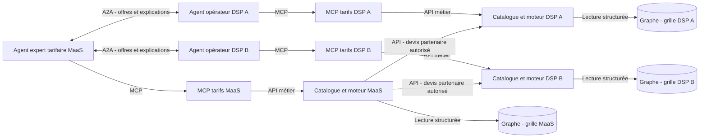

#### Outils proposés sur chaque serveur MCP tarifaire

Ces noms sont des contrats d’outils à implémenter dans le POC, pas des outils déjà disponibles.

| Outil MCP | Paramètres principaux | Résultat attendu |
|---|---|---|
| `list_fare_products` | Date du voyage, réseau, zones, profil. | Produits publiés accessibles à l’appelant et versions applicables. |
| `get_fare_grid` | Identifiant de grille, date d’effet ou version précise. | Grille structurée, montants, devise, conditions, provenance et statut de publication. |
| `get_fare_rules` | Produit et version. | Conditions d’éligibilité, correspondances, restrictions et justificatifs. |
| `quote_journey` | Parcours, date, profil et produits envisagés. | Devis déterministe : total, détail, versions utilisées, identifiant et expiration. |
| `explain_fare` | Identifiant du devis. | Décomposition vérifiable et références des règles ; formulation par l’agent à partir de ces éléments. |

- L’organisation autorisée est déterminée par l’identité authentifiée ; un paramètre fourni par le modèle ne permet jamais de changer de périmètre.
- A2A permet aux agents d’obtenir des propositions et explications. Pour produire un devis composé vérifiable, le moteur MaaS peut appeler les API tarifaires partenaires autorisées et conserver les identifiants des devis obtenus.
- Chaque version de grille porte un identifiant stable, une période d’effet, un statut, une provenance et l’autorité d’approbation. Les prix sont stockés en unités monétaires exactes ; les règles sont formalisées et exécutées par les moteurs, sans calcul confié au modèle.
- GraphRAG recherche et explique les relations et documents associés. La lecture de la grille pour un calcul passe par une requête structurée du service catalogue sur la version approuvée, sans extraction approximative depuis des passages de texte.
- Une interface d’administration importe, contrôle et publie les grilles dans le périmètre autorisé. Les outils MCP proposés ci-dessus sont en lecture et simulation ; toute future modification exige un workflow distinct d’approbation.
- Pour ce POC, le graphe tarifaire est la référence des catalogues fictifs approuvés. Lors d’une connexion à un SI existant, documenter si le graphe devient la référence ou reste une projection synchronisée ; éviter deux sources concurrentes.
- La commande conserve le devis accepté et les versions utilisées. À son expiration ou en cas de changement imposant un nouveau devis, le service recalcule et demande une nouvelle confirmation si le prix ou les conditions changent.

Les liens entre services du schéma global expriment les dépendances métier. Les opérations longues sont coordonnées par les workflows Temporal ; les appels exécutés par une Activity utilisent les opérations internes des services et ne redémarrent pas récursivement un nouveau workflow. Le schéma dédié Temporal précise cette séparation.

### Comment lire les échanges

| Liaison | Usage dans cette architecture | Exemple |
|---|---|---|
| A2A | Un agent confie une tâche à un autre agent et récupère son état et son résultat. | Le distributeur demande à l’opérateur de résoudre un chargement interrompu. |
| MCP | Le client MCP de l’environnement d’un agent invoque un outil exposé par un serveur MCP. | L’expert tarifaire appelle un outil de calcul ou l’analyste DSP recherche une clause. |
| API métier | L’adaptateur MCP appelle le service responsable de l’opération. | Le service de commande vérifie les droits et l’idempotence avant d’initier un paiement. |
| Webhook et événements | Les services publient les changements d’état ; les consommateurs gèrent doublons et retards. | Le paiement change d’état ou le valideur remonte une validation hors connexion. |
| SDK Keyple et APDU | Le code billettique pilote les échanges avec le support Calypso via le lecteur. | Chargement et validation du contrat de transport. |
| GraphRAG | Le service sélectionne relations et passages autorisés pour fournir un contexte sourcé à l’agent. | Retrouver les offres liées à deux réseaux et leurs conditions applicables. |

- Les flèches MCP montrent les appels ; leurs résultats reviennent au même client. Les noms de tâches et d’outils sont indicatifs, à formaliser dans les contrats d’interface.
- A2A et MCP ne donnent pas, à eux seuls, le droit d’acheter, de rembourser ou de charger une carte. L’identité, la délégation, les limites et les confirmations sont contrôlées côté serveur et service métier.
- Chaque opérateur conserve son périmètre de confiance. Le bloc de stockages transactionnels regroupe visuellement des systèmes qui peuvent être séparés ; il n’implique pas une base accessible à tous.
- Le graphe peut être partitionné ou fédéré. Les filtres d’accès s’appliquent aussi aux documents, index et caches avant leur transmission au modèle.
- Les applications de chargement et les valideurs disposent des moyens cryptographiques requis ; les clés ne sont jamais confiées aux agents IA.
- La validation locale ne dépend d’aucun appel A2A, MCP, GraphRAG ou blockchain. Le registre de preuves est alimenté après les opérations.
- Le consentement bancaire passe par le parcours du prestataire ; les identifiants bancaires ne transitent pas dans les conversations entre agents.

Références de protocole : [A2A](https://a2a-protocol.org/dev/specification/) et [architecture MCP](https://modelcontextprotocol.io/docs/learn/architecture). Figer les versions retenues lors de l’implémentation.

**Illustration complémentaire à produire :** un diagramme de séquence du parcours complet, incluant les réponses, confirmations et reprises après incident.

## 5. Base graphe et GraphRAG — Relier les données et donner du contexte aux agents

### Rôle dans l’architecture

- Stocker dans une base graphe les entités métier et leurs relations : autorités organisatrices, opérateurs, réseaux, zones, offres, versions tarifaires, conditions d’éligibilité, contrats de DSP et règles de reversement.
- Utiliser GraphRAG comme couche de recherche et de génération de réponses fondées sur ce graphe et les documents sources. GraphRAG désigne une approche ; ce n’est pas, à lui seul, un moteur de base de données.
- Combiner parcours des relations, recherche documentaire et recherche vectorielle selon la question.
- Distinguer cette approche générale du projet Microsoft GraphRAG, qui constitue une implémentation à étudier. Le moteur graphe et les composants de recherche seront choisis lors du cadrage technique.

### Modèle de données proposé

| Entité | Relations à représenter |
|---|---|
| Canal de vente, distributeur et accord de distribution | Autorisent la vente de produits et définissent les modes de délivrance, frais et commissions applicables. |
| Autorité organisatrice | Confie un service par une DSP ; approuve une gamme tarifaire. |
| Opérateur | Exploite un réseau ; distribue ou accepte une offre. |
| Catégorie de profil et condition d’éligibilité | Relient une offre aux critères d’âge, de statut, de résidence ou d’abonnement ; précisent les preuves et périodes applicables. |
| Offre et version tarifaire | Couvre des zones ; impose des conditions ; possède une période de validité. |
| Contrat de DSP et clause | Encadre un opérateur ; définit des obligations et des règles de répartition. |
| Document et passage source | Justifie une règle ou une relation ; porte une version et une provenance. |
| Commande, paiement, chargement et validation | Références ou projections reliées pour expliquer un parcours et ses incidents. |

- Associer aux faits leur source, leur version, leurs dates d’effet et leur date d’intégration.
- Distinguer les faits importés des systèmes de référence, les relations extraites par IA et les interprétations restant à valider.
- Conserver les documents originaux dans un stockage documentaire ; relier les passages cités aux entités du graphe.

### Alimentation et actualisation

- Importer les catalogues structurés et les contrats de DSP fictifs du POC.
- Identifier les entités, rapprocher leurs identifiants et contrôler les relations avant publication.
- Faire valider les règles extraites des contrats avant toute utilisation pour une décision tarifaire ou financière.
- Actualiser les projections opérationnelles par événements, avec déduplication, suivi du retard et possibilité de reconstruction.
- Propager corrections, suppressions et changements de droits dans le graphe, les index et les caches.

### Articulation avec les transactions

- Conserver commandes, paiements et écritures billettiques dans un stockage transactionnel de référence ; le graphe peut en porter des projections utiles à l’analyse.
- Lire l’état autoritaire dans le service métier avant toute émission, remboursement ou reprise de chargement.
- Utiliser les règles approuvées du moteur tarifaire pour les calculs ; une réponse GraphRAG ne constitue pas une autorisation de vente.
- Garder la validation locale indépendante de la disponibilité du graphe, du modèle IA et de la blockchain.
- Filtrer l’accès aux entités, relations et documents selon l’organisation et les droits de l’agent, avant de constituer le contexte envoyé au modèle.

### Questions à démontrer

- « Quelles offres couvrent ces deux réseaux pour ce profil et à cette date, et quelles conditions les justifient ? »
- « Quelle clause de DSP explique cette règle de répartition des recettes ? »
- « Quels produits et opérateurs seraient affectés par une modification de cette zone tarifaire ? »
- « Quels événements relient ce paiement à ce chargement interrompu ? »

Les réponses doivent restituer les sources, la date de validité et les éventuelles contradictions. En l’absence de preuve suffisante, l’agent doit signaler l’incertitude ou demander une vérification.

## 6. Paiement — Prépayé, postpayé, open banking et open payment

### Distinguer le mode de facturation du moyen de paiement

- **Prépayé :** le voyageur achète un droit ou alimente un solde avant le voyage. Les consommations suivantes utilisent ce droit ou ce solde selon les règles du produit.
- **Postpayé :** les passages sont collectés, les trajets reconstitués et le montant calculé après usage, éventuellement avec agrégation et plafonnement tarifaire, avant encaissement.
- **Open banking :** initiation de paiement bancaire utilisée pour un achat, un rechargement ou le règlement d’une facture. Un consentement ponctuel ne constitue pas automatiquement une autorisation de débits futurs.
- **Open payment transport :** usage d’une carte bancaire sans contact ou d’un portefeuille compatible au valideur. Le parcours EMV et l’acquisition bancaire sont distincts du chargement Calypso via Keyple.
- Une carte bancaire prépayée peut être utilisée dans un parcours transport facturé après usage : le financement de la carte et le mode de facturation du transport sont deux dimensions différentes.
- Dans le POC, permettre des produits de transport prépayés et postpayés. Un droit préacheté associé à un identifiant bancaire relève d’un choix de compte mobilité à intégrer et vérifier ; il ne s’agit pas d’écrire un titre Calypso dans la carte bancaire.

### Parcours prépayé

1. Calculer un devis à partir de la grille applicable et obtenir la confirmation du voyageur.
2. Initier le paiement ou le rechargement via le prestataire retenu.
3. Vérifier l’état du paiement qui autorise l’émission ou le crédit du solde ; distinguer autorisation, exécution et réception des fonds.
4. Créer le droit, charger le support compatible ou créditer le compte mobilité, selon le produit.
5. À la validation, contrôler puis consommer le droit ou le solde selon les règles du produit et le mode de fonctionnement de l’équipement.

### Parcours postpayé

1. Identifier le support par une référence protégée et vérifier les conditions d’acceptation et de risque applicables au parcours.
2. Collecter les passages des valideurs multiconstructeurs, y compris les remontées différées.
3. Dédupliquer et reconstituer les trajets, en traitant les entrées ou sorties manquantes selon une règle explicite.
4. Appliquer les versions tarifaires valables aux dates des trajets, les correspondances et le plafonnement prévu au contrat.
5. Produire un relevé et un montant à encaisser ; déclencher le paiement via le moyen autorisé et disponible.
6. Rapprocher les encaissements et répartir les recettes selon les règles DSP ; gérer les refus, reprises et régularisations.

Une validation acceptée ne prouve pas que le paiement final a été encaissé. Une préautorisation éventuelle ne constitue pas non plus l’encaissement du montant définitif. Les modalités d’autorisation, d’agrégation et de recouvrement dépendent du prestataire et des règles applicables au moyen de paiement ; les vérifier avant un pilote réel.

### Services et accès des agents

- Ajouter un service de compte mobilité pour les droits, soldes et références de supports, et un moteur de facturation après usage alimenté par les validations normalisées.
- Conserver les mouvements de solde, créances, factures, tentatives de paiement et encaissements dans le stockage transactionnel ; le graphe reçoit les relations et projections autorisées.
- Exposer via le MCP vente et paiement les outils proposés `get_billing_mode`, `get_mobility_account`, `get_usage_statement` et `get_payment_status`, avec filtrage des droits. Les montants sont calculés par les services déterministes.
- L’agent explique une facture ou prépare une demande de régularisation ; il ne choisit pas librement un débit, une règle de plafonnement ou une politique de recouvrement.
- Séparer le connecteur open banking du connecteur PSP/acquéreur EMV. Ne transmettre aux agents et au graphe ni numéro de carte bancaire brut, ni cryptogramme, ni secret de paiement.
- Vérifier les notifications, gérer les doublons et rendre idempotents crédit de solde, émission de droit et encaissement.
- Documenter le risque hors connexion : limites d’acceptation, données locales nécessaires, retard de propagation des blocages et traitement d’un solde insuffisant. La validation locale ne garantit pas l’absence d’impayés.
- Prévoir une clôture de facturation et une politique explicite pour les validations tardives : recalcul versionné et régularisation traçable plutôt que modification silencieuse d’une facture déjà encaissée.

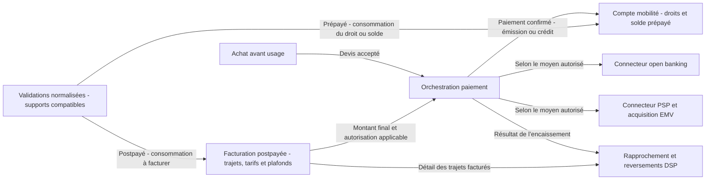

Références de départ : [Mastercard — Pay-as-you-Go](https://engagepartners.mastercard.com/English/solutions/solution/Pay-as-you-Go) et [TrueLayer — états de paiement et notifications](https://docs.truelayer.com/docs/payments-api-webhook-reference). Les modes réellement disponibles seront confirmés avec le prestataire ; le POC utilise des simulations ou une sandbox.

## 7. Keyple et Calypso — Écrire, valider et contrôler les titres

- Situer Calypso, Eclipse Keyple et les API Eclipse Keypop.
- Décrire la lecture du support et le chargement du contrat de transport.
- Préciser le modèle de données carte et les moyens cryptographiques nécessaires au démonstrateur.
- Préserver la validation locale, y compris lors d’une indisponibilité réseau.
- Distinguer commande commerciale, droit de transport, écriture sur carte et événement de validation.
- Traiter le cas d’un chargement interrompu ou d’un accusé de réception perdu avant toute nouvelle émission.
- Utiliser le démonstrateur Keyple de la CNA comme référence technique à évaluer.

### Valideurs multiconstructeurs — Unifier les remontées sans imposer un fabricant

Un même réseau peut exploiter plusieurs marques et générations de valideurs. Un fabricant peut aussi équiper plusieurs opérateurs. L’architecture distingue donc fabricant, modèle, équipement, opérateur et réseau ; le fabricant ne détermine pas à lui seul l’appartenance d’une validation à une DSP.

- Prévoir un connecteur pour chaque interface réellement utilisée : API, messages ou fichiers de lots, directement depuis l’équipement ou depuis le back-office du fabricant. Les protocoles seront documentés après accès aux spécifications ; aucun support natif n’est supposé.
- Keyple reste le choix proposé pour les composants billettiques développés dans le POC. La collecte ne suppose pas que tous les valideurs existants utilisent Keyple ; compatibilité du support et interopérabilité des remontées sont vérifiées séparément.
- Pour l’open payment, prévoir une chaîne EMV compatible et un raccordement au PSP/acquéreur distincts de Keyple/Calypso ; la normalisation des événements métier ne remplace pas les échanges bancaires requis.
- La décision de validation reste locale au valideur. Son journal permet la transmission différée, les reprises et la gestion des périodes sans réseau.
- Les connecteurs alimentent un service déterministe de collecte. Les remontées terrain ne passent pas par A2A, MCP ou un modèle de langage.

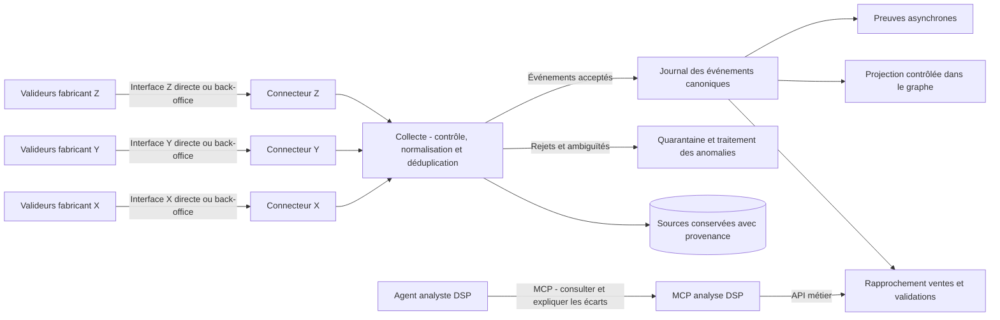

#### Contrat commun d’un événement de validation

Le format ci-dessous est une proposition pour le POC, à adapter aux données réellement exposées par chaque fabricant. Une information absente reste absente ; elle n’est pas inventée par le connecteur.

| Groupe | Champs ou informations à prévoir |
|---|---|
| Identité et provenance | Identifiant source, identifiant canonique, fabricant, modèle, équipement, opérateur, réseau et version du connecteur. |
| Temps | Horodatage terrain avec fuseau ou décalage connu, date de réception et indicateur de qualité de l’horloge. |
| Opération | Validation acceptée, refusée, entrée, sortie ou autre type documenté ; motif source et motif normalisé. |
| Contexte de transport | Ligne, arrêt, véhicule ou zone quand disponibles et fiables. |
| Support et droit | Référence pseudonymisée du support, produit et contrat lorsqu’ils sont exposés ; aucune clé secrète ni donnée bancaire. |
| Transport et schéma | Numéro de séquence ou de lot si disponible, version du format et référence vers la source conservée. |
| Prépayé et postpayé | Exactitude des soldes, trajets et plafonds ; absence de double débit ; impayés et régularisations traçables. |
| Commissions de distribution | Exactitude par vendeur et version contractuelle, conservation des montants répartis, arrondis, régularisations et absence de double règlement. |
| Rapprochement | Liens établis vers une vente ou un droit, avec méthode et statut de rapprochement ; ne pas supposer qu’un identifiant de commande est présent sur le valideur. |

- Vérifier l’identité de la source et son rattachement au parc autorisé. Distinguer l’authentification du transport d’une éventuelle signature de l’événement, qui dépend des capacités du matériel.
- Dédupliquer avec une clé stable incluant le périmètre source, l’équipement et l’identifiant d’événement, adaptée aux redémarrages et remises à zéro de compteur. Tester les doublons reçus par des chemins différents.
- Si aucun identifiant fiable n’existe, documenter une stratégie de rapprochement prudente et signaler les ambiguïtés ; deux passages proches peuvent être légitimes.
- Acquitter la réception seulement après persistance durable ; permettre la reprise et le rejeu sans double comptabilisation.
- Gérer l’arrivée tardive ou désordonnée, les trous de séquence, les changements de schéma et les horloges décalées. Conserver l’heure source et l’heure de réception sans masquer leur différence.
- Conserver séparément les refus et les validations acceptées. Les règles DSP déterminent quels événements entrent dans chaque indicateur ou calcul de reversement.
- Une correction produit une trace liée à l’événement initial ; les clôtures et recalculs de recettes doivent être versionnés.
- Ajouter au graphe les fabricants, modèles, équipements et affectations aux réseaux avec dates d’effet. Projeter seulement les événements ou agrégats utiles aux agents, selon les volumes et droits d’accès.
- L’agent analyste DSP utilise le MCP d’analyse pour expliquer les écarts et remonter les anomalies ; il ne modifie pas librement les événements sources.

## 8. Preuves du POC — Journal signé et blockchain locale

- Conserver les validations détaillées hors du journal de preuves, avec leur provenance et leurs contrôles d’accès.
- Constituer des lots et relevés signés, avec une sérialisation définie, des références stables et des corrections traçables.
- Démontrer la détection d’une modification et la vérification d’un relevé, avec ancrage des empreintes sur une blockchain locale et vérification de la transaction.
- Le journal signé apporte une vérification d’intégrité ; il ne reproduit pas la gouvernance d’un registre distribué et ne prouve pas la réalité d’un passage.
- Implémenter `ProofAnchoringWorkflow` : publier une preuve par lot, suivre sa confirmation et gérer les résultats incertains sans double ancrage. Conserver les données détaillées hors chaîne ; aucune monnaie réelle ni règlement financier sur chaîne.
- Comparer avec le journal signé ; une chaîne de développement ne démontre pas la gouvernance d’un consortium.

## 9. Agences et automates — Conversation temps réel par voix et texte

### Agent conversationnel temps réel à faible latence

- Assurer l’échange vocal et textuel avec le voyageur, avec réponse audio progressive, transcription affichée et possibilité d’interrompre la réponse.
- Proposer une session WebRTC pour l’audio et un canal WebSocket pour le texte et les événements ; préciser les transports définitifs lors du choix du moteur temps réel.
- Évaluer un moteur speech-to-speech ou une chaîne reconnaissance vocale → modèle conversationnel → synthèse vocale. Le choix dépendra de la latence et de la qualité mesurées en français.
- Séparer les réactions conversationnelles rapides des tâches métier plus longues : informer de la recherche en cours pendant qu’un agent métier consulte une grille ou vérifie un paiement.
- Déléguer via A2A au conseiller/distributeur MaaS, qui mobilise les agents tarifaires et de vente ainsi que leurs outils MCP.
- Corréler session, tour de parole et tâche métier ; ignorer les résultats devenus obsolètes après une correction. L’arrêt de la parole ne vaut pas annulation d’une transaction : son état doit être vérifié.
- Annoncer un prix ou un succès de paiement seulement après réception d’un résultat métier vérifié.
- Fixer avant essais un budget de latence pour chaque étape et mesurer les percentiles p50/p95 ; aucun niveau de performance n’est garanti à ce stade.

### Parcours et critères d’évaluation

- Voix → demande reconnue → confirmation → tâche métier → réponse textuelle et vocale.
- Texte saisi → dialogue et, au choix, synthèse vocale ; parcours tactile disponible à tout moment.
- Évaluer le français, le bruit, l’éclairage, l’angle du visage, les capacités du terminal et l’utilité pour les publics concernés, sans présumer une accessibilité universelle.
- Mesurer le délai jusqu’au premier retour utile, le délai de réponse métier, le délai d’arrêt audio après interruption séparément.
- Mesurer les erreurs de reconnaissance, les abstentions, les corrections et la réussite de l’achat. Une réponse rapide mais incorrecte ne constitue pas une réussite.
- Tester audio absent, coupure de session, interruption et changement de demande pendant un appel métier.
- Conserver l’obligation de confirmer le produit et le prix avant achat, quel que soit le mode d’entrée.

## 10. POC — Un parcours multimodal, jusqu’au rapprochement des recettes

> **Proposition de réalisation simplifiée :** voir [Une agence de mobilité augmentée par l’IA](proposition-poc-maas-agentique.md). Ce document propose un sous-ensemble démontrable et distingue intégrations réelles, simulateurs et extensions futures ; les éléments ci-dessous conservent la vision détaillée.

### Périmètre du démonstrateur billettique

- Harness d’exécution versionné pour les agents ; expérience Harness² isolée sur un scénario SAV simulé, avec référence, variantes et évaluation indépendante. Aucune amélioration récursive dans le chemin de vente courant.

- Intégrer OPA, OpenTelemetry et CloudEvents comme composants retenus, en complément de Temporal. Utiliser une identité numérique simulée jusqu’au choix d’un fournisseur réel.

- Deux opérateurs fictifs de transport collectif et leurs offres tarifaires.
- Profils fictifs adulte, jeune et étudiant ; droits vérifiés, expirés ou manquants, avec règles de réduction et de cumul différentes selon les offres.
- Extension multimodale : un fournisseur vélo simulé intégré de bout en bout ; autopartage, covoiturage et parking relais décrits par leurs contrats et scénarios, avec simulateurs à ajouter dans un second incrément.
- Deux vendeurs fictifs avec des accords de commission différents ; comparer le montant dû selon le vendeur, à produit et prix voyageur identiques.
- Un poste SAV agence minimal : recherche de commande, chronologie, diagnostic du chargement, préparation d’une reprise ou d’un remboursement et suivi du résultat.
- Deux canaux minimum pour le POC : boutique web et automate simulé ; prévoir le même contrat d’API pour l’application mobile, le guichet et les partenaires.
- Démontrer un achat web suivi d’un chargement sur automate, avec reprise de la même commande sans double émission.
- Premier incrément : agent conversationnel, distributeur MaaS coordonnant tarification et vente/SAV, et deux agents opérateurs. Les rôles internes regroupés sont annoncés explicitement dans la console.
- Incréments complémentaires : agent justificatifs, agent fournisseur vélo, analyste DSP/distribution ; isoler les rôles dans des agents distincts quand cela sert la démonstration.
- Console de démonstration : visualisation des échanges A2A/MCP, des preuves, des états et des latences ; indicateur réel, sandbox ou simulé pour chaque intégration.
- Une base graphe avec trois périmètres tarifaires explicites (DSP A, DSP B et MaaS), alimentée par les catalogues et DSP fictifs, des documents sources et une couche GraphRAG accessible aux agents habilités.
- Trois serveurs MCP tarifaires exposant la consultation des grilles et le calcul de devis via les services métier de chaque périmètre.
- Des services métier communs au démonstrateur pour tarification, commande et suivi transactionnel.
- Temporal avec `PurchaseAndIssueWorkflow` et `AfterSalesWorkflow` dans le premier incrément ; étendre aux autres workflows au rythme des scénarios.
- Intégration réelle à une sandbox open banking avec paiement ponctuel et consentement de test ; prestataire et accès à sélectionner. Open payment EMV simulé. Support de test Calypso ou simulation explicitement identifiée.
- Deux parcours de facturation : prépaiement d’un droit ou d’un solde, puis postpaiement de trajets avec plafonnement fictif. Simuler séparément la chaîne open payment EMV si aucun matériel et prestataire compatibles ne sont disponibles.
- Validation locale et transmission différée des événements.
- Deux fabricants fictifs de valideurs, avec deux formats distincts simulés, deux connecteurs et un contrat canonique commun. Les interfaces réelles restent à valider sur matériel ou documentation fabricant.
- Journal signé et blockchain locale pour les preuves du POC ; un contrat minimal, sans déploiement public ni actif de valeur.
- Dialogue temps réel voix/texte présent dès le premier incrément ; lecture labiale réservée à la cible future.

### Parcours nominal prépayé

1. Le voyageur exprime son besoin.
2. Le distributeur interroge les agents des opérateurs via A2A ; ils consultent GraphRAG pour retrouver offres, relations et conditions sourcées.
3. Le moteur tarifaire calcule les offres admissibles ; l’agent explique les choix.
4. Le voyageur confirme le produit et son prix.
5. Le paiement est initié et son état vérifié.
6. Le contrat de transport est chargé via Keyple sur le support de test.
7. Le voyageur valide, y compris sans connexion au système central.
8. Les événements sont remontés, dédupliqués et rapprochés.
9. Les règles de répartition calculent les parts des opérateurs et la commission du vendeur, puis produisent les relevés et règlements simulés avec leurs justificatifs.

### Variante postpayée du POC

1. Présenter un support de test ou un identifiant simulé accepté dans le parcours postpayé.
2. Collecter les passages issus des deux fabricants fictifs.
3. Reconstituer les trajets et calculer le montant selon les grilles et plafonds applicables.
4. Déclencher un encaissement simulé ou sandbox avec le moyen autorisé.
5. Produire le relevé explicable, rapprocher le paiement et calculer les reversements.

### Variante multimodale du POC

1. Recevoir un parcours transport collectif puis vélo, externe ou prédéfini, et proposer les deux offres commerciales correspondantes.
2. Vérifier la disponibilité du vélo, la validité des devis et les possibilités de réservation de l’opérateur simulé.
3. Confirmer les engagements après accord du voyageur et conserver les références des sous-commandes.
4. Suivre la validation du transport, le déverrouillage du vélo et la fin de location.
5. Calculer la consommation finale, les commissions et les parts fournisseurs ; afficher le relevé commun.
6. En cas d’échec partiel, appliquer les annulations ou compensations autorisées et exposer l’état réel au voyageur et au SAV.

### Variante parking relais du POC — Second incrément

1. Consulter un P+R fictif et son offre combinée avec le transport collectif.
2. Confirmer le devis et une réservation uniquement si le simulateur la prend en charge.
3. Enregistrer l’entrée, la validation transport puis la sortie du parking.
4. Appliquer une réduction fictive selon une règle explicite de preuve d’usage du réseau.
5. Calculer le montant final, la commission du vendeur et les parts parking/transport.
6. Rejouer le scénario avec une validation transport tardive et traiter la régularisation dans le SAV agence.

### Scénarios d’incident

- Révocation de délégation pendant une attente Temporal, indisponibilité d’OPA et contexte d’autorisation falsifié.
- CloudEvent invalide ou répété, schéma inconnu, même passage reçu par deux connecteurs.
- Indisponibilité du Collector OpenTelemetry et vérification de l’absence de données personnelles dans les traces.

- Arrêt et reprise d’un Worker Temporal pendant une vente, notification bancaire répétée, résultat de chargement incertain et approbation humaine après reprise.

- Droit étudiant expiré, anniversaire entre achat et voyage, avantage non reconnu par un partenaire et tentative de cumul interdit.

- Paiement confirmé mais chargement interrompu.
- Vélo devenu indisponible après le devis, déverrouillage échoué, restitution non remontée ou réservation partenaire expirée.
- Offre combinée partiellement confirmée ; annulation soumise à frais ; événement d’usage reçu deux fois.
- Paiement postpayé refusé, autorisation expirée ou reprise de débit reçue deux fois.
- Commission différente selon le vendeur ; remboursement partiel après règlement de la commission ; changement de contrat et double demande de règlement.
- Solde prépayé insuffisant ; validation tardive après clôture ; trajet incomplet ; franchissement d’un plafond tarifaire.
- Chargement effectué mais accusé de réception perdu.
- Notification de paiement ou événement de validation reçu deux fois.
- Lot de validations tardif, horloge décalée, compteur réinitialisé, événement reçu directement puis via le back-office fabricant.
- Format fabricant modifié, événement incomplet ou équipement non reconnu ; traitement en quarantaine et rejeu contrôlé.
- Opérateur ou réseau indisponible.
- Divergence entre les données de deux opérateurs.
- Offre expirée entre proposition et confirmation.
- Achat sur un canal puis reprise sur un autre ; double demande simultanée de délivrance.
- Produit ou remboursement demandé par un canal non habilité.
- Graphe en retard sur une mise à jour tarifaire ou sur l’état d’un paiement.
- Clause contradictoire, relation extraite erronée ou document inaccessible à l’agent.
- Demande de remboursement dépassant la délégation de l’agent.
- Deux conseillers interviennent sur le même dossier ; habilitation insuffisante ; remboursement demandé deux fois ; panne du prestataire après confirmation.
- Dossier provenant d’un autre canal ou opérateur ; vérification des droits de consultation et d’action de l’agence.
- Demande mal reconnue par l’interface vocale.

**Cas narratif central :** « Mon paiement est passé, mais ma carte n’a pas été rechargée et mon bus arrive. » Montrer les vérifications, les échanges entre agents et la résolution autorisée.

## 11. Évaluation — Mesurer ce que l’architecture apporte

Évaluer en priorité la démonstration de billettique IA : interaction, coopération, usage des connaissances et résolution des incidents. Utiliser un parcours classique comme référence sur quelques scénarios identiques pour mesurer l’apport des agents. Le calcul d’itinéraires et l’IV ne font pas partie des critères du POC.

| Dimension | Mesures à collecter |
|---|---|
| SAV en agence | Temps de résolution, exactitude du diagnostic, respect des habilitations, suivi des actions et absence de double remboursement ou chargement. |
| Profils et éligibilité | Exactitude du tarif selon la date et le fournisseur, contrôle des justificatifs, respect du cumul et absence d’exposition de pièces personnelles. |
| Service voyageur | Taux de réussite, délai de résolution et interventions humaines. |
| OPA | Décisions conformes à la matrice de droits, révocation prise en compte et refus des actions sensibles sans décision valide. |
| OpenTelemetry | Corrélation du parcours, qualité du filtrage, latences et reprises visibles sans confusion avec les opérations métier. |
| CloudEvents | Conformité des enveloppes et schémas, déduplication, provenance et traitement des événements tardifs. |
| Temporal | Reprise après arrêt du Worker, attentes durables, compensation vérifiée et absence de double effet externe. |
| Fiabilité | Doubles émissions, incohérences et succès des reprises après incident. |
| Validation | Latences médiane et haute, fonctionnement hors connexion. |
| Collecte multiconstructeur | Délai de remontée, taux de normalisation, pertes détectées, doublons évités, rejets, reprises et fidélité au format source. |
| Harness et Harness² | Comparaison référence/variante à budget comparable, résultats sur cas non utilisés pour l’amélioration, régressions, coût et respect des politiques non modifiables. |
| Agents IA | Exactitude des propositions, respect des autorisations, coût et temps de traitement. |
| Parking relais | Fiabilité de la disponibilité, cohérence entrée/sortie, calcul de durée, application justifiée des réductions et régularisation des preuves tardives. |
| Mobilités partagées | Disponibilité revérifiée, réservations confirmées, reprise après échec partiel, exactitude des durées facturées et clôture des usages. |
| Distribution multicanale | Cohérence des devis à contexte égal, respect des droits du canal, reprise de commande et absence de double émission. |
| Interopérabilité | Effort d’intégration d’un opérateur et qualité des échanges A2A. |
| Souplesse et agilité | Temps et effort pour ajouter un vendeur ou un connecteur, modifier une règle et remplacer un modèle ; nombre de composants affectés, compatibilité des opérations en cours et régressions. |
| Prépayé et postpayé | Exactitude des soldes, trajets et plafonds ; absence de double débit ; impayés et régularisations traçables. |
| Commissions de distribution | Exactitude par vendeur et version contractuelle, conservation des montants répartis, arrondis, régularisations et absence de double règlement. |
| Rapprochement | Écarts détectés, opérations expliquées et temps de traitement des contestations. |
| GraphRAG | Pertinence des relations retrouvées, exactitude des citations, fraîcheur, abstention, absence de fuite entre opérateurs, coût et latence. |
| Journal signé | Intégrité des lots et relevés, traçabilité des corrections et détection des modifications. |
| Conversation temps réel | Latences p50/p95 du premier retour utile et de la réponse métier, délai d’interruption audio et gestion des résultats obsolètes. |
| Interaction voix/texte | Erreurs de reconnaissance vocale, corrections nécessaires et taux de réussite de l’achat. |

- Comparer aussi une recherche documentaire/vectorielle seule à GraphRAG sur le même corpus et les mêmes questions, avec réponses de référence validées.
- Définir les seuils de réussite avant les essais.
- Séparer résultats mesurés, limites du dispositif et hypothèses de généralisation.
- Documenter les versions des composants, les jeux d’essai et les conditions d’exécution.

## 12. Avantages, inconvénients et compromis de l’architecture

Cette section expose les bénéfices attendus et les contraintes de l’architecture proposée. Aucun gain de coût, de performance, d’accessibilité ou de qualité n’est considéré comme acquis avant les essais. Le démonstrateur peut valider des mécanismes et des parcours ; il ne prouve pas à lui seul leur efficacité à l’échelle d’un réseau réel.

### Avantages attendus

**La souplesse et l’agilité sont des bénéfices centraux attendus de cette architecture.** Le découpage en capacités, les interfaces explicites et les règles versionnées visent à faciliter l’ajout d’acteurs, l’évolution des offres et le remplacement de composants sans reconstruire l’ensemble du système. Ces bénéfices restent à mesurer : ils dépendent de la stabilité des contrats d’interface et de la maîtrise des dépendances.

| Avantage | Apport concret pour la billettique | Comment le vérifier dans le POC |
|---|---|---|
| Souplesse d’intégration | Ajouter un opérateur, un vendeur, un canal ou un fabricant grâce à des interfaces et connecteurs explicites, en limitant les changements dans les autres composants. | Ajouter un vendeur et un format de validation ; mesurer l’effort, les adaptations et les composants touchés. |
| Agilité métier | Faire évoluer tarifs, réductions, commissions et autorisations par des règles approuvées et versionnées, sans modifier séparément chaque canal de vente. | Modifier une réduction étudiant et une commission ; vérifier leur application sur les canaux et la conservation des anciennes versions pour les opérations en cours. |
| Évolution indépendante | Remplacer un modèle IA ou un connecteur, améliorer un agent et faire évoluer un service en préservant ses contrats d’interface. | Remplacer un composant et exécuter les mêmes scénarios ; relever les adaptations, latences et régressions. |
| Expérimentation progressive | Activer une capacité sur un périmètre restreint, comparer les résultats et revenir à la version précédente si nécessaire. | Démontrer une activation limitée à un canal ou un acteur, puis son retrait sans interrompre les autres parcours. |
| Accompagnement personnalisé | L’agent explique les offres et réductions applicables, demande les éléments manquants et aide à résoudre un incident. | Comparer réussite du parcours, erreurs et interventions humaines avec une interface classique. |
| Coopération entre acteurs | A2A permet de déléguer des tâches à des agents indépendants ; MCP expose des outils selon leurs droits. | Réaliser une vente et un SAV impliquant deux opérateurs et vérifier les échanges ainsi que les limites de délégation. |
| Cohérence entre canaux | Vente web, mobile, automate et agence utilisent les mêmes règles métier et références de commande. | Reprendre un achat sur un autre canal sans divergence de tarif ni double émission. |
| Explications fondées sur les données | Le graphe relie offres, contrats, profils et acteurs ; GraphRAG retrouve les sources utiles pour expliquer un résultat. | Contrôler la pertinence des relations, la validité des sources et l’abstention quand les preuves manquent. |
| Continuité après incident | Temporal conserve la progression et coordonne attentes, reprises et compensations. | Arrêter un Worker pendant une vente, le relancer et vérifier l’état final ainsi que l’absence de double effet externe. |
| Autorisations explicites | OPA permet de versionner et tester les décisions d’accès et de délégation, indépendamment des formulations du modèle. | Tester une action autorisée, un dépassement de plafond et une révocation pendant une attente. |
| Intégration multiconstructeur | Les connecteurs et enveloppes CloudEvents donnent une représentation commune aux remontées de matériels différents. | Injecter deux formats, des doublons et des événements tardifs ; vérifier leur normalisation et leur rapprochement. |
| Traçabilité de la démonstration | OpenTelemetry relie les appels IA aux opérations et rend visibles latences, erreurs et reprises. | Retrouver le parcours complet d’un incident sans exposer de données personnelles dans les traces. |
| Vérification partagée des preuves | L’ancrage de lots permet aux participants de vérifier l’intégrité des données utilisées pour un relevé ou un reversement. | Détecter une modification de lot dans le journal signé ; comparer le journal signé et l’ancrage sur la blockchain locale. |
| Diversité des interactions | Texte et voix offrent plusieurs façons d’interagir avec le service. | Mesurer l’utilité réelle, les corrections et la réussite des tâches avec des utilisateurs et conditions représentatifs. |

### Inconvénients et limites

| Limite | Conséquence possible | Réponse proposée et limite résiduelle |
|---|---|---|
| Nombre élevé de composants | Intégration, exploitation et diagnostic plus difficiles ; déploiement lourd pour un petit périmètre. | Construire par incréments et regrouper les rôles internes quand leur séparation n’apporte rien. La plateforme conserve un coût d’exploitation. |
| Coût et latence des agents | Multiplication des appels de modèles, recherches et échanges A2A ; attente accrue pour le voyageur. | Fixer des budgets, limiter les délégations, paralléliser les lectures indépendantes et mesurer le coût par parcours réussi. Les performances restent dépendantes des modèles et services. |
| Résultats IA incertains | Mauvaise interprétation d’une demande, d’une clause ou d’un justificatif. | Réponses sourcées, schémas de sortie, contrôles déterministes et revue humaine. Une explication plausible peut néanmoins être fausse. |
| Qualité et fraîcheur des données | Un graphe incomplet ou un index en retard peut conduire à une proposition inadaptée. | Provenance, versions, dates d’effet et vérification de l’état de référence avant engagement. L’ingestion et la maintenance restent un travail continu. |
| Interopérabilité seulement partielle | A2A, MCP et CloudEvents ne rendent pas identiques les règles, produits et API des partenaires. | Définir les contrats métier et tests de conformité. Des adaptateurs propres à chaque fournisseur restent nécessaires. |
| Transactions réparties entre acteurs | Un paiement peut réussir alors qu’une réservation ou un chargement échoue ; certaines actions sont irréversibles. | Workflows Temporal, idempotence, rapprochement et compensations explicites. Une compensation peut être différée, payante ou nécessiter une intervention humaine. |
| Gouvernance des politiques | Une politique OPA incorrecte peut refuser un droit légitime ou autoriser une action excessive. | Revue, tests, versions, audit et réévaluation à l’exécution. Le moteur applique la politique ; il n’en garantit pas la justesse métier. |
| Données sensibles et surface d’accès élargie | Identités, justificatifs et historiques passent par plusieurs services et peuvent fuiter via outils, index ou traces. | Minimisation, séparation des périmètres, filtrage et rétention contrôlée. Tester les accès croisés et les instructions malveillantes dans les données. |
| Complexité de la blockchain | Gouvernance du réseau, gestion des clés, disponibilité des preuves et coût supplémentaires. | Publication asynchrone et comparaison avec un journal signé. Sans besoin de vérification entre acteurs indépendants, le bénéfice peut être insuffisant. |
| Maturité variable de la lecture labiale — cible future | Sensibilité à la langue, à l’éclairage, au cadrage et aux personnes ; erreurs pouvant perturber l’achat. | Expérimentation séparée, confirmation du texte et parcours alternatif. Ne pas en faire une condition d’accès au service. |
| Dépendances technologiques | Évolution des SDK, protocoles, modèles, licences et conditions des prestataires. | Versions figées, interfaces d’adaptation et tests de régression. Changer de fournisseur conserve un coût. |
| Écart entre simulation et terrain | Une démonstration réussie peut masquer les contraintes des équipements et systèmes réels. | Étiqueter réel, sandbox et simulé ; documenter les éléments non validés. Ne pas extrapoler à la production sans pilote représentatif. |

### Compromis assumés

- **Autonomie et contrôle :** les agents prennent en charge compréhension, explication et coordination ; les opérations engageantes passent par les règles, autorisations et services transactionnels.
- **Richesse des interactions et rapidité :** le dialogue reste réactif, tandis que la vente ou le SAV suit son état durable. Un accusé de prise en charge ne doit pas être présenté comme une opération terminée.
- **Connaissances partagées et confidentialité :** les acteurs partagent les informations nécessaires, pas un accès général aux dossiers, justificatifs ou traces.
- **Résilience et cohérence immédiate :** les validations locales et remontées différées préservent l’usage hors connexion, au prix de retards à traiter dans les soldes, plafonds et rapprochements.
- **Ambition futuriste et périmètre maîtrisé :** conserver la vue cible complète, mais démontrer chaque capacité avec un scénario identifié. Le calcul d’itinéraires et l’IV restent externes.

### Conditions pour retenir une brique après le démonstrateur

- Conserver un agent séparé si sa coopération, sa responsabilité ou son indépendance apporte une valeur mesurable par rapport à un outil ou un workflow simple.
- Retenir GraphRAG sur les questions où les relations et sources améliorent les réponses ; privilégier les lectures structurées pour les prix, droits et états.
- Conserver Temporal pour les opérations qui nécessitent attente, reprise et compensation ; maintenir les médias et validations locales sur leurs chemins temps réel.
- Évaluer ultérieurement la blockchain si le besoin de preuves entre acteurs et sa gouvernance justifient sa complexité.
- Évaluer ultérieurement la lecture labiale et ne la retenir que si les essais montrent un bénéfice pour les publics concernés, avec un parcours alternatif disponible.
- Présenter les gains avec leurs conditions de mesure et les résultats défavorables avec la même visibilité que les réussites.

## Axes futurs — Extensions de l’architecture cible, hors POC actuel

La blockchain locale fait partie du POC. Cette section réserve à une phase ultérieure sa gouvernance entre organisations indépendantes ainsi que la lecture labiale ; ces extensions ne conditionnent pas la réussite du POC.

### Axe futur 1 — Consortium blockchain pour les preuves partagées

- Poser le besoin : disposer d’éléments vérifiables pour rapprocher les opérations et répartir les recettes.
- Proposer une publication asynchrone de preuves d’événements ou de lots, hors du chemin critique du valideur.
- Définir les participants, les droits d’écriture, la gouvernance et la gestion des corrections ou contestations.
- Garder les données voyageurs et les trajets détaillés hors chaîne ; examiner les risques de corrélation des preuves.
- Expliquer la limite : l’intégrité d’une déclaration ne garantit pas la réalité du trajet déclaré.
- Comparer la blockchain à un registre central avec journal signé.
- Retenir la blockchain uniquement si l’expérimentation démontre un bénéfice pour la coopération interorganisations.

### Axe futur 2 — Agent de perception labiale

- Agent spécialisé chargé de piloter un moteur de reconnaissance visuelle de la parole (VSR), de suivre la qualité de capture et de demander une nouvelle formulation si nécessaire.
- Le moteur VSR traite les images ; un modèle de langage généraliste ne remplace pas ce composant de perception.
- Privilégier un traitement local sur le terminal pour le POC ; vérifier les capacités matérielles avant de retenir ce choix.
- Transmettre des hypothèses de texte avec horodatage, état provisoire ou final, qualité et confiance si le moteur en fournit une exploitable. Calibrer les seuils sur les essais.
- Utiliser A2A pour la coordination de la tâche et un canal d’événements pour les transcriptions progressives. Le flux vidéo reste sur le chemin de perception, sans passage par GraphRAG ou par les outils MCP métier.
- Si audio et vidéo sont disponibles, définir leur synchronisation et la gestion des désaccords ; ne pas fusionner aveuglément deux transcriptions.
- En mode silencieux, afficher la proposition de texte et permettre sa correction avant de l’utiliser comme demande métier confirmée.
- Activer la caméra à la demande de l’usager, indiquer son état et prévoir l’arrêt de la capture. Par défaut dans le POC, ne pas conserver les images.

### Schéma dédié — Dialogue rapide et perception labiale

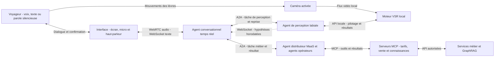

### Conditions d’ouverture de ces axes

- Blockchain : établir le besoin de vérification entre acteurs indépendants, définir la gouvernance, puis comparer au journal signé du POC en coût, disponibilité et utilité.
- Lecture labiale : choisir un moteur adapté au français, tester le matériel et mesurer l’utilité pour les usagers ; conserver une confirmation de transcription et une alternative voix/texte.
- Définir un budget et des critères de réussite propres à chaque expérimentation. Leurs résultats ne conditionnent pas la réussite du POC billettique actuel.

## 13. Travaux existants et apport de l’article

- Situer les travaux antérieurs sur MaaS et blockchain.
- Présenter A2A et Keyple comme briques existantes mobilisées par le POC.
- Positionner l’apport : une chaîne de bout en bout, avec incidents, responsabilités et résultats reproductibles.
- Ne pas revendiquer de première mondiale sur la base d’une recherche bibliographique ciblée.

### Positionnement face à l’existant — Recherche ciblée du 18 octobre 2026

- [Omio Travel MCP](https://www.omio.com/developers/mcp) présente l’accès d’agents IA à des offres de transport et à un parcours de réservation. Cela constitue un précédent pour la vente assistée par outils MCP, pas une preuve de l’ensemble de notre architecture ni de son déploiement à grande échelle.
- [Masabi Justride](https://www.masabi.com/) présente une plateforme commerciale couvrant billettique mobile, billettique par compte et open payment. Les fonctions billettiques ne sont donc pas inédites ; ces pages ne démontrent pas notre combinaison A2A, GraphRAG, justificatifs, Temporal, blockchain et perception labiale.
- [Temporal Durable AI](https://docs.temporal.io/ai) documente l’exécution durable d’agents et les patterns d’approbation et de compensation.
- Cette recherche ciblée n’a pas identifié une offre publique documentant exactement tout le démonstrateur. Elle ne prouve ni son inexistence ni une première mondiale. L’apport proposé est l’intégration explicite et observable de ces capacités dans la billettique.

### Technologies complémentaires à évaluer — Non retenues automatiquement

| Technologie ou approche | Contribution possible au démonstrateur |
|---|---|
| Identité numérique et attestations vérifiables | Choisir le fournisseur d’identité et, en complément, évaluer OpenID4VP pour présenter un droit étudiant ou un attribut nécessaire sans transmettre systématiquement une pièce complète ; démontrer un émetteur fictif approuvé et un statut révoqué. |
| Routage de modèles par tâche | Comparer un modèle rapide pour le dialogue et des modèles spécialisés pour les documents et analyses complexes, avec budgets et repli mesurés. |
| Banc de simulation des acteurs | Injecter latence, refus, événements tardifs et réponses contradictoires pour mesurer les agents sans dépendre de comptes ou équipements réels. |

Références : [OpenID4VP 1.0](https://openid.net/specs/openid-4-verifiable-presentations-1_0.html), [W3C VC 2.0](https://www.w3.org/TR/2025/REC-vc-data-model-2.0-20250515/), [OPA](https://www.openpolicyagent.org/docs), [OpenTelemetry](https://opentelemetry.io/docs/specs/semconv/), [CloudEvents](https://github.com/cloudevents/spec).

### Références de départ à approfondir avant rédaction

- [Spécification A2A](https://a2a-protocol.org/dev/specification/) — sélectionner et figer une version publiée pour le POC.
- [Microsoft GraphRAG — Présentation](https://microsoft.github.io/graphrag/) et [architecture d’indexation](https://microsoft.github.io/graphrag/index/architecture/) — références pour la couche de connaissances ; choix d’implémentation à confirmer.
- [Eclipse Keyple](https://keyple.org/).
- [Démonstrateur de billettique Keyple de la CNA](https://github.com/calypsonet/keyple-demo-ticketing).
- [TrueLayer — Notifications de paiement](https://docs.truelayer.com/docs/payments-api-webhook-reference) — exemple d’intégration, choix du prestataire à confirmer.
- [TrustedMaaS: Transforming trust and transparency Mobility-as-a-Service with blockchain](https://www.sciencedirect.com/science/article/pii/S0167739X23003138).
- [Integrating Blockchain Technology into Mobility-as-a-Service Platforms for Smart Cities](https://www.mdpi.com/2624-6511/8/1/9).
- [Blockchain-based Mobility-as-a-Service](https://oulurepo.oulu.fi/handle/10024/25804).
- [MaaS for All — Calypso Networks Association](https://calypsonet.org/wp-content/uploads/2024/10/060824-WP-MaaSForAll_v1_compressed-1.pdf).
- [Advances and Challenges in Deep Lip Reading](https://arxiv.org/abs/2110.07879).

## 14. Conclusion — Ce que le POC permet réellement d’affirmer

- Répondre à la question initiale à partir des mesures.
- Évaluer explicitement la souplesse et l’agilité obtenues : capacité à intégrer un nouvel acteur et à modifier une offre avec un impact limité et vérifié sur le système.
- Identifier les tâches où les agents IA améliorent le parcours et celles qui restent mieux prises en charge par un workflow déterministe.
- Évaluer l’apport du graphe et de GraphRAG pour les questions reliant plusieurs offres, opérateurs et clauses contractuelles.
- Présenter les résultats du journal signé et les résultats de l’ancrage local et les conditions d’un déploiement blockchain interorganisations.
- Présenter la lecture labiale comme perspective de l’architecture cible, sans lui attribuer de résultat du POC actuel.
- Présenter les étapes vers un pilote : matériel réel, intégration opérateurs, sécurité, gouvernance et tests avec des usagers.

## Livrables associés

- Article illustré par les schémas d’architecture et de séquence.
- Code et procédure de lancement du POC.
- Configurations versionnées du harness, protocole d’expérimentation Harness², résultats comparatifs et procédure d’activation ou de retour à une version précédente.
- Workflows et Workers Temporal, procédure locale et scénario reproductible de panne/reprise.
- Politiques OPA versionnées et matrice des décisions attendues.
- Configuration OpenTelemetry, conventions figées et vues de la console.
- Schémas CloudEvents, exemples multiconstructeurs et scénarios de déduplication.
- Console de démonstration des interactions IA et scénarios commerciaux avec parcours externes ou prédéfinis.
- Interface SAV agence, matrice des habilitations et scénarios de régularisation avec traces de décision.
- Catalogue tarifaire fictif, règles de répartition et jeux d’essai.
- Schéma du graphe, pipeline d’alimentation, provenance des faits et corpus d’évaluation GraphRAG.
- Contrat canonique de validation, correspondances des formats fabricants, connecteurs simulés et jeux de tests de reprise.
- Traces anonymisées des parcours nominaux et des incidents.
- Tableau des résultats et limites de l’expérimentation.

