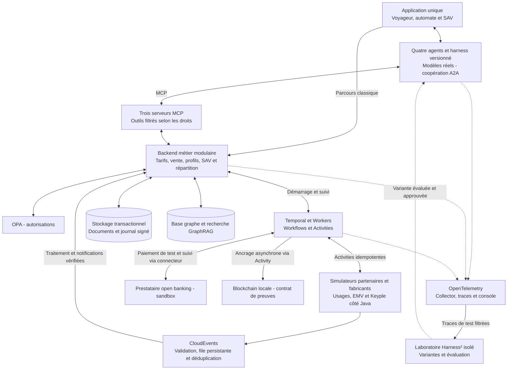

# Proposition de POC — Une agence de mobilité augmentée par l’IA

> **Open source :** code original et documentation du POC sous [licence MIT](LICENSE), copyright 2026 Benjamin Maillard. Les composants tiers conservent leurs propres licences. Première version locale exécutable disponible depuis le 24 octobre 2026 : voir le [README](README.md). Publication publique à réaliser.

> Proposition de périmètre cible. La réalisation locale couvre une partie de ces capacités ; son état vérifié est détaillé dans le README. Tous les réseaux, personnes, tarifs et contrats utilisés sont fictifs.
>
> Objectif : démontrer les concepts retenus dans le plan avec quelques parcours exécutables, sans reproduire un système billettique industriel. Une blockchain locale et une intégration open banking en sandbox font partie du POC. Seule la lecture labiale reste une perspective. Itinéraires et information voyageurs restent externes ou prédéfinis.

## 1. Une démonstration de 15 à 20 minutes

« Léa, étudiante, veut acheter les droits nécessaires pour un déplacement déjà défini : parking relais, transport collectif et vélo. Elle dispose d’un budget, paie son titre, rencontre un problème de chargement et sollicite le SAV. »

Le démonstrateur montre successivement la compréhension de la demande, la justification du tarif, la coopération entre acteurs, l’exécution contrôlée et la résolution de l’incident. Le parcours est prédéfini ; l’IA prépare une proposition commerciale, sans calculer d’itinéraire.

### Acte 1 — Comprendre, vérifier et expliquer

- Léa se connecte avec une identité de démonstration et dialogue par texte ou voix avec l’agent MaaS.
- Elle transmet une attestation étudiante fictive. Une extraction documentaire réelle lit les champs ; un émetteur simulé confirme ou refuse la référence. Ces deux vérifications sont affichées séparément.
- L’agent interroge les agents partenaires via A2A. Les outils MCP accèdent aux offres et règles approuvées.
- Le moteur calcule les prix ; GraphRAG fournit les conditions et clauses qui expliquent la réduction et la commission.
- Le voyageur voit les produits, montants, conditions et sources avant de confirmer.

### Acte 2 — Acheter, subir une panne et reprendre

- Le connecteur appelle réellement la sandbox d’un prestataire open banking à sélectionner : création du paiement de test, parcours de consentement bancaire de test, réception et vérification de la notification, puis lecture du statut autorisant l’émission. Aucun argent réel ne circule. Un simulateur local reste disponible pour les pannes reproductibles, mais ne remplace pas la preuve d’intégration sandbox.
- Temporal suit le paiement puis le chargement. Un bouton arrête réellement le Worker après le paiement ; le redémarrage reprend la même commande.
- Un service Java utilisant Keyple traite un support simulé. L’état du support est conservé indépendamment du Worker pour tester les réponses perdues et éviter de rejouer aveuglément une écriture.
- La console prouve que la commande n’a subi qu’un paiement de test et qu’un chargement effectif. Le rendu distingue matériel simulé et logiciel réellement exécuté.

### Acte 3 — Consommer et répartir

- Deux simulateurs de fabricants produisent des validations dans deux formats différents. Les connecteurs les normalisent en CloudEvents.
- L’un des simulateurs renvoie un doublon et un événement tardif. Le rapprochement ne les comptabilise pas deux fois.
- Le vélo produit un début et une fin d’usage ; le parking une entrée et une sortie. Les accès physiques sont simulés.
- Une règle simple calcule le montant final du vélo et la réduction parking conditionnée à une validation transport.
- Le relevé distingue prix voyageur, commission vendeur et part de chaque partenaire. Un lot signé est ancré sur une blockchain locale ; la console affiche la transaction, sa confirmation et la comparaison de l’empreinte avec les données conservées hors chaîne.

### Acte 4 — Résoudre un incident en agence

- Le conseiller ouvre la même commande dans une vue SAV et demande à l’agent d’expliquer un montant ou un chargement en échec.
- Le diagnostic cite les événements et règles disponibles ; il signale les informations manquantes.
- OPA autorise une action dans la délégation du conseiller, mais refuse la même action au-delà d’un plafond fictif.
- Temporal attend l’approbation du superviseur si nécessaire, puis exécute la régularisation idempotente. Le journal conserve auteur, décision et résultat.

### Épilogue — Faire évoluer le système

- Modifier une réduction ou une commission dans une nouvelle version du catalogue, puis refaire un devis. La commande précédente conserve sa version d’origine.
- Montrer une expérience Harness² sur un cas SAV : référence, variante, mesures et décision de retenir ou rejeter la variante. La preuve repose sur une exécution réelle du laboratoire, qui peut être préparée avant la démonstration et consultée dans la console.
- Aucun bénéfice de Harness² n’est présupposé : un candidat rejeté est aussi un résultat utile.

> **Choix d’implémentation :** voir le [plan technique](plan-implementation-poc.md) : Docker sur Mac, Agno/OpenAI, FalkorDB, Temporal, OPA et blockchain Anvil ; le document technique précise les modèles, le budget et le raccordement bancaire.

## 2. Quatre agents déployés, des compétences regroupées

| Agent | Compétences regroupées |
|---|---|
| Agent MaaS | Conversation, conseil commercial, coordination de vente et assistance SAV ; clients MCP et A2A. |
| Agent transport | Catalogue de transport, devis, chargement et consultation des validations. |
| Agent mobilités partenaires | Vélo, parking et deux fiches de services pour autopartage et covoiturage ; chaque fournisseur conserve son identifiant et ses droits. |
| Agent justificatifs | Extraction, contrôles de cohérence et sollicitation de l’émetteur simulé ; le service d’éligibilité décide du droit. |

Les rôles tarifaires et d’analyse DSP restent des compétences des agents, appuyées par des outils déterministes. Le POC n’exige pas un microservice ou un modèle différent pour chaque compétence. Trois serveurs MCP suffisent : MaaS/SAV, transport, et partenaires/profils avec séparation des outils par droits.

## 3. Chaque concept a une preuve concrète

| Concept | Réalisation proposée | Simplification assumée |
|---|---|---|
| IA conversationnelle | Modèle réel, texte et voix en streaming ; interruptions et correction d’une demande. | Un fournisseur de modèle et une langue, le français. Aucune promesse de latence avant mesure. |
| A2A | Véritables échanges de tâches entre les agents MaaS et partenaires. | Déploiement local ; liste fermée d’agents de confiance. |
| MCP | Serveurs et clients réels, outils typés et résultats structurés. | Petit catalogue d’outils, sans découverte publique. |
| Graphe et GraphRAG | Base graphe réelle, règles structurées et une dizaine de documents fictifs reliés à leurs sources ; recherche hybride limitée. | Pas d’ingestion massive ni de synthèse globale coûteuse. Les prix sont lus et calculés de façon déterministe. |
| Identité et profils | Identités fictives authentifiées localement, droits étudiant valides ou expirés. | Aucun raccordement à un fournisseur national d’identité. |
| Justificatifs | Extraction réelle, attestation et vérification d’émetteur simulées. | Un seul format documentaire connu ; pas de détection universelle de fraude. |
| Temporal | Service et Worker réels, vente/émission, SAV et clôture de consommation. | Une installation locale ; pas de haute disponibilité. |
| OPA | Politiques Rego réelles pour organisation, rôle, action, montant et approbation. | Petite matrice de permissions testée, pas de portail d’administration complexe. |
| Keyple/Calypso | SDK Keyple réel et lecteur/carte simulés via un adaptateur de test à vérifier. | Aucun matériel requis ; essai NFC physique optionnel. L’APDU et les mécanismes crypto réellement couverts sont documentés. |
| Open banking | Véritable appel à une sandbox, consentement de test, notifications vérifiées et suivi du paiement. | Un prestataire et un paiement ponctuel ; accès sandbox et capacités à vérifier avant intégration. Aucun argent réel. |
| Open payment EMV | Connecteur et présentations de supports bancaires simulés. | Pas d’acquisition réelle ni de certification EMV ; distinct de l’open banking. |
| Prépayé et postpayé | Droit transport préacheté ; vélo facturé après usage ; petit scénario séparé de transport postpayé avec plafond. | Un plafond et quelques règles. Le solde prépayé central est simulé ; ne pas cumuler débit carte et débit central pour le même usage. |
| CloudEvents | Enveloppes réelles, schémas validés, source, identifiant et déduplication. | Deux formats fabricants et une file persistante locale, sans plateforme de streaming à grande échelle. |
| OpenTelemetry | SDK, Collector, backend de traces et vue des échanges instrumentés. | Traces filtrées ; pas de supervision industrielle 24 h/24. |
| Commissions et DSP | Calcul reproductible et relevé de répartition sourcé. | Deux vendeurs et deux accords fictifs ; règlements simulés. |
| Mobilités partagées | Vélo et parking dans le scénario principal ; autopartage et covoiturage via fiches et transitions simples. | Aucun contrôle de flotte, permis réel ou accès physique. Réservation dépendante du fournisseur simulé. |
| Multicanal et SAV | Trois vues d’une application : voyageur web/mobile, automate, conseiller SAV. | Une interface responsive et les mêmes services ; pas d’application native ni de véritable automate. |
| Harness | Configuration versionnée, budgets, contexte et outils contrôlés. | Un harness de référence et une variante. |
| Harness² Google Research | Expérience isolée réelle sur le scénario SAV, avec adaptation au banc billettique. | Une boucle bornée et un jeu de vérification distinct ; pas d’auto-modification pendant les ventes. Faisabilité de l’adaptateur à établir en premier. |
| Preuves et blockchain | Journal signé et ancrage réel des empreintes sur une blockchain locale, contrat minimal et vérification d’intégrité. | Une chaîne de développement sans cryptoactif de valeur ; pas de gouvernance de consortium industriel. |

Une simulation doit être visible dans l’interface. Un flux réellement exécuté avec un partenaire simulé reste une démonstration logicielle, pas une validation de ce partenaire ou de son matériel.

## 4. Architecture compacte

Le backend est modulaire mais peut rester un seul déploiement. Les frontières opérateur et vendeur sont contrôlées même sur une machine unique. La conversation et le valideur simulé ne passent pas par un workflow pour chaque trame ou chaque lecture.

Les choix de moteurs précis, SDK et versions seront figés avant implémentation. Les technologies déjà retenues dans le plan sont conservées ; cette proposition n’ajoute pas un nouveau framework pour chaque rôle.

## 5. Réduire les règles, conserver les cas qui prouvent quelque chose

Jeu de données de départ proposé : un réseau de transport, un partenaire de mobilité fictif avec quatre services, deux vendeurs, trois profils voyageurs, deux valideurs et une petite dizaine de produits. Une liste de trajets ou besoins prédéfinis remplace le calcul d’itinéraires.

Règles à implémenter : une réduction étudiant, une condition d’âge, une incompatibilité de cumul, un plafond postpayé, deux commissions, une réduction P+R et une politique de remboursement. Tous les montants sont fictifs, déclarés dans des fixtures et évalués par des tests déterministes.

Les points qui doivent rester précis malgré le périmètre réduit : état du paiement, référence du devis, version tarifaire, idempotence, autorisation au moment de l’action et distinction entre opération réussie, échouée ou incertaine.

## 6. Réalisation par étapes

1. **Lever les incertitudes techniques :** accès à une sandbox bancaire et transaction sur blockchain locale, puis un appel A2A, un outil MCP, une opération Keyple simulée et une tâche Harness² adaptée au domaine. Documenter les limites ; ne pas remplacer silencieusement un échec d’intégration par une animation.
2. **Construire la vente simple :** catalogue, profil, devis, confirmation, paiement sandbox, émission et contrôle de droit. Le même parcours est utilisable sans IA pour servir de référence.
3. **Brancher les agents et GraphRAG :** dialogue, coopération, sources et justificatifs ; les mêmes services réalisent les opérations.
4. **Démontrer le contrôle et la reprise :** Temporal, OPA, arrêt de Worker, SAV et approbation humaine.
5. **Ajouter usages et répartition :** CloudEvents, deux formats fabricants, vélo, parking, postpayé, commissions et ancrage des lots sur blockchain locale.
6. **Finaliser la console et l’expérience Harness² :** traces, mesures, scénario d’évolution tarifaire et comparaison de variantes.

OpenTelemetry est instrumenté dès les premières étapes ; seule la présentation de la console est finalisée à la fin. Pas de délai ferme annoncé avant la vérification des intégrations exploratoires.

## 7. Critères de réussite

- Un paiement est créé et confirmé dans la sandbox externe, avec référence vérifiable et notification contrôlée.
- Un lot est ancré sur la chaîne locale ; son empreinte est vérifiable et une altération est détectée ; une panne de chaîne ne bloque pas la validation.

- Un parcours conversationnel exécute réellement ses outils et présente un devis correspondant aux règles fictives.
- Une correction de profil produit le tarif attendu et une explication reliée à une source.
- Une panne puis une reprise ne provoquent ni deuxième paiement de test ni deuxième émission du même droit.
- Une action interdite est refusée par OPA, même si l’agent la demande.
- Un doublon de validation n’augmente pas le montant facturé.
- Le relevé équilibre montants encaissés, commissions, parts et régularisations selon les fixtures.
- Un incident est repris depuis le SAV avec la même référence et un résultat vérifié.
- La console relie les échanges aux résultats et affiche le statut réel/simulé de chaque intégration.
- Une nouvelle version tarifaire change les nouveaux devis sans altérer les anciennes commandes.
- L’expérience Harness² produit un résultat reproductible, positif ou négatif, sans droit de modifier les politiques ni les règles financières.

Mesurer séparément : taux de réussite, erreurs, premier retour utile, réponse métier p50/p95, coût des appels IA, temps de reprise et effort d’évolution. Les cibles chiffrées seront fixées après un premier parcours de référence ; aucun gain n’est annoncé par avance.

## 8. Livrables

- Application de démonstration et procédure de démarrage locale.
- Jeux de données fictifs, politiques, schémas d’événements et scénarios réinitialisables.
- Adaptateurs réels et simulateurs clairement identifiés.
- Scénario de présentation, console et dossier de mesures.
- Résultats Harness² et versions du harness.
- Article fondé sur les résultats, avec architecture cible, périmètre exécuté et limites.

## 9. Deux intégrations limitées pour rester réalisable

### Open banking en sandbox

- Sélectionner un prestataire selon l’accès à sa sandbox, ses scénarios de test et les notifications disponibles ; aucun fournisseur n’est considéré comme déjà raccordé.
- Conserver les secrets côté serveur et les identifiants du prestataire dans la commande. Le retour du navigateur après consentement ne suffit pas à déclarer le paiement réussi.
- Temporal attend la confirmation vérifiée et gère délais, doublons et consultation de statut. Définir l’état qui autorise l’émission selon le contrat du prestataire.
- Démontrer succès, refus et notification répétée. Pour le postpayé, un paiement ponctuel peut régler le montant final avec un nouveau consentement ; ne pas supposer une autorisation de prélèvements futurs.
- Une indisponibilité d’accès sandbox est un blocage d’intégration à signaler, pas une raison de présenter un simulateur comme une connexion bancaire.

### Blockchain locale

- Déployer un contrat minimal : enregistrer l’identifiant d’un lot, son empreinte, la version du format et l’émetteur autorisé, puis consulter cette preuve.
- Conserver les validations, trajets, justificatifs et données personnelles hors chaîne. Utiliser une sérialisation canonique pour calculer une empreinte stable.
- Un workflow Temporal publie le lot après persistance et suit la transaction. Avant toute reprise, il recherche une transaction ou preuve déjà soumise pour éviter un double ancrage.
- Démontrer un lot valide, une copie altérée et une indisponibilité temporaire de la chaîne. La validation terrain et la vente continuent ; les preuves en attente restent identifiées.
- Ne pas inclure dans ce POC de token, de paiement en cryptomonnaie, de règlement financier par smart contract ou de déploiement public.
- Une chaîne locale prouve l’intégration et le contrôle d’empreinte ; elle ne démontre pas une confiance distribuée entre organisations indépendantes. Le journal signé sert de référence de comparaison.

## 10. Architecture cible conservée

La lecture labiale reste une extension future. La gouvernance blockchain interorganisations, l’identité numérique externe, les paiements avec argent réel, le matériel NFC et les raccordements industriels feront l’objet de validations spécifiques ultérieures. Le POC démontre la coopération et la maîtrise des opérations billettiques ; il ne constitue pas une homologation ni une mise en production.
